This is my walkthrough of the [NetworkMiner room](https://tryhackme.com/room/networkminer) from TryHackMe, part of the SOC Level 1 path.

NetworkMiner is an open source network forensic analysis tool. It can sniff live traffic, but in this room it is used to open PCAP files and get a quick look at what is inside: hosts, operating systems, sessions, files, images, emails, credentials and DNS queries. OS fingerprinting (it uses Satori and p0f), file extraction and credential grabbing work without any setup, which makes it good for a first look at a capture. The downside is that the filtering is limited and it is not made for very big captures or for going through packets one by one, that is where Wireshark is better.

## Task 1: Hosts and credentials

The exercise files are in `~/Desktop/Exercise Files`. To open one I go to File, then Open, and pick the pcap.

### What is the total number of frames? (mx-3.pcap)

I opened mx-3.pcap. The number of frames is not in the main tabs, it is in the file metadata. In the Case Panel I right-clicked the file and chose Show Metadata.

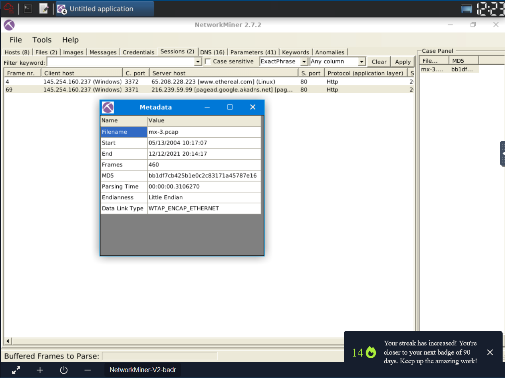

The Metadata window shows the file name, the start and end time, the number of frames, the MD5 of the file and a few other details. The Frames line says 460, so the answer is 460.

### How many IP addresses use the same MAC address as host 145.253.2.203?

For this I went to the Hosts tab. Every host can be expanded and one of the things it shows is the MAC address, so I compared them.

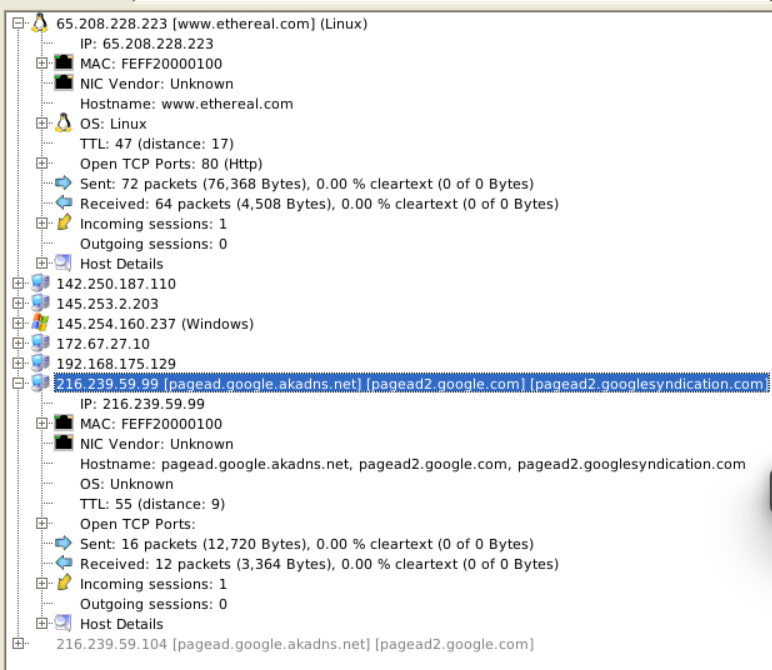

In the screenshot I expanded 65.208.228.223 (www.ethereal.com) and 216.239.59.99, and both show the MAC address FEFF20000100. These two use the same MAC address as 145.253.2.203, so the answer is 2.

### How many packets were sent from host 65.208.228.223?

The Hosts tab also shows the packets of every host. In the same screenshot, 65.208.228.223 says Sent: 72 packets (76,368 Bytes) and Received: 64 packets (4,508 Bytes). The answer is 72.

### What is the name of the web server banner under host 65.208.228.223?

In Hosts I expanded 65.208.228.223 and then expanded Host Details at the bottom.

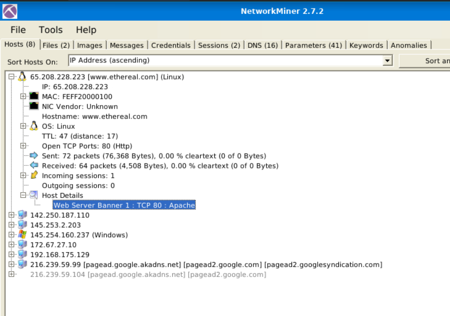

Under Host Details there is a line that says Web Server Banner 1 : TCP 80 : Apache. The banner is Apache, and it matches the open port 80 (Http) listed higher up for the same host.

### What is the extracted username for host 02694W-WIN10? (mx-4.pcap)

I loaded mx-4.pcap and opened the Credentials tab. NetworkMiner lists every credential it found in the traffic, with the client, the server, the protocol, the username and the password.

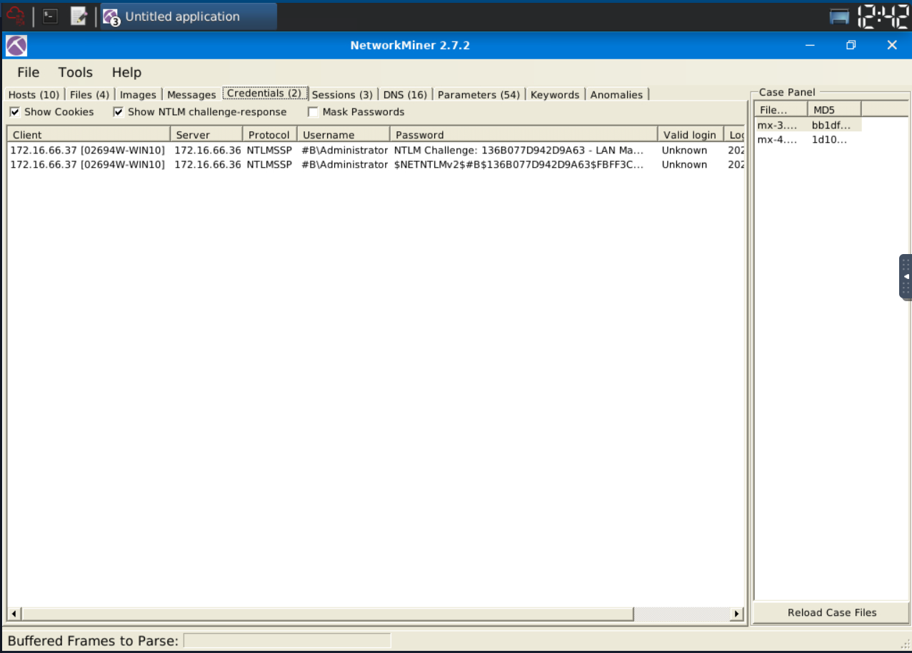

There are two rows, both from the client 172.16.66.37 [02694W-WIN10] to the server 172.16.66.36, over NTLMSSP. The username on both is #B\Administrator, which is the answer.

### What is the extracted password for the user logged into 02694W-WIN10? (full NTLM hash)

The password is in the same row of the Credentials tab. I right-clicked it and used Copy password, and this is what I got:

```text
NTLM Challenge: 136B077D942D9A63 - LAN Manager Response: 000000000000000000000000000000000000000000000000 - NTLM Response: FBFF3C253926907AAAAD670A9037F2A501010000000000000094D71AE38CD60170A8D571127AE49E00000000020004003300420001001E003000310035003600360053002D00570049004E00310036002D004900520004001E0074006800720065006500620065006500730063006F002E0063006F006D0003003E003000310035003600360073002D00770069006E00310036002D00690072002E0074006800720065006500620065006500730063006F002E0063006F006D0005001E0074006800720065006500620065006500730063006F002E0063006F006D00070008000094D71AE38CD601060004000200000008003000300000000000000000000000003000009050B30CECBEBD73F501D6A2B88286851A6E84DDFAE1211D512A6A5A72594D340A001000000000000000000000000000000000000900220063006900660073002F003100370032002E00310036002E00360036002E0033003600000000000000000000000000
```

This is not a password in clear text. It is the NTLM challenge and response captured during the login. The second row in the screenshot shows the same login in the $NETNTLMv2$ format.

## Task 2: Files, anomalies and messages

### What is the name of the Linux distro mentioned in the file associated with frame 63602? (mx-7.pcap)

I opened mx-7.pcap, went to the Files tab and typed 63602 in the Filter keyword bar. One .txt file showed up. I double-clicked it, the File Details window opened, and in the source the distro is CentOS.

### What name and surname are mentioned in the file associated with frame 76469?

Same thing in the Files tab, this time filtering for 76469.

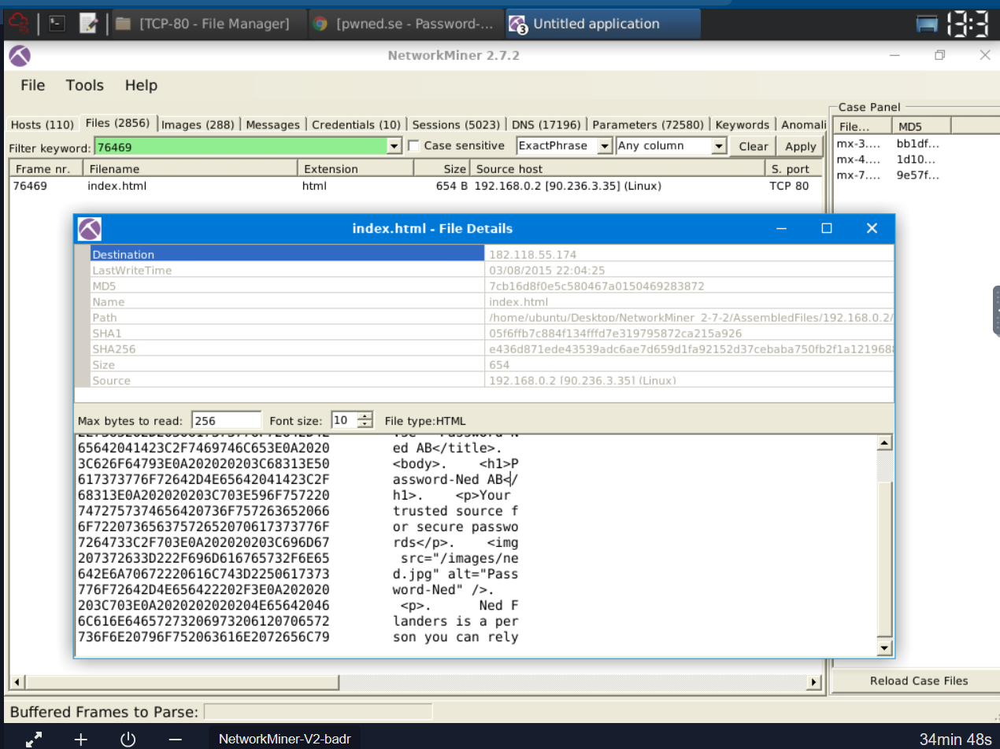

The filter leaves one file, index.html (654 B), coming from 192.168.0.2 on TCP port 80. Double-clicking it opens File Details, and at the bottom the content of the file is shown in hex with the text next to it. Reading the text you can see a page called Password-Ned AB, "Your trusted source for secure passwords", and then "Ned Flanders is a person you can rely on". The name is Ned Flanders.

### What is the source address of the image "ads.bmp.2E5F0FD9[1].bmp"?

In the Files tab I searched for the file name.

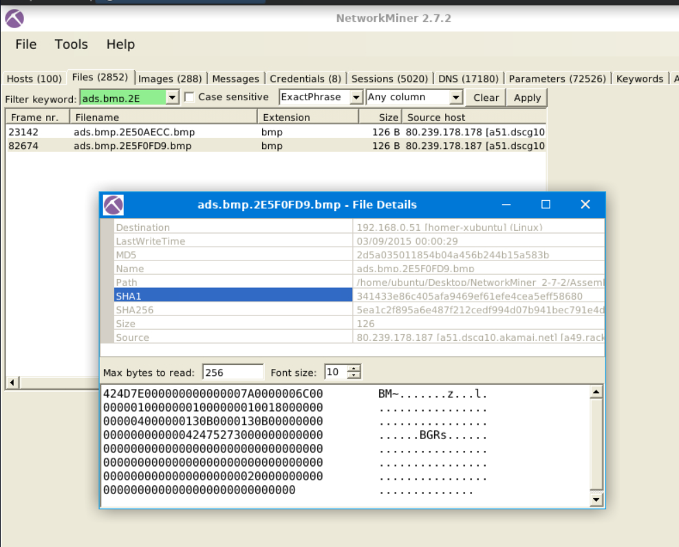

In the screenshot I only typed the beginning of the name, ads.bmp.2E, so two files with a very similar name show up: ads.bmp.2E50AECC.bmp in frame 23142 and ads.bmp.2E5F0FD9.bmp in frame 82674. The one from the question is the second one, so I double-clicked that. File Details shows the source 80.239.178.187 (a51.dscg10.akamai.net) and the destination 192.168.0.51 (homer-xubuntu). The answer is 80.239.178.187.

### What is the frame number of the possible TLS anomaly?

NetworkMiner has an Anomalies tab for things that look wrong in the traffic.

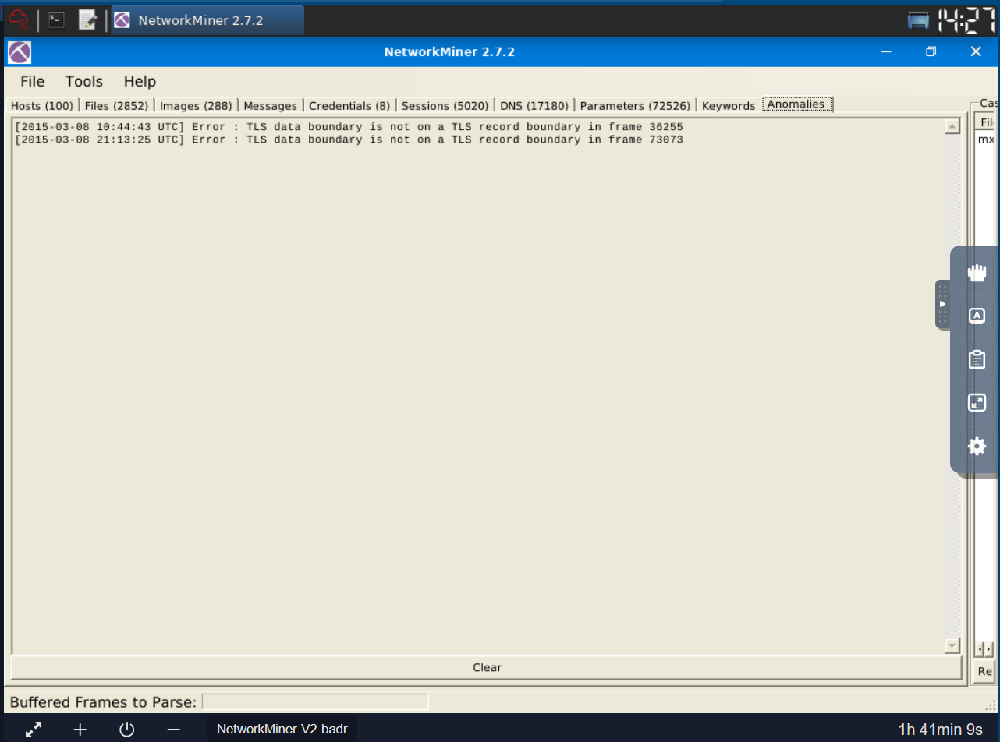

It lists two errors, both saying that the TLS data boundary is not on a TLS record boundary. One is in frame 36255 and the other in frame 73073.

### Which platform sent an email with the subject starting with "You have more..."? (mx-9.pcap)

I loaded mx-9.pcap and opened the Messages tab, which shows the emails that NetworkMiner rebuilt from the traffic.

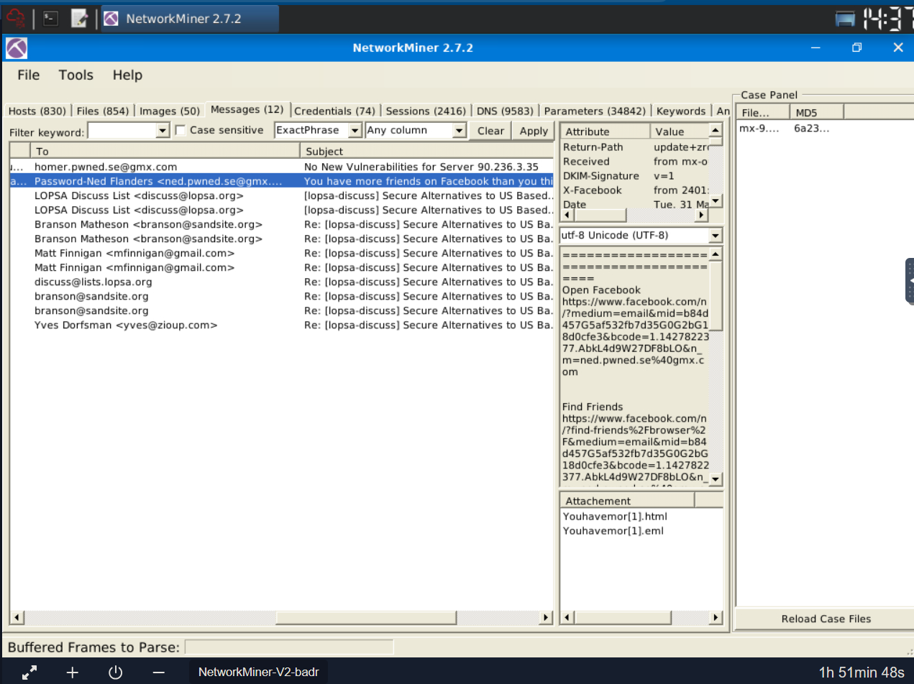

The selected message has the subject "You have more friends on Facebook than you thi...", sent to Password-Ned Flanders. On the right the body is full of facebook.com links (Open Facebook, Find Friends) and the attachments are Youhavemor[1].html and Youhavemor[1].eml. The platform is Facebook.

### What is the email address of Branson Matheson?

Same Messages tab, I selected one of the emails from Branson Matheson.

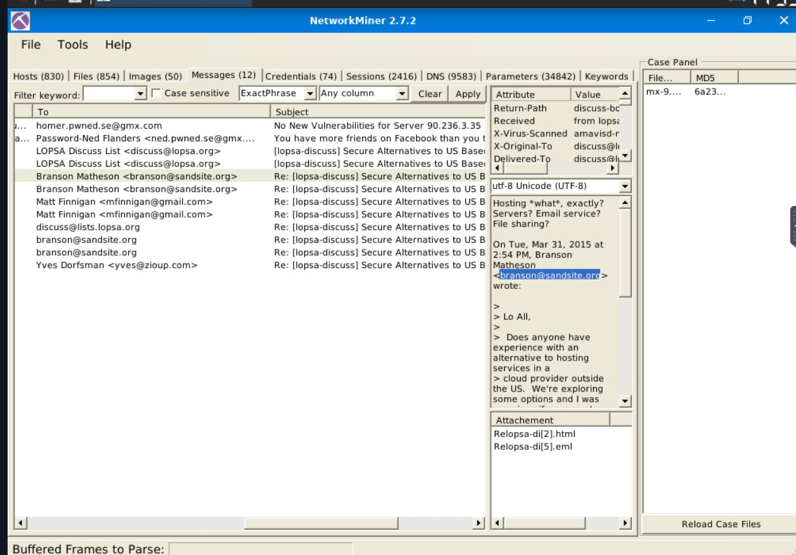

In the body of the email, in the quoted line "Branson Matheson wrote:", the address is highlighted in the screenshot. It is branson@sandsite.org.

## Task 3: Versions

The room asks which version of NetworkMiner can do what. As it says in the official documentation, version 2.7 can detect duplicate MAC addresses. The Frames tab and more details about the packets are in version 1.6. I used 2.7.2 for most of the room and 1.6.1 only for the frames question.

## Task 4: Exercises

### What is the full OS name of host 131.151.37.122?

In the Hosts tab I looked for the IP address, expanded it and then expanded OS.

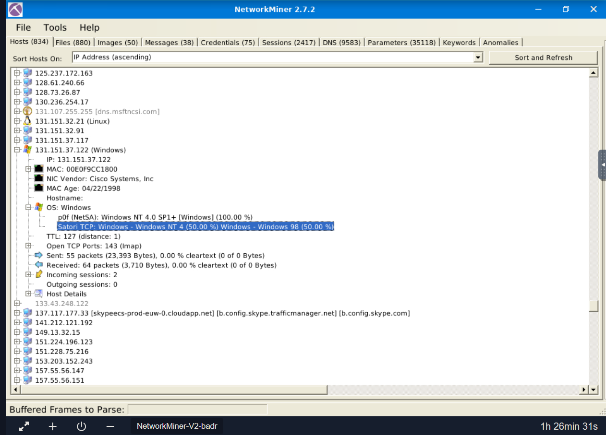

NetworkMiner gives two guesses. p0f says Windows NT 4.0 SP1+, and Satori TCP says Windows - Windows NT 4 (50%) and Windows - Windows 98 (50%). The full OS name is Windows - Windows NT 4.

### How many bytes were sent by the client (\*.32.91) through port 1065?

On the same host, I expanded Incoming sessions: 2.

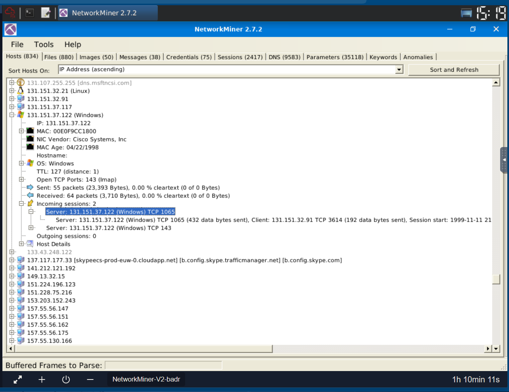

The first session is the server 131.151.37.122 on TCP 1065. The line under it says the server sent 432 data bytes, and the client 131.151.32.91 on port 3614 sent 192 data bytes. The question is about the client, so the answer is 192.

### How many bytes were sent back by the server (\*.37.122) through port 143?

The second session of the same host is the one on TCP 143, which is IMAP.

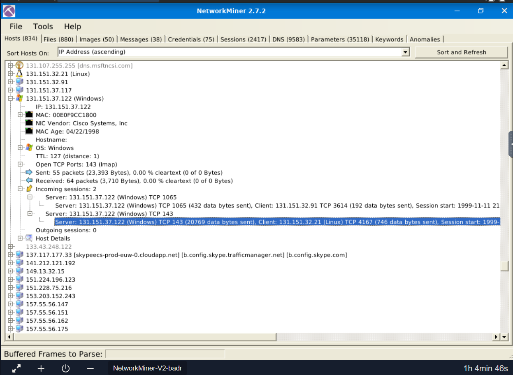

Here the server 131.151.37.122 sent 20769 data bytes, and the client 131.151.32.21 (Linux) on port 4167 sent 746. The question is about the server, so the answer is 20769.

### What is the sequence number of frame number 9?

The sequence number is not shown in the newer version, so I used NetworkMiner 1.6.1. I loaded the PCAP, opened the Frames tab, selected frame 9 and expanded it.

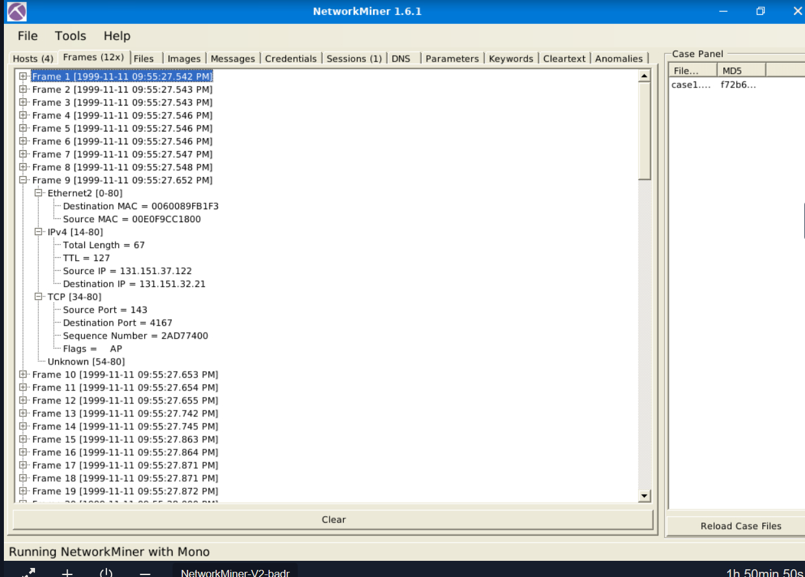

The frame has three parts: Ethernet2, IPv4 and TCP. In the IPv4 part the frame goes from 131.151.37.122 to 131.151.32.21. In the TCP part the source port is 143, the destination port is 4167 and the Sequence Number is 2AD77400.

A frame sequence is the order of the packets in a capture. In NetworkMiner it helps an analyst rebuild the timeline of an incident and link each piece of evidence (a file, a host, an account) to the exact packet it came from.

One more thing about this PCAP: the Parameters tab is empty. In the Hosts tab every host has 0% cleartext traffic, and NetworkMiner only reads parameters from cleartext traffic, so there was nothing to show.

### What is the USB product's brand name? (case2.pcap)

I loaded case2.pcap and went to the Images tab, which has a lot of images, and scrolled down until I saw one with USB devices.

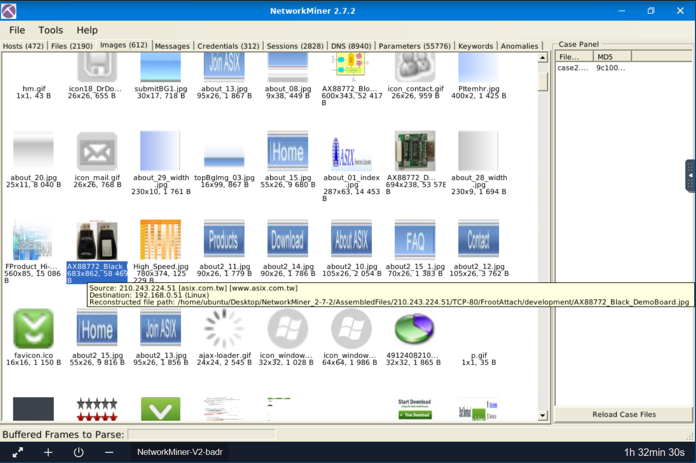

When you put the mouse over an image, a box shows the source, the destination and the path of the file. This one is AX88772_Black_DemoBoard.jpg, from 210.243.224.51 (www.asix.com.tw). Other images from the same site have the ASIX logo, so the brand is ASIX.

### What is the name of the phone model?

Also in the Images tab, scrolling down there is a picture with some phones.

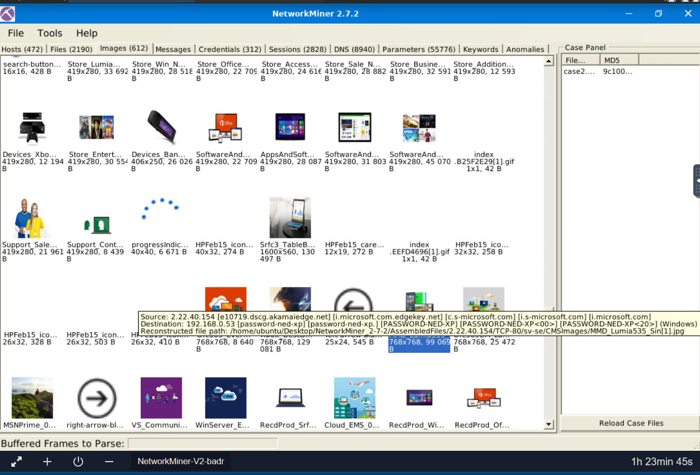

The box over the image shows the file MMD_Lumia535_Sin[1].jpg, coming from 2.22.40.154 (i.microsoft.com). To be sure I opened the file in the browser.

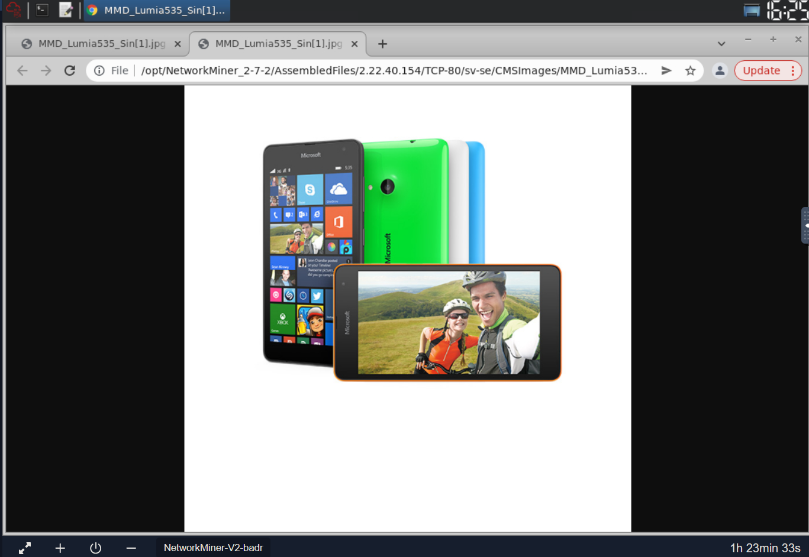

It shows Microsoft phones in black, green, white and blue. The model is Lumia 535.

### What is the source IP of the fish image?

I went to the Files tab and searched for the word fish.

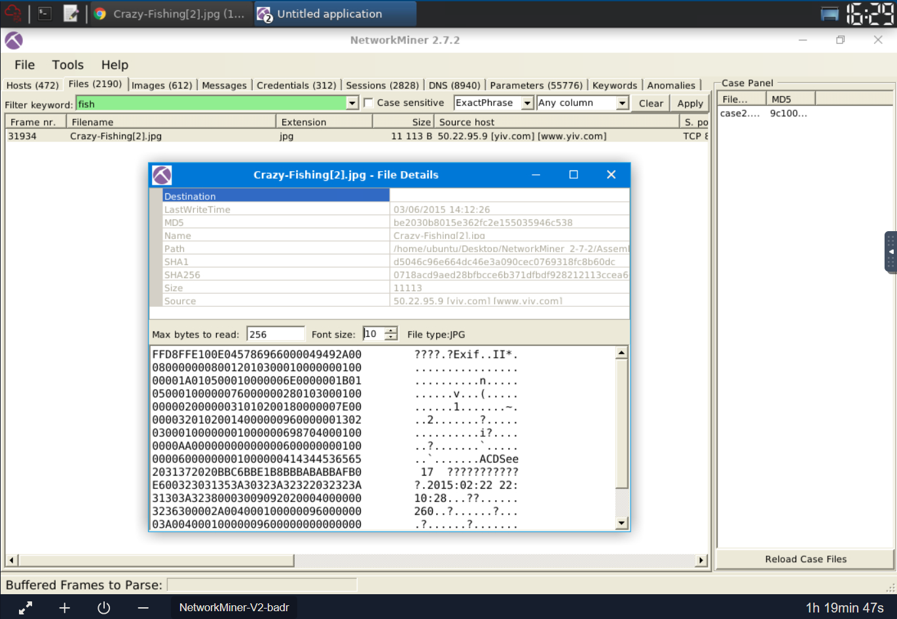

One file shows up, Crazy-Fishing[2].jpg (11 113 B, frame 31934). The source is 50.22.95.9 (www.yiv.com), shown both in the table and in File Details. I also opened the image to check that it is the fish.

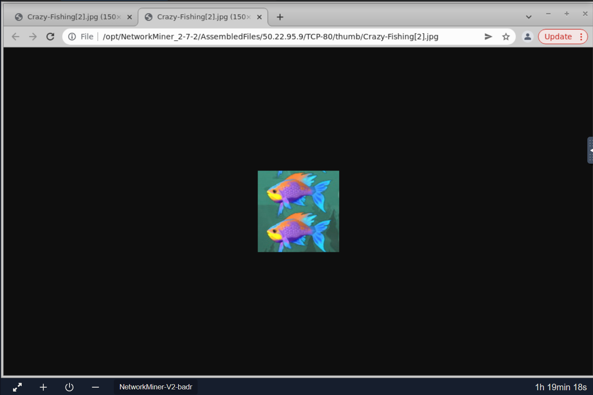

The answer is 50.22.95.9.

### What is the password of homer.pwned.se@gmx.com?

To see the credentials of the mail account I opened the Credentials tab. In case2 there are 312 of them, mostly cookies.

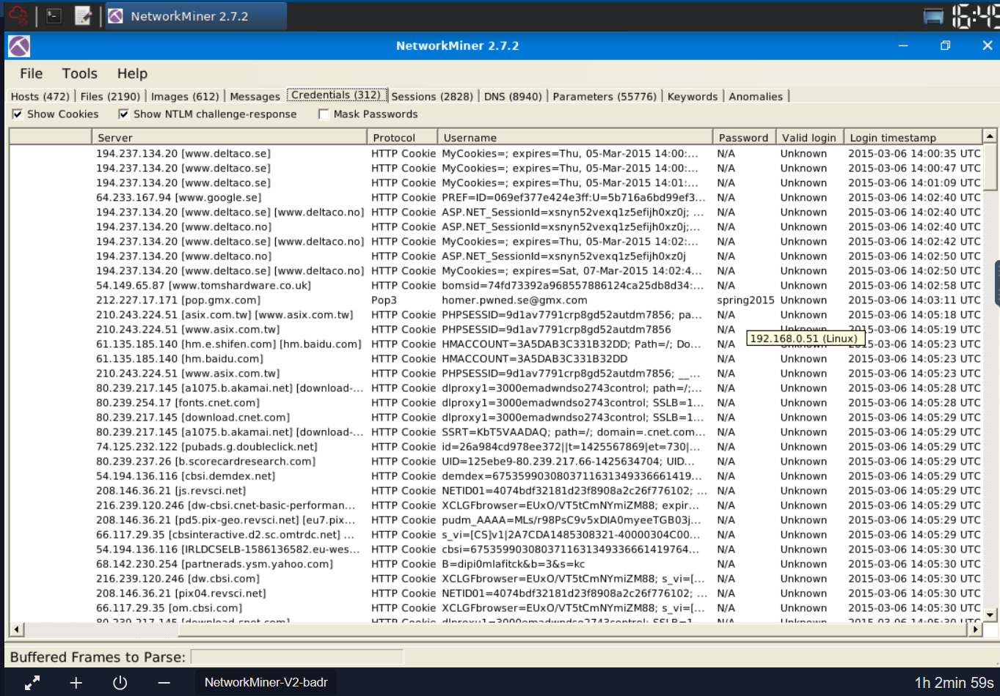

One row has the protocol Pop3, the server pop.gmx.com, the username homer.pwned.se@gmx.com and the password spring2015, from 2015-03-06. POP3 sends the login in clear text, which is why NetworkMiner can read the password directly.

### What is the DNS query of frame 62001?

I opened the DNS tab and typed the frame number in the filter bar.

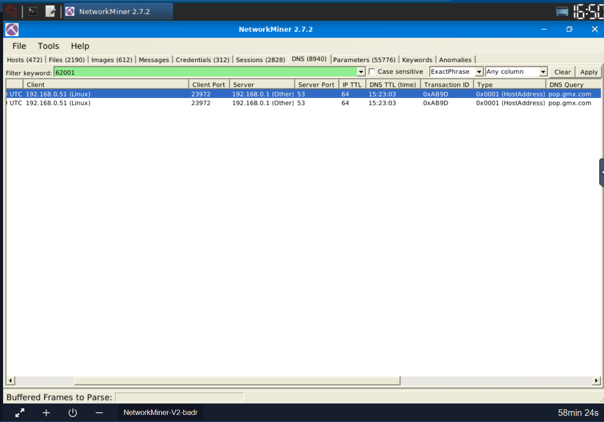

The filter returns two identical rows. The client 192.168.0.51 asks the server 192.168.0.1 on port 53, with the transaction ID 0xAB9D and the type HostAddress, and the DNS Query column says pop.gmx.com.

The lab and the analysis are mine. I used Claude to help organize my notes and format the post.