This is my writeup for the [Data Exfiltration Detection](https://tryhackme.com/room/dataexfildetection) room on TryHackMe, part of the Network Security Monitoring module in the SOC Level 1 path.

Attackers rarely build custom transport protocols to move stolen files out of an environment when perimeter firewalls already allow DNS, HTTP, FTP, and ICMP outbound. Whether the transfer goes over a web upload or gets chunked into ping payloads, network-level triage comes down to the same four questions: which internal host initiated the session, where the bytes went, how payload size or query length compares against normal traffic, and whether the surrounding account or protocol behavior makes sense. (For the introductory room question, exfiltrating data over HTTP falls under `Network-based` techniques.)

## Lab Setup and Splunk Overview

The VM provides four packet captures under `/data_exfil/` on the Desktop (`dns_exfil/dns_exfil.pcap`, `ftp_exfil/ftp_lab.pcap`, `http_exfil/http_lab.pcap`, and `icmp_exfil/icmp_lab.pcap`) alongside a local Splunk instance preloaded with logs in `index=data_exfil`.

Before touching individual channels, I ran a broad search across `index=data_exfil` with the time picker set to `All time` so older lab timestamps would not get filtered out:

```spl
index=data_exfil
```

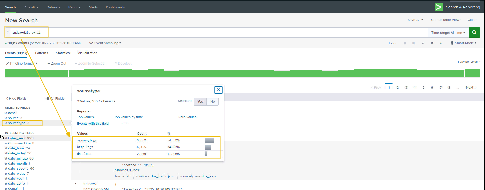

The index holds `18,117` events divided across three sourcetypes:

- `sysmon_logs` with `9,952` events (`54.9%`)
- `http_logs` with `6,165` events (`34.0%`)
- `dns_logs` with `2,000` events (`11.0%`)

FTP and ICMP are not indexed as separate sourcetypes here, so DNS and HTTP can be triaged in Splunk and verified in Wireshark, while FTP and ICMP are investigated directly from their PCAPs.

## Channel 1: DNS Tunneling

Recursive DNS (`UDP/53`) is permitted out of almost every corporate network. By encoding chunks of a file into subdomain labels such as `<encoded_chunk>.attacker-domain.tld` and sending standard lookups through a public or internal resolver, a compromised host can push data to the authoritative nameserver for that domain without opening a direct connection to the attacker's IP.

### Inspecting `dns_exfil.pcap` in Wireshark

I opened `dns_exfil.pcap` (`2,000` packets) and filtered on outbound DNS queries without responses using `dns.flags.response == 0`. Routine lookups for `github.com`, `google.com`, `wikipedia.org`, and `stackoverflow.com` sat between `56` and `63` bytes, interspersed with `81`-byte frames carrying randomized 20-character alphanumeric subdomains.

Filtering on frame length (`dns && frame.len > 70`) stripped away all normal lookups and left a single parent domain receiving every long query: `tunnelcorp.net`. Applying a domain filter isolated the entire covert stream:

```text
dns && dns.qry.name contains tunnelcorp.net
```

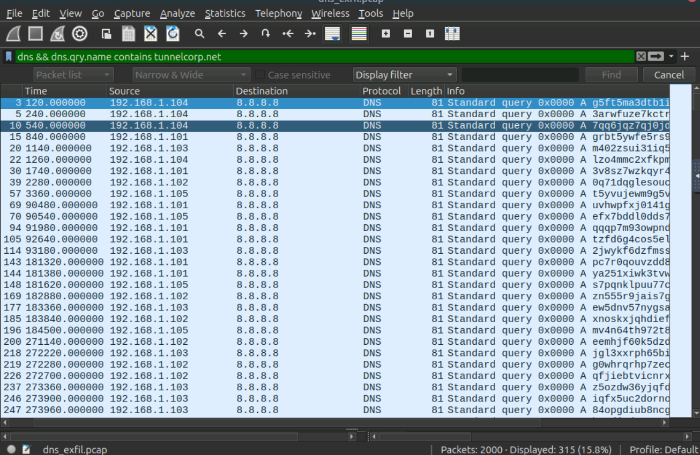

Out of `2,000` packets in the capture, `315` (`15.8%`) match `tunnelcorp.net`. Multiple internal hosts (`192.168.1.101` through `192.168.1.105`) send standard `A` queries to `8.8.8.8` with unique labels like `g5ft5ma3dtb1i4q7im4r.tunnelcorp.net` and `3arwfuze7kctrf0e2ef5.tunnelcorp.net`, and none of them receive a DNS response in the capture.

### Correlating in Splunk (`dns_logs`)

Switching to Splunk, I aggregated `sourcetype="dns_logs"` by query name to compare normal domain frequency against the tunneled subdomains:

```spl
index="data_exfil" sourcetype="dns_logs"
| stats count by query
| sort -count
```

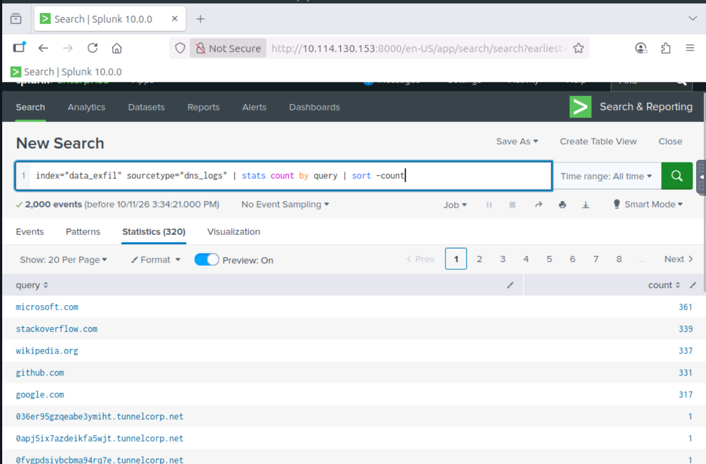

The `2,000` DNS logs break down into `320` distinct query values. Five legitimate domains account for `1,685` events (`microsoft.com` at `361`, `stackoverflow.com` at `339`, `wikipedia.org` at `337`, `github.com` at `331`, and `google.com` at `317`). The remaining `315` distinct queries each appear with `count = 1` because every DNS request encodes a different data chunk in its left-hand label.

Filtering for query strings longer than `30` characters (or checking the pre-tagged `label="suspicious"` field in the JSON events) returns those exact `315` records:

```spl
index="data_exfil" sourcetype="dns_logs"
| where len(query) > 30
| stats count by src_ip
| sort -count
```

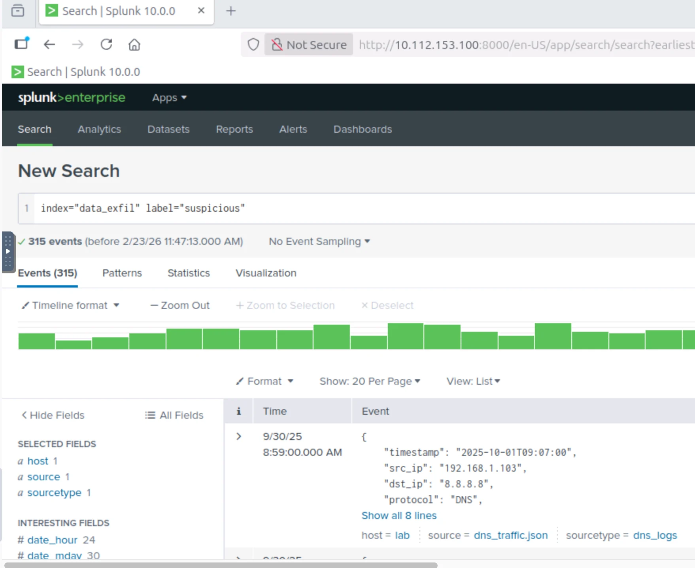

> Grouping raw `dns_logs` by `src_ip` without filtering query length first puts `192.168.1.104` at the top (`413` total lookups versus `405` from `192.168.1.103`) due to normal browsing noise. Restricting the search to `len(query) > 30` before counting by `src_ip` isolates the tunneled traffic and shows `192.168.1.103` sent the highest number of suspicious requests.
{: .prompt-tip }

From the DNS investigation:

- Suspicious domain receiving tunneled data: `tunnelcorp.net`
- Total DNS tunneling log entries: `315`
- Internal IP sending the maximum number of suspicious requests: `192.168.1.103`

## Channel 2: Cleartext FTP Uploads

Standard FTP sends authentication (`USER`, `PASS`), commands (`STOR`, `RETR`), and file transfers in cleartext. When an attacker drops stolen spreadsheets or credential dumps onto an external FTP server, a packet capture lets you reconstruct every login and file directly.

### Hunting Weak Accounts and `STOR` Transfers in `ftp_lab.pcap`

I opened `ftp_lab.pcap` (`3,719` packets) in Wireshark and reviewed the control traffic with `ftp || ftp-data` and `ftp.request.command == "USER" || ftp.request.command == "PASS"`. Most sessions in the file are benign filler: test accounts (`user`, `test`, `dev`) uploading placeholder `report_*.txt` files (`43` bytes per stream) to `104.16.123.96`, `20.112.52.29`, and `8.8.8.8`.

Searching for default and privileged account names separated the real exfiltration sessions, all of which pointed to a single external server at `185.203.119.12`. Filtering for the `guest` account returned `5` connections (`0.1%` of the capture):

```text
ftp contains "guest"
```

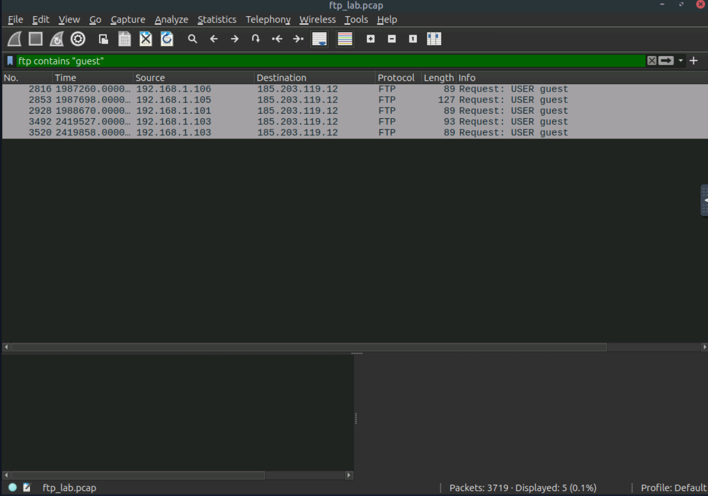

Next, I filtered on `ftp contains "root"` to check what the `root` account uploaded. Six matching packets appeared against `185.203.119.12`. Right-clicking frame `2079` (`192.168.1.103` to `185.203.119.12`) and choosing `Follow -> TCP Stream` (`tcp.stream eq 2074`) showed `USER root`, `PASS toor`, and `STOR customer_data.xlsx`.

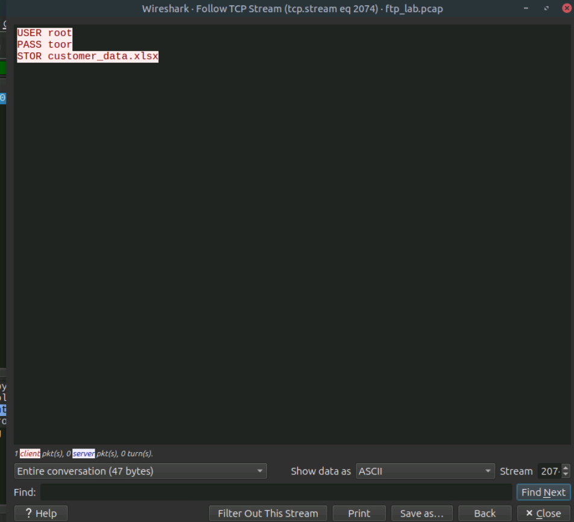

### Isolating the Largest FTP Payload

Rather than inspecting every TCP stream manually, I filtered on FTP packet length above `90` bytes to surface frames carrying extra inline data beyond a short command:

```text
ftp && frame.len > 90
```

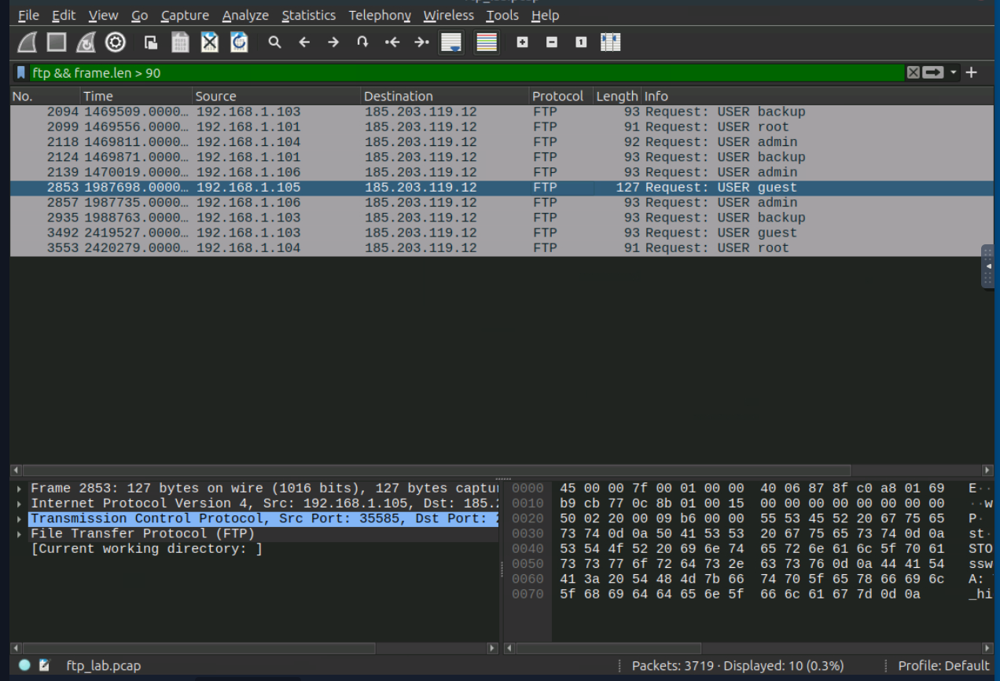

Ten packets matched, every one of them heading to `185.203.119.12` under `backup`, `root`, `admin`, or `guest`. Nine of those frames measured `91` to `93` bytes, while frame `2853` from `192.168.1.105` reached `127` bytes. Following TCP stream `2846` on frame `2853` revealed the `guest` session uploading `internal_passwords.csv` along with the flag inside its `DATA` line:

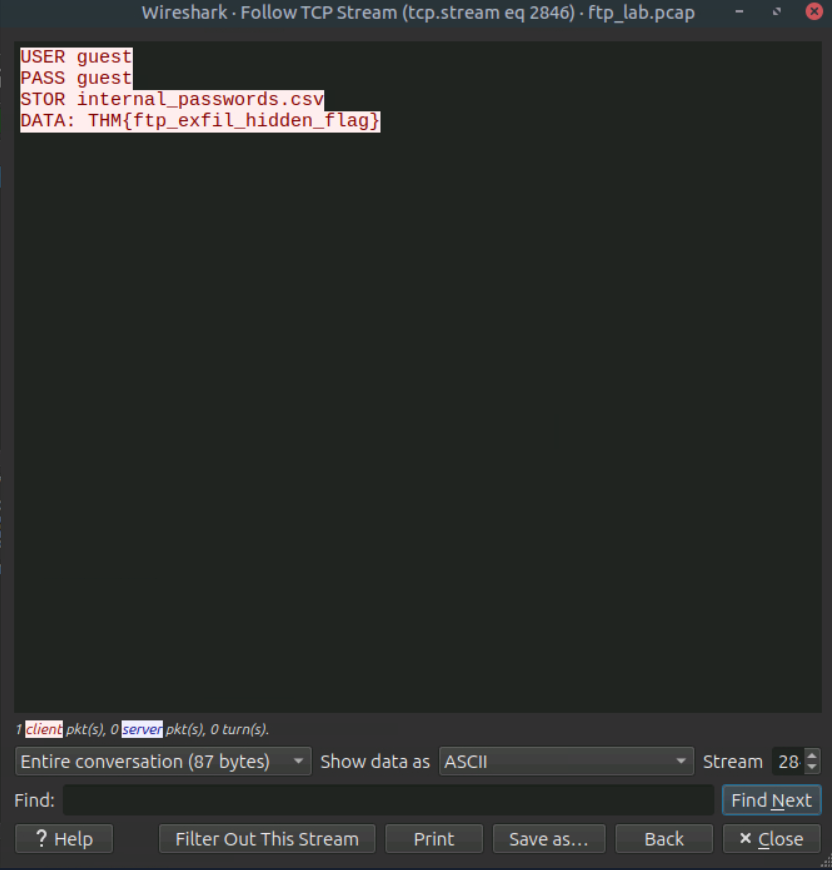

From the FTP investigation:

- Connections observed from the `guest` account: `5`
- Customer-related file exfiltrated from the `root` account: `customer_data.xlsx`
- Internal IP sending the largest payload to an external IP: `192.168.1.105`
- Flag inside the CSV transfer stream: `THM{ftp_exfil_hidden_flag}`

## Channel 3: HTTP POST Exfiltration

Outbound HTTP `POST` traffic blends easily into everyday SaaS syncs, telemetry pings, and API calls. When workstations generate thousands of legitimate requests per hour, counting total events per internal IP rarely spots a single upload; comparing `bytes_sent` and destination domain rarity does.

### Finding the Byte-Count Outlier in Splunk (`http_logs`)

Out of `6,165` events in `sourcetype="http_logs"`, filtering `method=POST` left `3,075` outbound `POST` requests. Grouping those `3,075` events by `src_ip` showed an even distribution across all five workstations (`586` to `641` `POST` events per host, with average request sizes around `373` to `376` bytes), so host volume gave nothing away.

Pivoting to `stats` by destination `domain` immediately exposed an outlier:

```spl
index="data_exfil" sourcetype="http_logs" method=POST
| stats count avg(bytes_sent) max(bytes_sent) min(bytes_sent) by domain
| sort - count
```

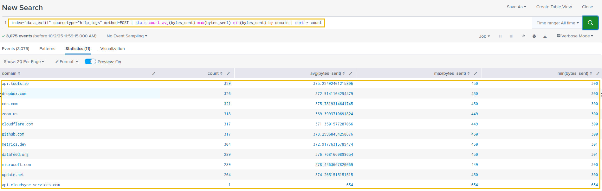

Ten domains (`api.tools.io`, `dropbox.com`, `cdn.com`, `zoom.us`, `cloudflare.com`, `github.com`, `metrics.dev`, `datafeed.org`, `microsoft.com`, and `update.net`) each logged between `264` and `329` `POST` requests, and every request stayed strictly between `300` and `450` bytes. At the bottom of the list, `api.cloudsync-services.com` appeared once (`count = 1`) with `654` bytes sent.

Filtering on `bytes_sent > 600` pulled the full metadata for that event:

```spl
index="data_exfil" sourcetype="http_logs" method=POST bytes_sent > 600
| table _time src_ip uri domain dst_ip bytes_sent
| sort - bytes_sent
```

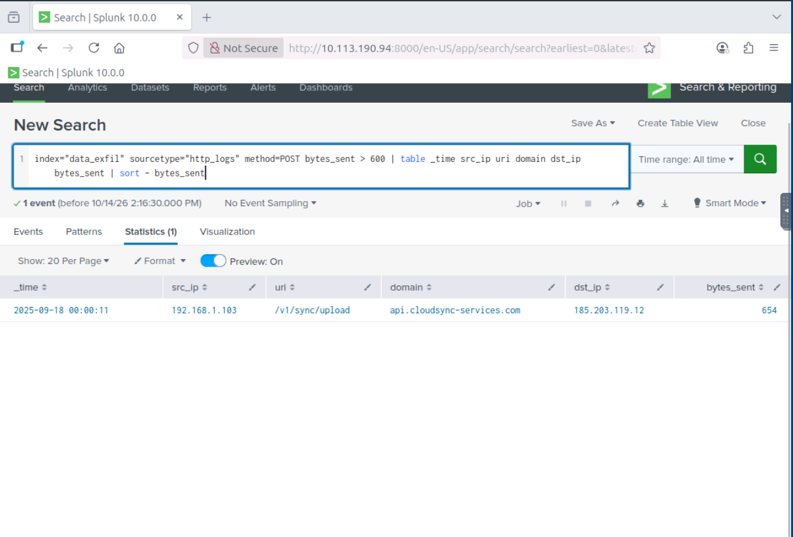

At `2025-09-18 00:00:11`, host `192.168.1.103` uploaded `654` bytes to `api.cloudsync-services.com` (`/v1/sync/upload`) at `185.203.119.12`, the exact same external IP address that received the rogue FTP transfers in the previous task.

### Reconstructing the Upload in `http_lab.pcap`

To inspect what left the host, I opened `http_lab.pcap` (`6,165` packets) in Wireshark. Filtering `http.request.method == "POST" and frame.len > 500` still matched `1,177` routine `/status`, `/update`, and `/index.html` posts (`507` to `563` bytes on the wire). Raising the length threshold above `750` bytes isolated the exact packet matching Splunk's `654`-byte body plus headers:

```text
http.request.method == "POST" and frame.len > 750
```

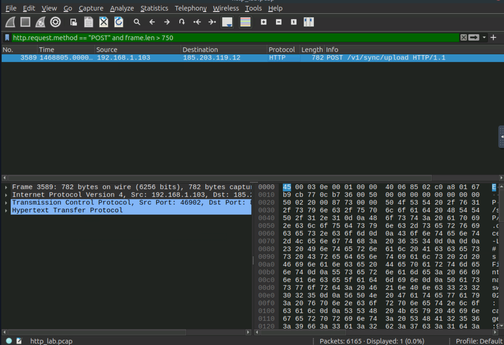

Only frame `3589` (`782` bytes on wire) remained. Following HTTP stream `3586` (`tcp.stream eq 3586`) revealed a cleartext credentials and notes dump sent in the `POST /v1/sync/upload` body (`Content-Length: 654`), including Finance admin credentials (`finance_admin` / `F!n@nc3#2025`), VPN gateway `vpn.corpnet.local`, an SSH key fingerprint, PostgreSQL credentials for `db01.internal.corp:5432` (`db_reader` / `R3@d0nly!2025`), confidential IR notes, SHA/MD5-style hashes for `secret.txt` and `backup.tar.gz`, and the flag:

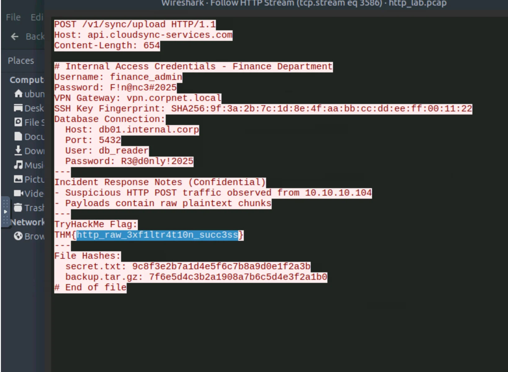

> A line inside the uploaded text (`Incident Response Notes`) reads `Suspicious HTTP POST traffic observed from 10.10.10.104`. Always trust packet headers and SIEM flow telemetry over strings inside an attacker's payload: both frame `3589`'s IPv4 source header and Splunk's `src_ip` field prove the upload originated from `192.168.1.103`.
{: .prompt-warning }

From the HTTP investigation:

- Compromised internal host used for HTTP exfiltration: `192.168.1.103`
- Flag inside the HTTP stream: `THM{http_raw_3xf1ltr4t10n_succ3ss}`

## Channel 4: Covert ICMP Echo Payloads

ICMP Echo Requests (`type 8`) exist to test reachability, so networks that allow `ping` rarely inspect the `Data` portion of an echo frame. By replacing the standard small ping pattern with `100+` bytes of arbitrary text or encoded chunks, an attacker can smuggle files out to a remote listener one Echo Request at a time without needing an Echo Reply (`type 0`).

### Filtering Oversized Echo Requests in `icmp_lab.pcap`

I opened `icmp_lab.pcap` (`8,536` packets) and checked `icmp` and `icmp.type == 8` (`4,271` Echo Requests). Almost the entire capture consists of `32`-byte internal pings (`ping` ASCII payload) between `192.168.1.x` addresses.

Adding a frame length check over `100` bytes separated the covert transfers from the `32`-byte baseline:

```text
icmp.type == 8 and frame.len > 100
```

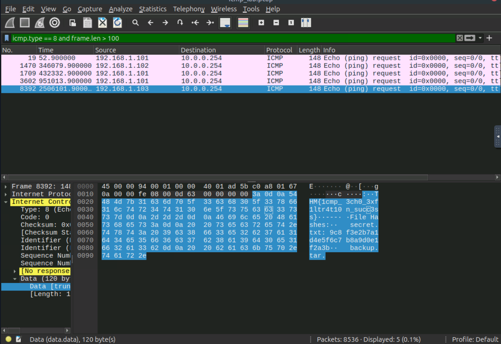

Five packets matched (frames `19`, `1470`, `1709`, `3602`, and `8392`), each `148` bytes on the wire with a `120`-byte ICMP `Data` field. All five go from internal hosts (`192.168.1.101`, `192.168.1.102`, and `192.168.1.103`) to `10.0.0.254`, and Wireshark marks each one `[No response seen]`.

Reading the `120`-byte `Data` payloads across those five packets shows the same stolen credential and incident notes file from the HTTP scenario split into five chunks (frame `19`, for example, holds the `db01.internal.corp` database credentials). Opening packet `8392` (`192.168.1.103` to `10.0.0.254`) displays the final chunk in plain ASCII, containing the ICMP flag alongside the `secret.txt` and `backup.tar` file hashes:

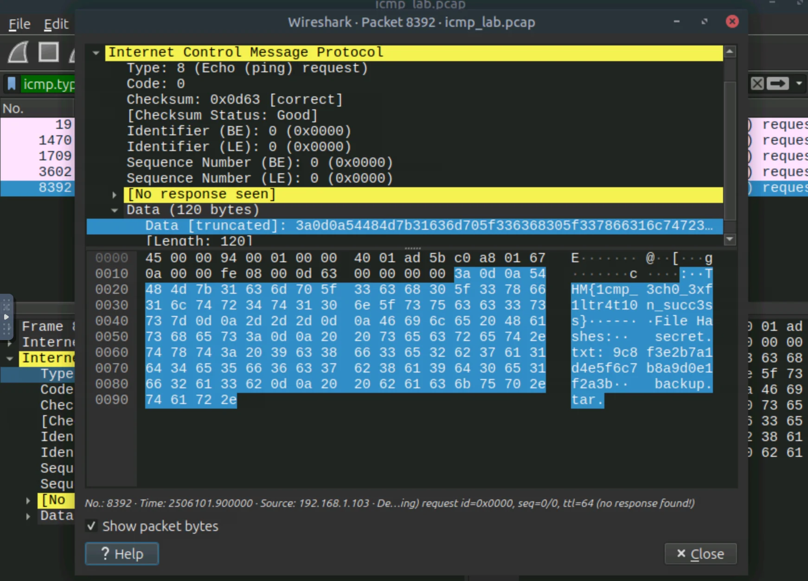

From the ICMP investigation:

- Flag inside the oversized ICMP Echo Request payload: `THM{1cmp_3ch0_3xf1ltr4t10n_succ3ss}`

## Detection Summary and Takeaways

| Channel | Primary Anomaly | Key Splunk / Wireshark Pivot | Compromised Host / Destination |
| --- | --- | --- | --- |
| DNS | `315` unanswered `81`-byte queries with unique 20-char subdomains (`count = 1`) | `dns && dns.qry.name contains tunnelcorp.net` / `where len(query) > 30` | `192.168.1.103` (top) via `8.8.8.8` to `tunnelcorp.net` |
| FTP | Weak/privileged accounts (`guest`, `root`, `admin`, `backup`) running `STOR` to external IP | `ftp contains "guest"`, `ftp contains "root"`, `ftp && frame.len > 90` | `192.168.1.105` (`127` B max) and `192.168.1.103` to `185.203.119.12` |
| HTTP | Single `654`-byte `POST` (`782` B frame) to a one-off domain vs `300` to `450` B baseline | `method=POST bytes_sent > 600` / `http.request.method == "POST" and frame.len > 750` | `192.168.1.103` to `api.cloudsync-services.com` (`185.203.119.12`) |
| ICMP | Five unanswered `148`-byte Echo Requests (`120` B `Data`) vs `32`-byte internal pings | `icmp.type == 8 and frame.len > 100` | `192.168.1.101`, `.102`, `.103` to `10.0.0.254` |

Three practical lessons stood out while working through these captures:

1. Payload size and query cardinality catch what raw host volume misses. In both `dns_logs` and `http_logs`, total events per internal IP were almost flat across all five workstations (`~400` DNS queries and `~600` HTTP `POST` requests each). Pivoting on `len(query) > 30`, `count = 1` subdomains, and `bytes_sent > 600` isolated the malicious transfers immediately.
2. One-way outbound requests without replies still exfiltrate data. Neither the `315` `tunnelcorp.net` lookups nor the `5` `148`-byte ICMP Echo Requests to `10.0.0.254` received responses, because the encoded chunks had already reached the listener inside the outbound request fields.
3. Cross-channel indicators tie separate alerts into one intrusion. Workstation `192.168.1.103` showed up in every exfiltration channel, external IP `185.203.119.12` acted as the drop server for both the rogue FTP uploads and the `api.cloudsync-services.com` HTTP `POST`, and the same stolen credentials document surfaced in both HTTP stream `3586` and the `120`-byte ICMP chunks.

*The lab and the analysis are mine. I used Gemini to help structure my notes and edit the post.*
