Room: [Man-in-the-Middle Detection](https://tryhackme.com/room/mitmdetection)

This writeup covers my investigation of the **Man-in-the-Middle Detection** room from TryHackMe's SOC Level 1 path. An internal network alert at Acme Corp flagged abnormal local traffic over several days, pointing to an active attacker on the corporate LAN intercepting packets, hijacking domain lookups, and harvesting portal credentials.

## Scenario and Lab Environment

Acme Corp's monitoring flagged anomalous ARP, DNS, and HTTP behavior around the internal authentication portal `corp-login.acme-corp.local`. On the lab VM (`10.113.149.228`), the `~/Desktop/mitm_traffic` folder provides two artifacts covering the same multi-day window:

- `network-traffic.pcap` (`3,281` packets) for packet-level reconstruction in Wireshark.
- `mitm_attack.log`, a full text log of the attack sequence that is also pre-ingested into Splunk at `10.113.149.228` under `index=network_logs`.

Going into the investigation, the case ticket only gives us the router IP and the portal hostname:

| Role | IP Address | MAC Address | Notes |
| --- | --- | --- | --- |
| Gateway | `192.168.10.1` | Unknown at start | Legitimate LAN router |
| Attacker | Unknown | Unknown | Internal rogue host |
| Victim | Unknown | Unknown | Targeted workstation |
| Portal Domain | `corp-login.acme-corp.local` | N/A | Corporate login portal |

I ran the primary packet analysis in Wireshark to verify Ethernet frame headers, DNS transaction IDs, hex answer payloads, and TCP streams, then mapped the indicators back to `index=network_logs` for SIEM hunting.

## Stage 1: Detecting ARP Spoofing

Address Resolution Protocol (ARP) maps IPv4 addresses to Ethernet MAC addresses on a local subnet without any built-in authentication. Hosts accept ARP replies (`is-at`, opcode `2`) even when they never sent a matching request, overwriting existing ARP cache entries. By claiming that `192.168.10.1` lives at the attacker's MAC address, an internal host can force victim traffic to pass through its own interface before reaching the real gateway.

### Isolating ARP Requests and Replies

I opened `network-traffic.pcap` in Wireshark and started with a broad `arp` display filter, which returned `391` packets (`11.9%` of the capture):

```text
arp
```

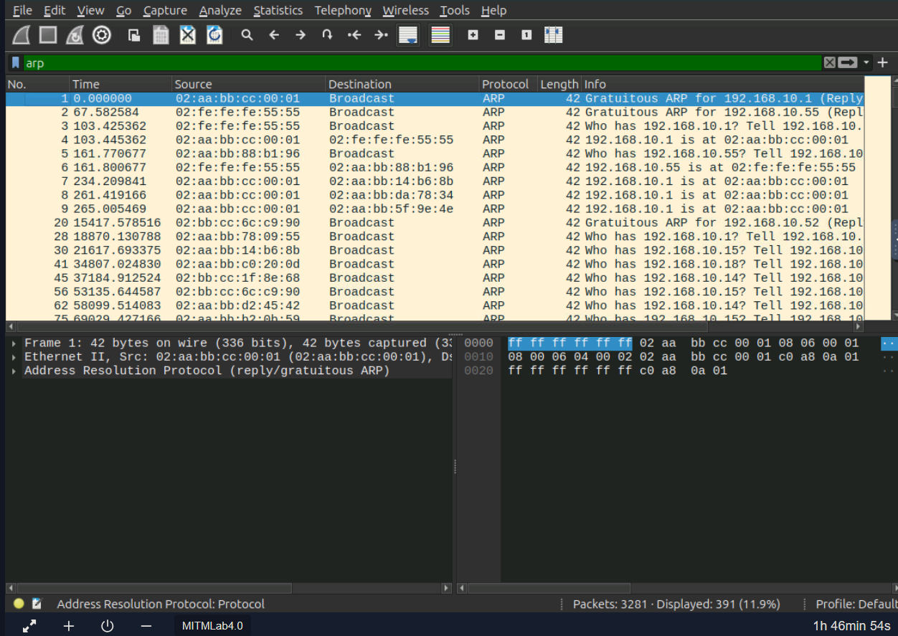

Even the first four frames reveal key MAC-to-IP pairings on `192.168.10.0/24`:

- Frame `1` (`t = 0.000000`) is a broadcast gratuitous ARP from `02:aa:bb:cc:00:01` announcing `192.168.10.1`, establishing the legitimate router MAC.
- Frame `2` (`t = 67.582584`) is a broadcast gratuitous ARP from `02:fe:fe:fe:55:55` announcing `192.168.10.55`.
- Frames `3` and `4` show `02:fe:fe:fe:55:55` (`192.168.10.55`) asking `Who has 192.168.10.1?` and receiving `192.168.10.1 is at 02:aa:bb:cc:00:01` directly from the gateway.

Splitting the traffic by opcode separates normal address resolution queries from replies. Filtering for ARP requests (`arp.opcode == 1`) returns `232` broadcast `Who has` frames across workstations on the subnet:

```text
arp.opcode == 1
```

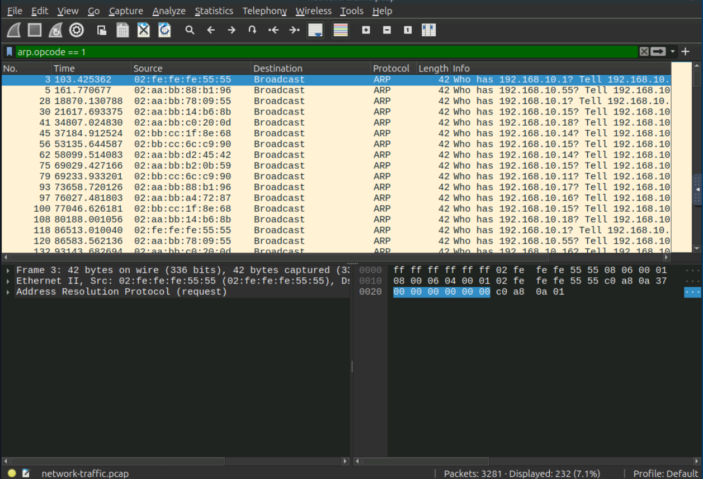

Filtering for ARP replies (`arp.opcode == 2`) narrows the view to `159` `is-at` packets, which is where cache poisoning leaves its footprint:

```text
arp.opcode == 2
```

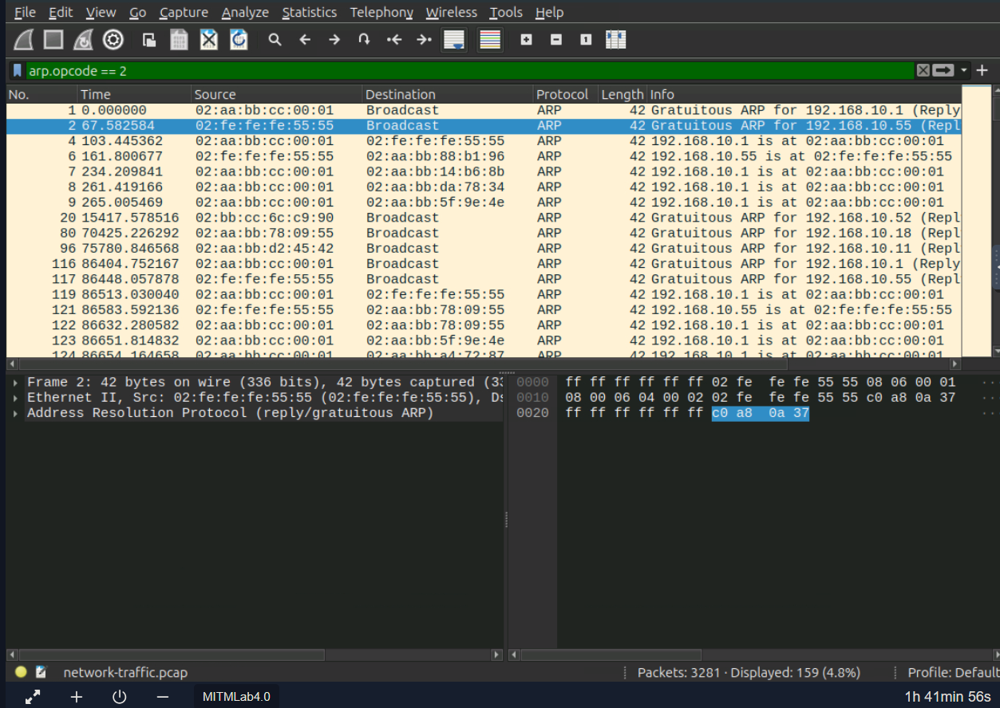

### Establishing the Legitimate Gateway Baseline

Before hunting for forged replies, I pinned down every ARP packet genuinely sent by the router (`192.168.10.1` at `02:aa:bb:cc:00:01`):

```text
arp && arp.src.proto_ipv4 == 192.168.10.1 && eth.src == 02:aa:bb:cc:00:01
```

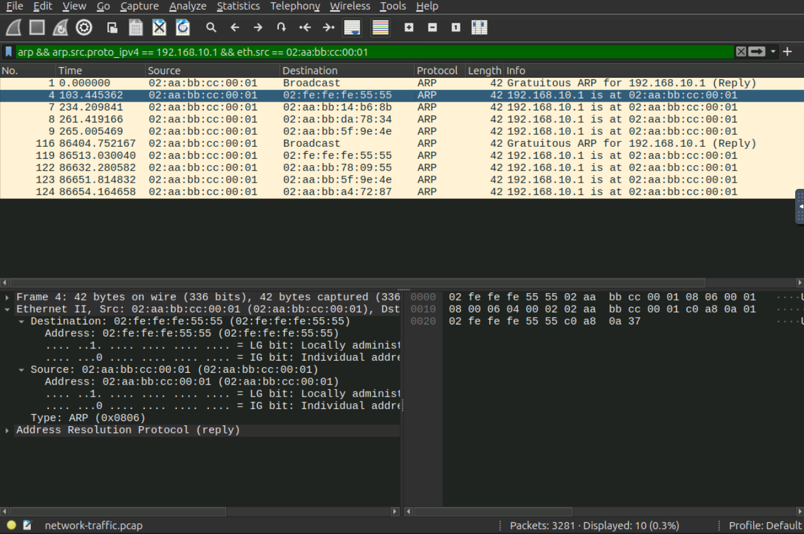

Exactly **`10`** ARP packets originate from the real gateway MAC (`Frames 1, 4, 7, 8, 9, 116, 119, 122, 123, 124`). Next, I checked how many gratuitous ARP replies were observed for `192.168.10.1`:

```text
arp.isgratuitous == 1 && arp.src.proto_ipv4 == 192.168.10.1
```

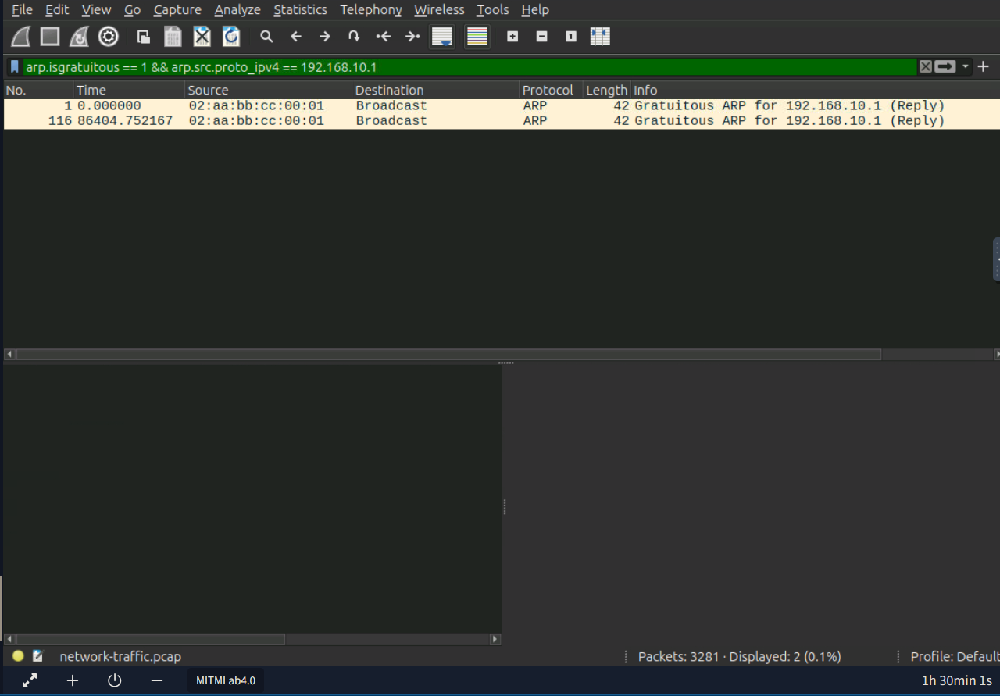

Only **`2`** gratuitous ARP replies appear (`Frames 1` and `116`), and both belong to the legitimate router `02:aa:bb:cc:00:01`.

> Filtering only on `arp.isgratuitous` misses targeted ARP spoofing. Tools like `arpspoof` and `ettercap` commonly send forged `opcode == 2` replies as unicast Ethernet frames directly to the victim's MAC rather than subnet-wide gratuitous broadcasts, keeping noise off uninvolved hosts.
{: .prompt-info }

### Identifying the Rogue Gateway MAC

To catch unicast poisoning, I filtered for all ARP replies claiming source IP `192.168.10.1` regardless of Ethernet sender:

```text
arp.opcode == 2 && arp.src.proto_ipv4 == 192.168.10.1
```

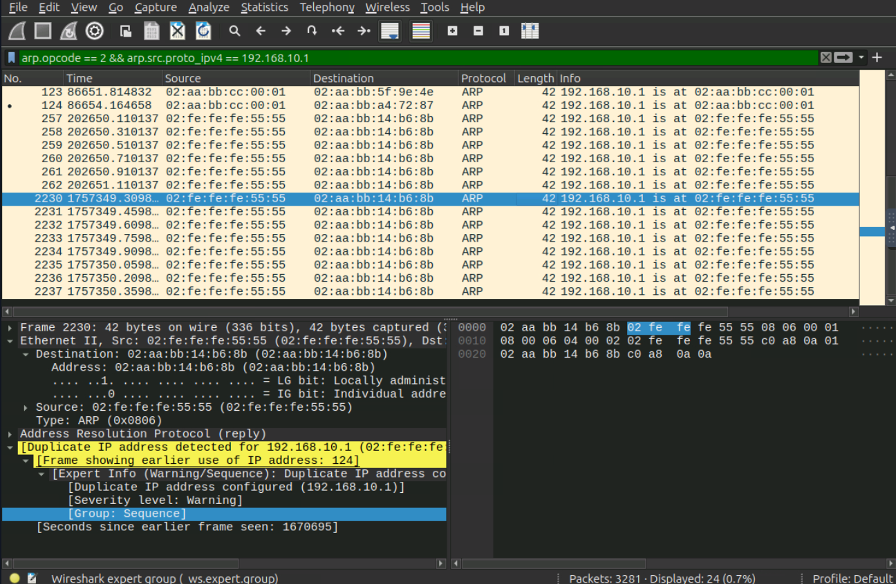

This returns `24` packets: the `10` legitimate replies from `02:aa:bb:cc:00:01` plus **`14`** forged unicast replies from **`02:fe:fe:fe:55:55`** (`192.168.10.55`) addressed directly to `02:aa:bb:14:b6:8b` (`192.168.10.10`, visible as `c0 a8 0a 0a` in the ARP target IP bytes).

The attacker's `14` spoofing packets arrive in two rapid bursts aimed solely at `192.168.10.10`:

- Frames `257` through `262` (`t = 202650.11` to `202651.11`): `6` replies spaced `200 ms` apart (`192.168.10.1 is at 02:fe:fe:fe:55:55`).
- Frames `2230` through `2237` (`t = 1757349.30` to `1757350.35`): `8` replies spaced `150 ms` apart right before the credential theft.

Wireshark's Expert Info flags every one of those frames with `[Duplicate IP address detected for 192.168.10.1 (02:fe:fe:fe:55:55)]`, pointing back to Frame `124` where `02:aa:bb:cc:00:01` last used the address. Filtering directly on Wireshark's duplicate-address fields (or excluding `eth.src == 02:aa:bb:cc:00:01`) isolates all **`14`** attacker packets cleanly and confirms **`2`** unique MAC addresses claimed `192.168.10.1`:

```text
arp.duplicate-address-detected || arp.duplicate-address-frame
```

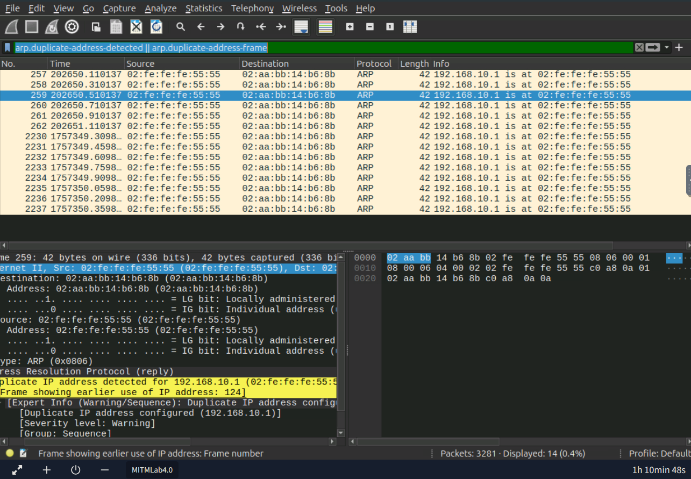

## Stage 2: Unmasking DNS Spoofing

With `192.168.10.10`'s ARP cache pointing the default gateway to `02:fe:fe:fe:55:55`, every outbound packet from the victim hits the attacker (`192.168.10.55`) first. That lets the attacker inspect outbound UDP port `53` queries on the wire and inject a spoofed DNS reply faster than the external resolver can answer over the WAN.

### Comparing Resolver Responses Against the Baseline

Filtering on `dns` surfaces `1,509` packets (`46.0%` of the PCAP), showing internal hosts querying Google DNS at `8.8.8.8` for domains such as `updates.acme-corp.local`, `cdn.svc.net`, `www.google.com`, and `corp-login.acme-corp.local`:

```text
dns
```

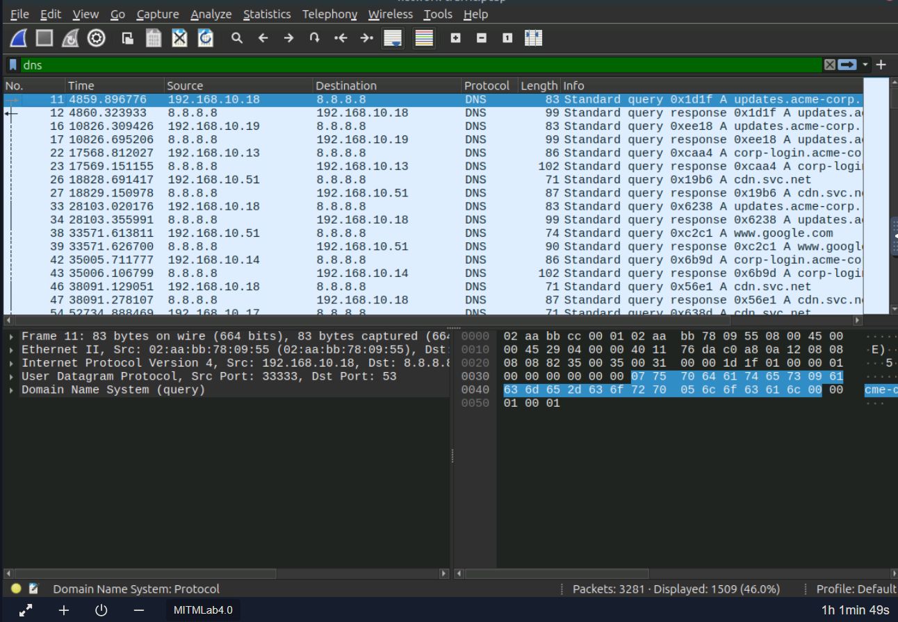

Checking legitimate resolver responses with `dns.flags.response == 1 && ip.src == 8.8.8.8` returns `753` packets. Dropping the source IP restriction to view all DNS responses (`dns.flags.response == 1`) brings the count to `755`:

```text
dns.flags.response == 1
```

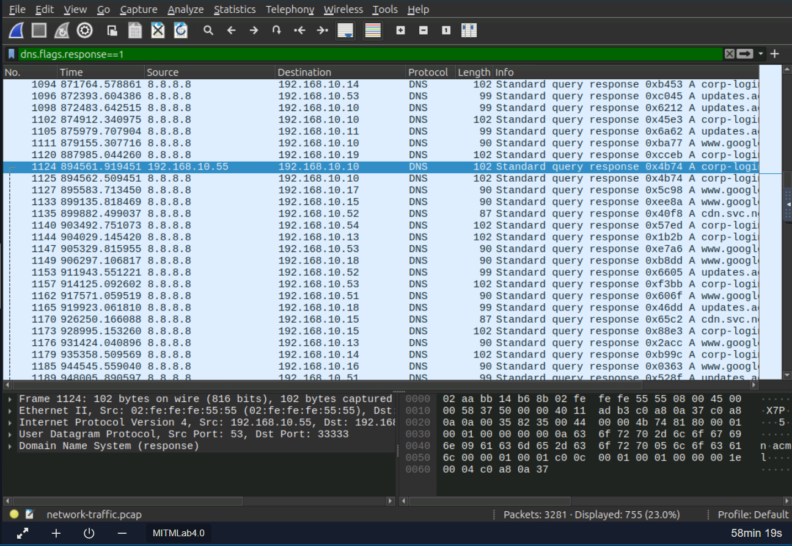

That two-packet difference (`755` total minus `753` from `8.8.8.8`) immediately exposes **`2`** DNS packets coming from an IP other than `8.8.8.8`, both sent by `192.168.10.55` to `192.168.10.10`.

### Isolating Forged Answers for corp-login.acme-corp.local

Focusing on all queries and responses for the login portal returns `421` packets:

```text
dns && dns.qry.name == "corp-login.acme-corp.local"
```

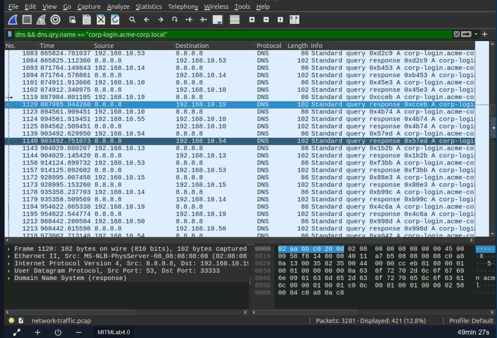

Frames `1123` through `1125` capture the DNS race condition in action:

- In Frame `1123` (`t = 894561.909451`), `192.168.10.10` sends an `A` query (`0x4b74`) to `8.8.8.8` for `corp-login.acme-corp.local`.
- In Frame `1124` (`t = 894561.919451`), just `10 ms` later, `192.168.10.55` answers with matching transaction ID `0x4b74`.
- In Frame `1125` (`t = 894562.509451`), `8.8.8.8` replies `590 ms` too late; the victim's stub resolver has already accepted the first matching response and closed its UDP socket on port `33333`.

Counting all DNS responses for `corp-login.acme-corp.local` yields **`211`** packets (`209` legitimate answers from `8.8.8.8` and `2` forged answers from `192.168.10.55`):

```text
dns.flags.response == 1 && dns.qry.name == "corp-login.acme-corp.local"
```

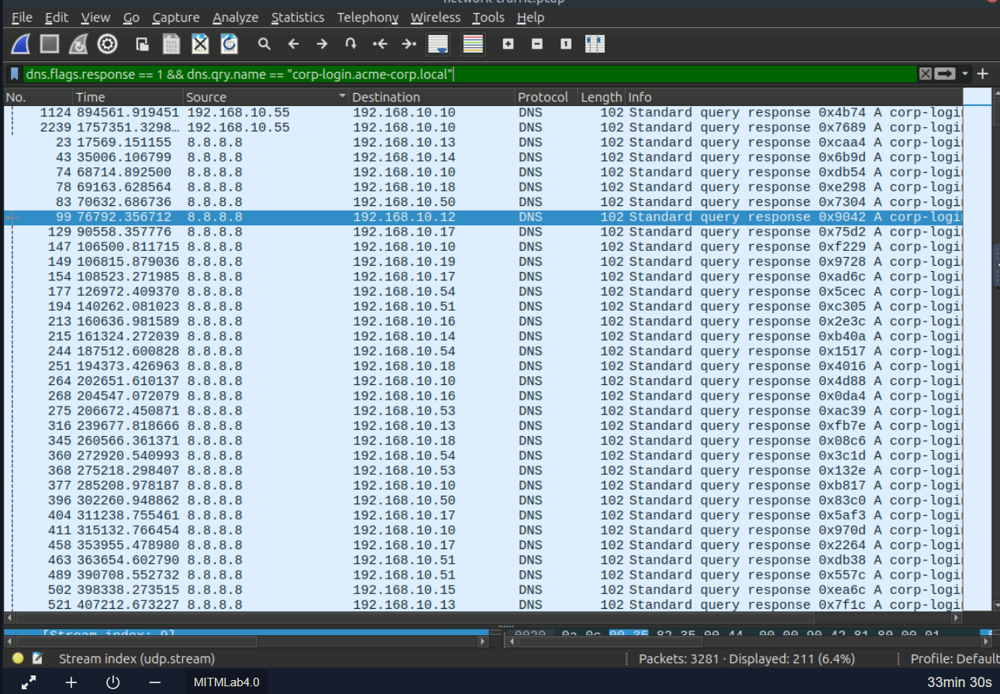

Excluding `8.8.8.8` isolates the exact **`2`** spoofed responses (`Frames 1124` and `2239`):

```text
dns.flags.response == 1 && ip.src != 8.8.8.8 && dns.qry.name == "corp-login.acme-corp.local"
```

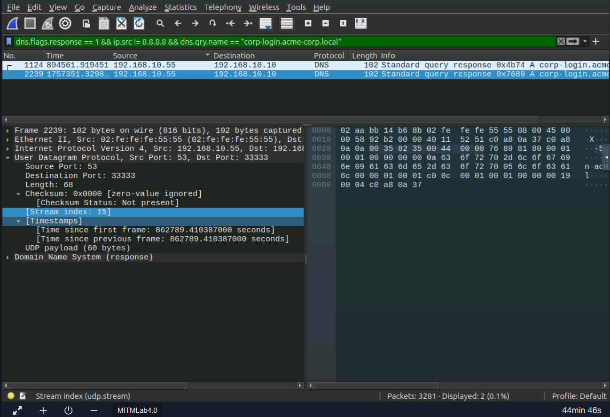

In both frames, the trailing four bytes of the DNS `A` record payload are `c0 a8 0a 37`, which converts to **`192.168.10.55`** (with short TTLs of `30` seconds in Frame `1124` and `25` seconds in Frame `2239`). Instead of reaching the real portal servers, `192.168.10.10` now resolves `corp-login.acme-corp.local` directly to the attacker's machine.

## Stage 3: Spotting SSL Stripping and Credential Theft

Redirecting DNS alone would normally trigger a browser TLS certificate warning if the attacker served a self-signed certificate for `corp-login.acme-corp.local` on port `443`. To avoid alerting the user, the attacker combined DNS spoofing with SSL stripping, serving the login form over unencrypted HTTP on port `80` so credentials travel in cleartext.

### Verifying Normal TLS Usage Across the LAN

Filtering on `tls || ssl` shows `64` TLSv1.2 handshake packets across the capture. Narrowing down to `Client Hello` messages targeting `corp-login.acme-corp.local` confirms how the portal normally operates:

```text
tls.handshake.type == 1 && tls.handshake.extensions_server_name == "corp-login.acme-corp.local"
```

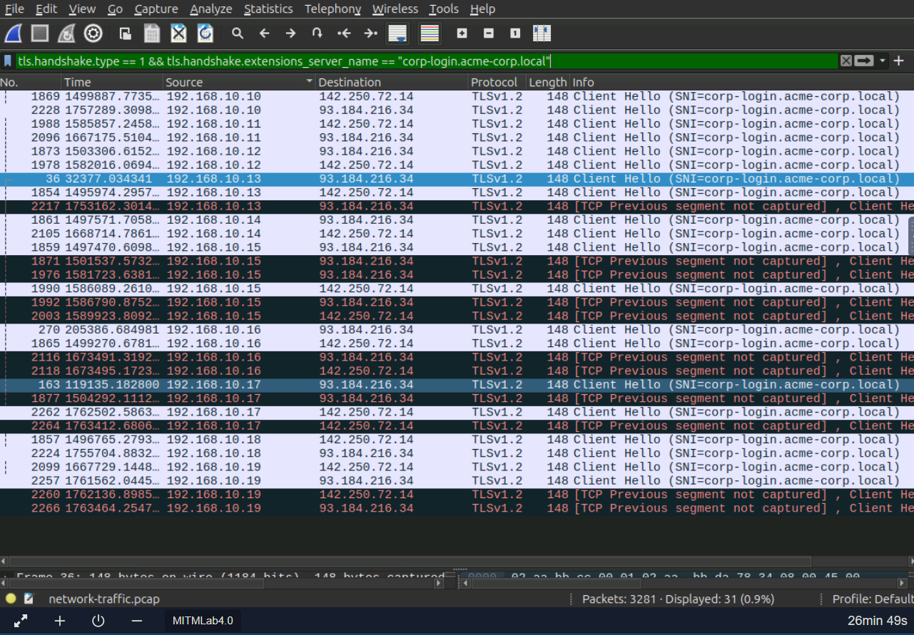

All `31` `Client Hello` frames show workstations `192.168.10.10` through `192.168.10.19` negotiating encrypted TLSv1.2 sessions with external portal IPs `93.184.216.34` and `142.250.72.14`. Even the victim host `192.168.10.10` completed a legitimate TLSv1.2 handshake in Frame `2228` (`t = 1757289.30`), roughly `60` seconds before the second ARP poisoning burst (`Frames 2230-2237`) and forged DNS reply (`Frame 2239` at `t = 1757351.32`).

### Capturing the Downgraded HTTP Login

Immediately after Frame `2239` resolves `corp-login.acme-corp.local` to `192.168.10.55`, TLS traffic from `192.168.10.10` stops completely. Filtering for plaintext HTTP between the victim and attacker shows what took its place:

```text
http && ip.src == 192.168.10.10 && ip.dst == 192.168.10.55
```

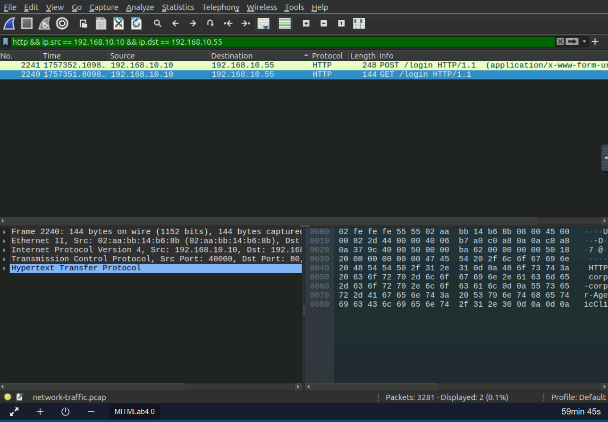

At `t = 1757351.80` (`480 ms` after the spoofed DNS reply), `192.168.10.10` sends `GET /login HTTP/1.1` over TCP port `80` (`Frame 2240`), followed `300 ms` later by `POST /login HTTP/1.1` (`Frame 2241`). Filtering across the entire PCAP for `POST` requests to the portal domain confirms that **`1`** plaintext `POST` occurred:

```text
http.request.method == "POST" && http.host == "corp-login.acme-corp.local"
```

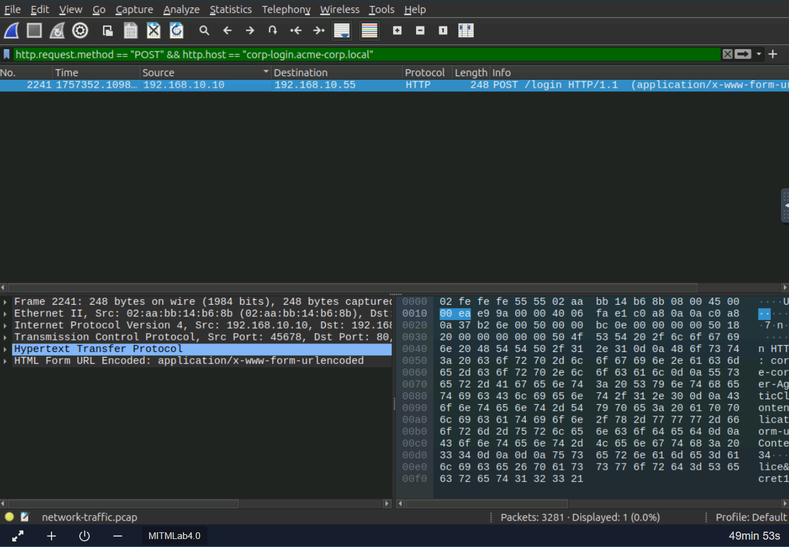

Following the HTTP stream (`tcp.stream eq 94`) on Frame `2241` exposes the full URL-encoded form submission in cleartext:

```http
POST /login HTTP/1.1
Host: corp-login.acme-corp.local
User-Agent: SyntheticClient/1.0
Content-Type: application/x-www-form-urlencoded
Content-Length: 34

username=alice&password=Secret123!
```

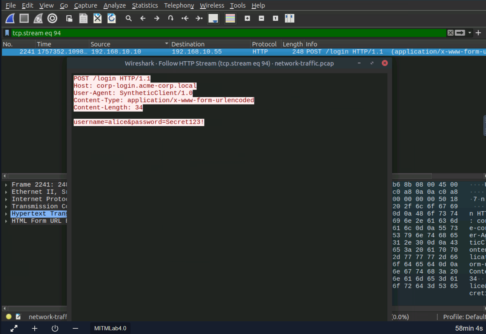

The attacker captured username `alice` and plaintext password **`Secret123!`**.

> HTTP Strict Transport Security (`Strict-Transport-Security` with a long `max-age` and browser preload/cache) blocks classic SSL stripping. Even when ARP and DNS spoofing point `corp-login.acme-corp.local` to `192.168.10.55`, an HSTS-aware client refuses to send `GET /login` or `POST /login` over unencrypted port `80` and requires a valid TLS certificate on port `443` before transmitting credentials.
{: .prompt-warning }

## Correlating the Chain in Splunk

While packet captures give byte-level proof, most SOC investigations start in a SIEM. In this lab, `mitm_attack.log` is indexed into Splunk under `index=network_logs`, allowing the same three stages to be hunted with fast keyword pivots before pulling full PCAPs:

```spl
index=network_logs "192.168.10.1" "02:fe:fe:fe:55:55"
```

```spl
index=network_logs "corp-login.acme-corp.local" "192.168.10.55"
```

```spl
index=network_logs "corp-login.acme-corp.local" "POST" "/login"
```

Running these three searches against `index=network_logs` surfaces the gateway MAC conflict (`02:fe:fe:fe:55:55` vs `02:aa:bb:cc:00:01`), the rogue internal IP answering DNS queries for `corp-login.acme-corp.local`, and the downgraded HTTP `POST /login` from `192.168.10.10` to `192.168.10.55`.

## Attack Timeline and IOC Summary

Reconstructing the resolved entities fills in every blank from the initial case ticket:

| Role / Artifact | Value | Notes |
| --- | --- | --- |
| Legitimate Gateway | `192.168.10.1` (`02:aa:bb:cc:00:01`) | Sent `10` total ARP replies, including `2` gratuitous broadcasts |
| Attacker Host | `192.168.10.55` (`02:fe:fe:fe:55:55`) | Sent `14` spoofed ARP replies, `2` forged DNS answers, hosted fake HTTP `/login` |
| Victim Host | `192.168.10.10` (`02:aa:bb:14:b6:8b`) | Poisoned client (`SyntheticClient/1.0`) |
| Legitimate DNS Resolver | `8.8.8.8` | Returned `209` of the `211` DNS responses for the portal |
| Target Domain | `corp-login.acme-corp.local` | Normally served over TLSv1.2 (`93.184.216.34`, `142.250.72.14`) |
| Compromised Credentials | `alice` / `Secret123!` | Exfiltrated via cleartext `POST /login` in Frame `2241` |

The tightest view of how all three techniques lock together appears in the `63`-second window between Frame `2228` and Frame `2241`:

| Frames | Relative Time (s) | Stage | Observed Activity |
| --- | --- | --- | --- |
| `257-262` | `202650.11 - 202651.11` | ARP Spoofing (Burst 1) | `02:fe:fe:fe:55:55` sends `6` unicast ARP replies claiming `192.168.10.1` to `192.168.10.10` |
| `1123-1125` | `894561.90 - 894562.50` | DNS Spoofing (Attempt 1) | `192.168.10.55` answers `0x4b74` in `10 ms` with `192.168.10.55`, beating `8.8.8.8` by `590 ms` |
| `2228-2229` | `1757289.30 - 1757289.60` | Normal TLS Baseline | `192.168.10.10` completes a valid TLSv1.2 handshake with `93.184.216.34` |
| `2230-2237` | `1757349.30 - 1757350.35` | ARP Spoofing (Burst 2) | `02:fe:fe:fe:55:55` sends `8` unicast ARP replies re-poisoning `192.168.10.1` on `192.168.10.10` |
| `2239` | `1757351.32` | DNS Spoofing (Attempt 2) | `192.168.10.55` answers query `0x7689` for `corp-login.acme-corp.local` with `192.168.10.55` |
| `2240-2241` | `1757351.80 - 1757352.10` | SSL Stripping | `192.168.10.10` requests `GET /login` and submits `alice` / `Secret123!` over HTTP port `80` |

## Containment and Hardening

- Isolate `192.168.10.55` (`02:fe:fe:fe:55:55`) at the switch port immediately and flush poisoned ARP and DNS caches on `192.168.10.10`.
- Reset the password for `alice`, revoke any active portal sessions or tokens issued after `t = 1757352`, and audit authentication logs for lateral logins from `192.168.10.55`.
- Enable DHCP Snooping and Dynamic ARP Inspection (DAI) on access switches so ports drop ARP replies whose MAC-to-IP bindings do not match the trusted snooping table, pinning `192.168.10.1` to `02:aa:bb:cc:00:01`.
- Restrict UDP/TCP source port `53` traffic on internal VLAN ACLs so only approved DNS resolvers can return DNS answers to client subnets, and enable DNSSEC validation where supported.
- Enforce HSTS (`Strict-Transport-Security`) across `acme-corp.local` web services and disable plaintext authentication listeners on port `80` so browsers refuse HTTP downgrades.

*The lab and the analysis are mine. I used Gemini to help structure my notes and edit the post.*
