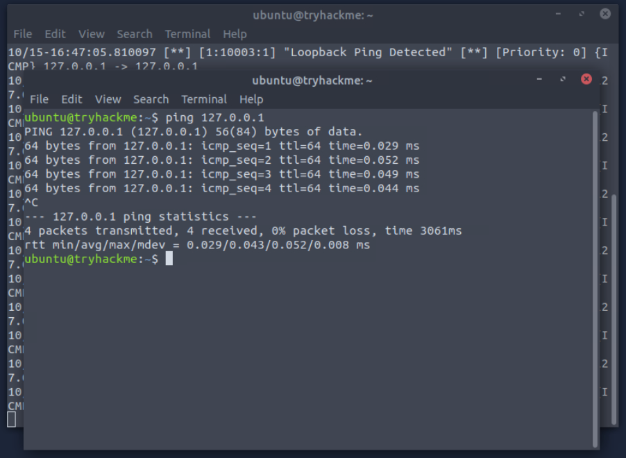
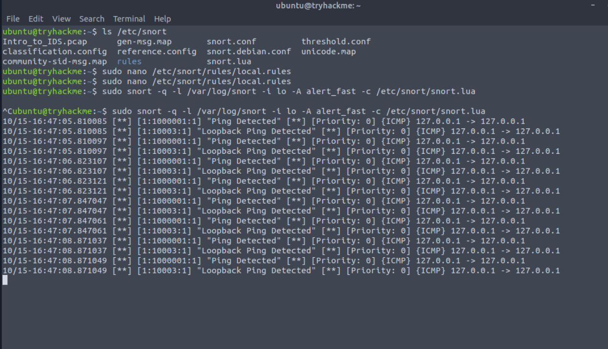
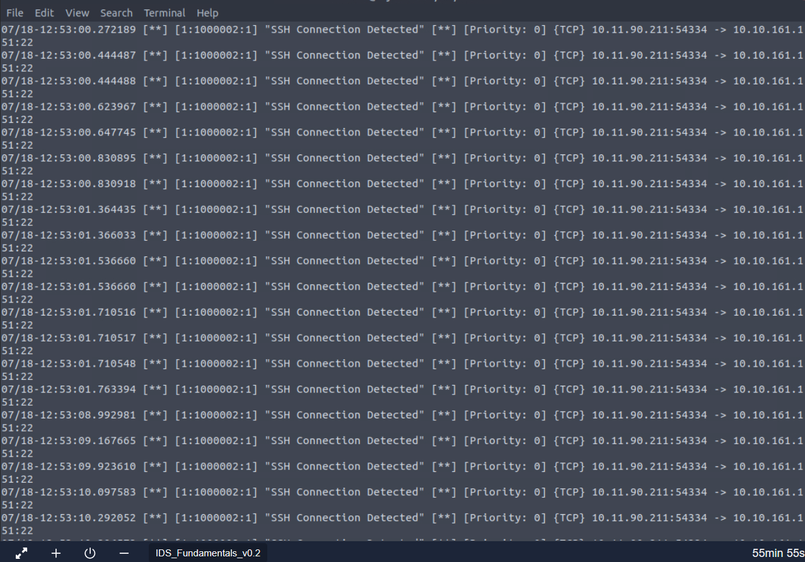
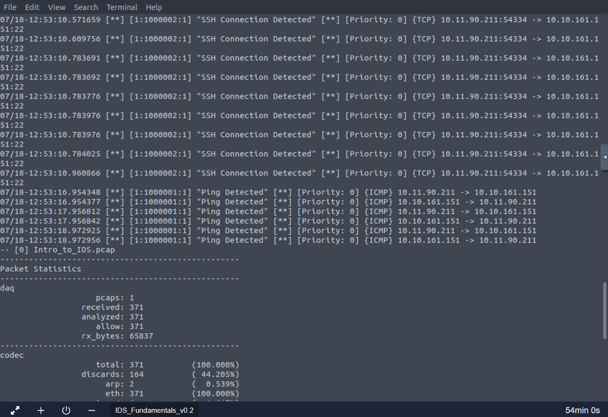
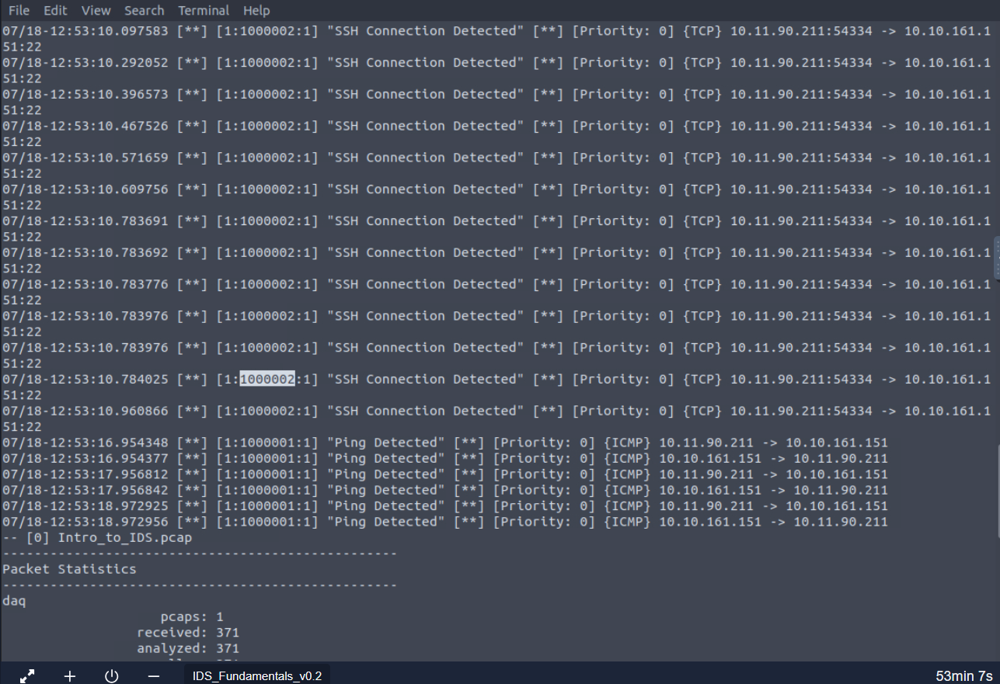

This is my writeup for the [IDS Fundamentals](https://tryhackme.com/room/idsfundamentals) room on TryHackMe, part of the SOC Level 1 path. The room introduces Intrusion Detection Systems and gets hands-on with Snort 3, covering custom rule creation in `local.rules`, live alert testing on a network interface, and offline analysis of a captured attack PCAP.

## IDS Concepts and Snort 3 Modes

An Intrusion Detection System (IDS) passively monitors traffic or host activity and raises alerts when something matches a known threat or behavioral deviation. Because an IDS sits out-of-band (or listens passively on a SPAN/mirror port), it detects suspicious activity without blocking packets inline; active blocking belongs to an Intrusion Prevention System (IPS).

At the deployment level, a Host Intrusion Detection System (HIDS) watches events on an individual endpoint, whereas a Network Intrusion Detection System (NIDS) inspects packets crossing a network segment to spot threats across multiple hosts. Detection engines generally take one of three approaches:

- Signature-based detection compares packets and payloads against explicit rules for known attacks.
- Anomaly-based detection flags deviations from an established traffic or behavioral baseline.
- Hybrid detection combines signature matching and anomaly analysis in the same engine to catch known patterns alongside unusual traffic shifts.

Snort 3 is an open-source NIDS/NIPS that operates in three main modes depending on the flags passed at launch:

- Sniffer mode reads packets directly off a network interface and prints them to the console.
- Packet logger mode records live network traffic to disk (such as a PCAP file) for later review.
- Network Intrusion Detection System (NIDS) mode evaluates live or recorded packets against enabled rulesets and writes alerts when rules match.

## Snort 3 Configuration and Rule Anatomy

Snort 3 does not hardcode a single configuration directory across every distribution. Source builds normally install under `/usr/local/etc/snort`, while the Ubuntu VM in this lab keeps everything in `/etc/snort` and loads the main Lua configuration via `-c /etc/snort/snort.lua`.

Listing `/etc/snort` shows the configuration files, rule directory, and the exercise capture we will analyze later:

```bash
ls /etc/snort
```

```text
Intro_to_IDS.pcap      gen-msg.map       snort.conf        threshold.conf
classification.config  reference.config  snort.debian.conf unicode.map
community-sid-msg.map  rules             snort.lua
```

`snort.lua` defines network variables such as `$HOME_NET` and specifies which rule files inside `/etc/snort/rules/` are loaded at startup. Custom user-written detections live in `/etc/snort/rules/local.rules`.

### Breaking Down a Snort Rule

Every Snort rule has two sections: the rule header (everything before the parentheses) and the rule options (key-value pairs separated by semicolons inside the parentheses). Here is a basic ICMP rule that alerts whenever any external or internal source pings an address in `$HOME_NET`:

```text
alert icmp any any -> $HOME_NET any (msg:"Ping Detected"; sid:10001; rev:1;)
```

| Field | Value | Role in the Rule |
| :--- | :--- | :--- |
| Action | `alert` | Generates an alert and logs the packet when conditions match |
| Protocol | `icmp` | Restricts inspection to ICMP traffic |
| Source IP | `any` | Matches packets originating from any IP address |
| Source Port | `any` | Placeholder for any source port (ICMP has no transport ports) |
| Direction | `->` | Matches traffic flowing from the source side to the destination side |
| Destination IP | `$HOME_NET` | Matches destinations within the protected range set in `snort.lua` |
| Destination Port | `any` | Placeholder for any destination port |
| `msg` | `"Ping Detected"` | Alert text printed in logs and console output when triggered |
| `sid` | `10001` | Unique Signature ID identifying this specific rule |
| `rev` | `1` | Rule revision number, incremented whenever the signature is edited |

## Writing and Testing a Custom Rule

To test a custom signature on live traffic, I opened `/etc/snort/rules/local.rules` in `nano`:

```bash
sudo nano /etc/snort/rules/local.rules
```

The file already contained rules needed for the PCAP exercise (`sid:1000001` and `sid:1000002`), so I left those untouched and appended a loopback-specific ICMP rule at the bottom:

```text
alert icmp any any -> 127.0.0.1 any (msg:"Loopback Ping Detected"; sid:10003; rev:1;)
```

After saving the file, I started Snort 3 in NIDS mode listening on the `lo` loopback interface:

```bash
sudo snort -q -l /var/log/snort -i lo -A alert_fast -c /etc/snort/snort.lua
```

Here is what each flag controls in this command:

- `-q` suppresses the startup banner and initialization output so only alerts appear in the terminal.
- `-l /var/log/snort` sets the directory where Snort writes its log files.
- `-i lo` attaches packet capture to the local loopback interface.
- `-A alert_fast` formats alerts as compact single-line entries (`timestamp`, `[gid:sid:rev]`, message, protocol, and `src -> dst`).
- `-c /etc/snort/snort.lua` loads the Snort 3 configuration file and its enabled rulesets.

With Snort listening in the first terminal, I opened a second terminal window, ran `ping 127.0.0.1`, and stopped it after four packets:



Switching back to the Snort window shows the alerts streaming in real time:



```text
10/15-16:47:05.810085 [**] [1:1000001:1] "Ping Detected" [**] [Priority: 0] {ICMP} 127.0.0.1 -> 127.0.0.1
10/15-16:47:05.810085 [**] [1:10003:1] "Loopback Ping Detected" [**] [Priority: 0] {ICMP} 127.0.0.1 -> 127.0.0.1
10/15-16:47:05.810097 [**] [1:1000001:1] "Ping Detected" [**] [Priority: 0] {ICMP} 127.0.0.1 -> 127.0.0.1
10/15-16:47:05.810097 [**] [1:10003:1] "Loopback Ping Detected" [**] [Priority: 0] {ICMP} 127.0.0.1 -> 127.0.0.1
```

> Four transmitted pings produced sixteen alert lines in the console. Two things happen at once on loopback: each ping generates both an ICMP Echo Request (`16:47:05.810085`) and an ICMP Echo Reply 12 microseconds later (`16:47:05.810097`), and both packets match `127.0.0.1` as the destination. Because `local.rules` already had `[1:1000001:1] "Ping Detected"` enabled alongside our new `[1:10003:1] "Loopback Ping Detected"` rule, every request and reply fired both rules (4 lines per ping). Adding `itype:8;` to the rule options would restrict alerts strictly to Echo Requests.
{: .prompt-tip }

## Investigating `Intro_to_IDS.pcap`

The final task hands over `/etc/snort/Intro_to_IDS.pcap` from a network incident and asks us to identify the host attempting an SSH connection, check what other rule fired during the capture, and pull the SSH signature ID.

Instead of `-i` for live capture, `-r` tells Snort 3 to process an offline PCAP file. Running without `-q` also prints the packet breakdown once Snort finishes reading the capture:

```bash
sudo snort -r /etc/snort/Intro_to_IDS.pcap -A alert_fast -c /etc/snort/snort.lua
```

### SSH Connection Source

Scrolling up into the `alert_fast` output shows a burst of TCP alerts between `12:53:00` and `12:53:10`:



```text
07/18-12:53:00.272189 [**] [1:1000002:1] "SSH Connection Detected" [**] [Priority: 0] {TCP} 10.11.90.211:54334 -> 10.10.161.151:22
```

Every `"SSH Connection Detected"` line shows source `10.11.90.211:54334` connecting over TCP to the target host `10.10.161.151` on port `22`. That identifies `10.11.90.211` as the machine initiating the SSH connection.

### Additional Alerts and Packet Statistics

At the bottom of the alert stream (`12:53:16` to `12:53:18`), six ICMP alerts fire right before Snort prints its `Packet Statistics` summary:



```text
07/18-12:53:16.954348 [**] [1:1000001:1] "Ping Detected" [**] [Priority: 0] {ICMP} 10.11.90.211 -> 10.10.161.151
07/18-12:53:16.954377 [**] [1:1000001:1] "Ping Detected" [**] [Priority: 0] {ICMP} 10.10.161.151 -> 10.11.90.211
```

Besides `"SSH Connection Detected"`, the other rule message triggered in the capture is `Ping Detected`. Three ICMP echo requests go from `10.11.90.211` to `10.10.161.151` at one-second intervals, each answered by an echo reply from `10.10.161.151`. Under `Packet Statistics`, the `daq` and `codec` counters show that `Intro_to_IDS.pcap` contains `371` Ethernet packets (`65,837` bytes total, including `2` ARP packets and `164` discards).

### SSH Signature ID

In `alert_fast` output, the bracketed identifier `[gid:sid:rev]` appears right before the alert message:



For `"SSH Connection Detected"`, the header reads `[1:1000002:1]`: Generator ID `1` (standard Snort rules engine), Signature ID `1000002`, and Revision `1`. That follows the standard Snort convention of assigning local custom rules SIDs starting at `1000000` (`1000001` for `"Ping Detected"` and `1000002` for `"SSH Connection Detected"`).

### PCAP Alert Summary

| Rule Header (`[gid:sid:rev]`) | Alert Message | Protocol | Observed Flow |
| :--- | :--- | :--- | :--- |
| `[1:1000002:1]` | `SSH Connection Detected` | TCP | `10.11.90.211:54334 -> 10.10.161.151:22` |
| `[1:1000001:1]` | `Ping Detected` | ICMP | `10.11.90.211 <-> 10.10.161.151` (3 requests, 3 replies) |

*The lab and the analysis are mine. I used Gemini to help structure my notes and edit the post.*
