This is my walkthrough of the [Detecting Web DDoS](https://tryhackme.com/room/detectingwebddos) room from TryHackMe's SOC Level 1 path. The lab walks through how availability attacks show up in web server logs, starting with a single-host flood in a plain access log and moving to a multi-host botnet flood investigated in Splunk.

## DoS, DDoS, and Where to Look

A Denial-of-Service (DoS) attack tries to knock a service offline or degrade response times for real users from a single source. A Distributed Denial-of-Service (DDoS) attack scales the same goal across a botnet of compromised machines so the traffic cannot be shut down by blocking one IP address. Motives vary by target: some campaigns aim for direct reputational damage by making customers lose confidence when a site stays unreachable, while others stem from extortion, rivalry, or hacktivism, such as the June 2023 Layer 7 DDoS campaign that disrupted Microsoft's Outlook, OneDrive, and Azure portal.

From a SOC triage perspective, the layer under attack dictates which telemetry actually helps:

- Volumetric and transport-layer floods (SYN floods, UDP amplification, ICMP floods) saturate link bandwidth or exhaust TCP state tables before an HTTP request is ever logged. Packet captures in Wireshark or NetFlow summaries are the right tools there because the web server may never write an access log line.
- Application-layer (Layer 7) HTTP floods complete full TCP handshakes and send valid HTTP requests against expensive routes like `/login` or `/search`. Because each request looks syntactically normal on the wire, web access logs and SIEM aggregation in Splunk are much faster than packet inspection for isolating the targeted URI, botnet distribution, User-Agent rotation, and downstream `503` errors.

## Single-Source HTTP DoS in Raw Access Logs

Before opening Splunk, Task 4 drops a small combined access log on the Desktop (`~/Desktop/access.log`) to show what an unthrottled single-source flood looks like next to normal browsing.

I opened `access.log` in Pluma and checked the baseline traffic right before `01:59 UTC`:

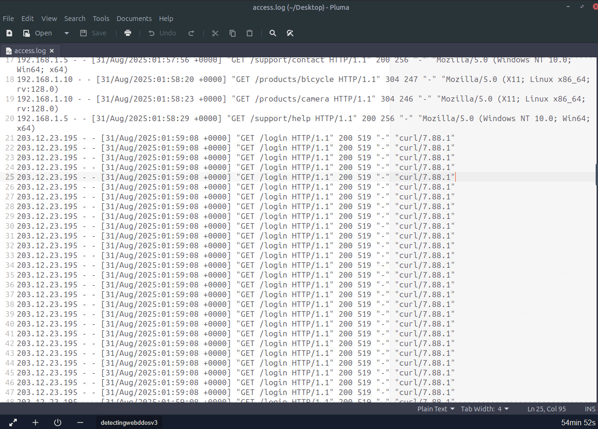

Lines 17 through 20 (`01:57:56` to `01:58:29 +0000` on `31/Aug/2025`) show two internal clients, `192.168.1.5` (Windows 10) and `192.168.1.10` (Linux Firefox), requesting `/support/contact`, `/products/bicycle`, `/products/camera`, and `/support/help` several seconds apart and receiving `200` and `304` status codes.

At line 21, the pattern breaks. External IP `203.12.23[.]195` starts hammering `GET /login HTTP/1.1` with `curl/7.88.1` inside a single second (`31/Aug/2025:01:59:08 +0000`). The earliest requests in that burst still return `200` (`519` bytes), meaning the login handler is actively processing them.

Scrolling further down through the exact same `01:59:08` timestamp shows the tipping point:

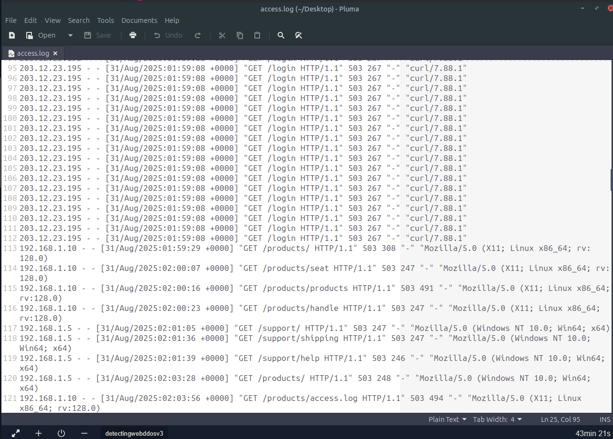

By lines 95 through 112 (over 90 `GET /login` requests within one second from `203.12.23[.]195`), the web server runs out of worker capacity and starts returning HTTP `503` (`Service Unavailable`, `267` bytes). From line 113 onward (`01:59:29` through `02:03:56 +0000`), every legitimate page load from `192.168.1.10` and `192.168.1.5` across `/products/` and `/support/` also fails with `503`.

## Investigating a Botnet HTTP Flood in Splunk

Task 5 moves to a distributed attack recorded on `03/Sep/2025`. The web server's combined access log (`/home/ubuntu/Documents/access_ddos.log`, `sourcetype=access_combined`, `2,528` total events) is ingested into Splunk under `index="main"`.

> The attacking subnet in this dataset (`203.0.113.0/24`) is RFC 5737's `TEST-NET-3` documentation block rather than live internet infrastructure, so I kept those addresses undefanged below to match the exact Splunk queries.
{: .prompt-info }

### Identifying the Targeted Endpoint

I started with a broad search across `All time` (`index="main"`) and opened `uri_path` (`20` distinct values) in Splunk's left Fields sidebar instead of writing a separate `top` query right away.

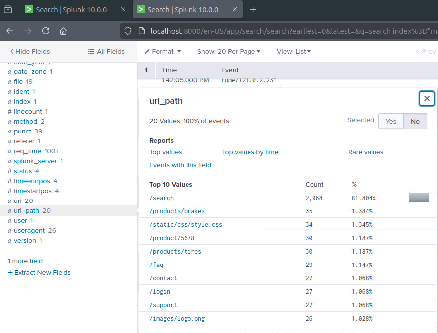

`/search` accounts for `2,068` events, or `81.804%` of all logged traffic. Every other path sits around `1%`, led by `/products/brakes` (`35` hits, `1.384%`), `/static/css/style.css` (`34`), `/product/5678` (`30`), `/products/tires` (`30`), `/faq` (`29`), and `/contact`, `/login`, and `/support` (`27` each).

Picking `/search` is a deliberate Layer 7 choice. Static files like `style.css` or `logo.png` are cheap to serve from memory, whereas `/search` typically hits an application worker and runs a backend database query on every request.

### Finding the Top Source IP and Request Distribution

Next, I filtered down to `index="main" uri_path="/search"` and opened `clientip` in the sidebar to see who generated those `2,068` hits.

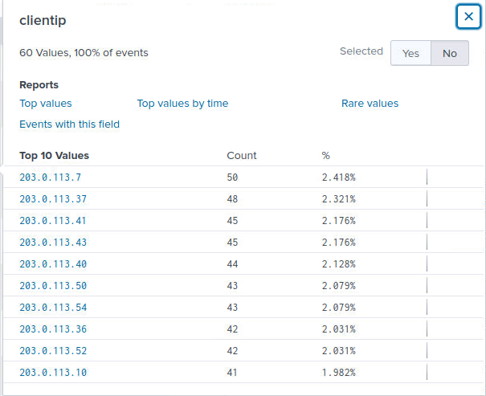

`203.0.113.7` is at the top of the list, but with only `50` requests (`2.418%` of `/search` traffic). Right behind it sit `203.0.113.37` (`48`), `203.0.113.41` (`45`), `203.0.113.43` (`45`), `203.0.113.40` (`44`), `203.0.113.50` (`43`), `203.0.113.54` (`43`), `203.0.113.36` (`42`), `203.0.113.52` (`42`), and `203.0.113.10` (`41`).

That flat curve is the main difference between Task 4 and Task 5. No single host sends hundreds of requests; each bot contributes roughly 30 to 50 hits so per-IP volume stays low while the combined load overwhelms `/search`.

Filtering specifically on `index="main" uri_path="/search" clientip="203.0.113.7"` and expanding one of its late events (`13:12:31 UTC`) confirms the extracted fields:

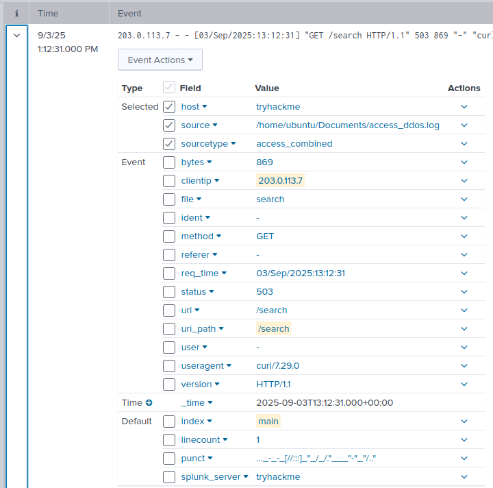

By `13:12:31`, `203.0.113.7` is issuing `GET /search HTTP/1.1` with no `referer` (`-`), `useragent="curl/7.29.0"`, and already getting `status=503` (`869` bytes) back from the exhausted server.

### Counting the Botnet Size

Scrolling through the raw `/search` events at `13:12:29 UTC` shows that every attacking IP comes out of the same `203.0.113.0/24` range (`203.0.113.6`, `.11`, `.27`, `.32`, `.34`, `.39`, `.41`, `.42`, `.52`, `.58`, `.59`, `.60`, and others), while each request carries a different CLI or scripting User-Agent:

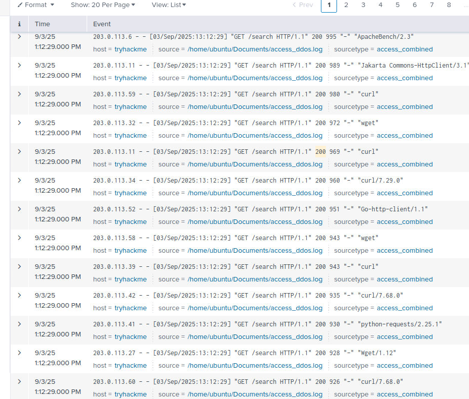

To get an exact count of unique hosts participating in the botnet, I ran `stats dc(clientip)` against that `/24` prefix:

```spl
index="main" clientip="203.0.113.*"
| stats dc(clientip)
```

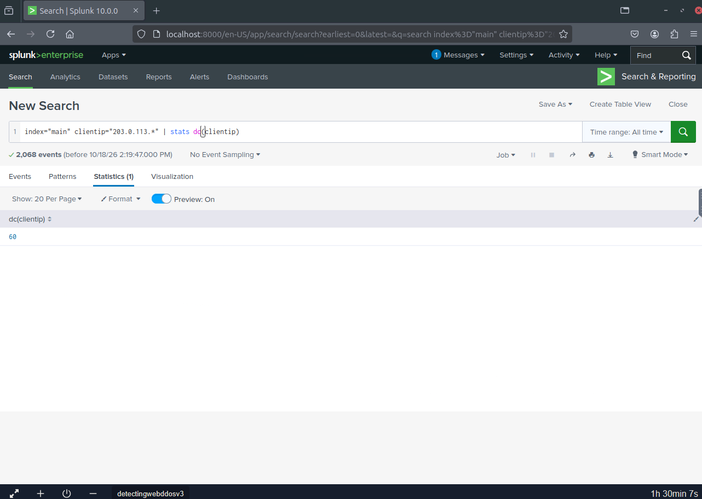

The search matches `2,068` events and returns `dc(clientip) = 60`. Two useful details fall out of those numbers:

- Every single request from the `60` hosts in `203.0.113.0/24` targeted `/search` (`2,068` out of `2,068`), and none of the internal users ever touched `/search` during this window.
- Across all of `index="main"`, Splunk extracted `100` distinct `clientip` values (`60` external `203.0.113.x` bots plus `40` internal `10.10.0.x` clients).

### Checking User-Agent Rotation

Returning to `index="main"` and opening the `useragent` field (`26` distinct values) shows how the botnet handled HTTP client strings:

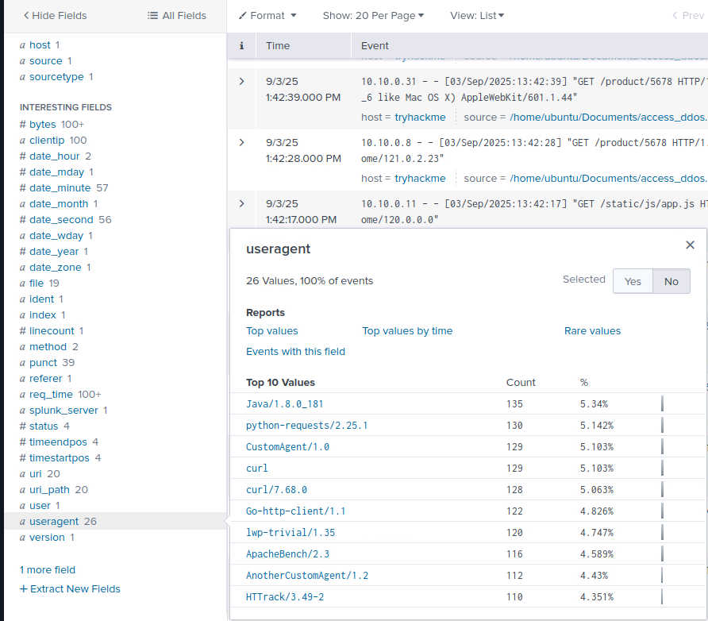

`Java/1.8.0_181` sits in first place with `135` requests (`5.34%` of all events), but the entire top 10 list is automated tooling spread into nearly equal slices:

| User-Agent | Requests | Share of All Events |
| --- | --- | --- |
| `Java/1.8.0_181` | 135 | 5.340% |
| `python-requests/2.25.1` | 130 | 5.142% |
| `CustomAgent/1.0` | 129 | 5.103% |
| `curl` | 129 | 5.103% |
| `curl/7.68.0` | 128 | 5.063% |
| `Go-http-client/1.1` | 122 | 4.826% |
| `lwp-trivial/1.35` | 120 | 4.747% |
| `ApacheBench/2.3` | 116 | 4.589% |
| `AnotherCustomAgent/1.2` | 112 | 4.430% |
| `HTTrack/3.49-2` | 110 | 4.351% |

Even earlier in the raw events we also saw `Jakarta Commons-HttpClient/3.1`, `curl/7.29.0`, `wget`, and `Wget/1.12`. Because no single string exceeds roughly 5.3% of traffic, writing an emergency WAF rule to drop `Java/1.8.0_181` alone would barely dent the flood. At the same time, none of these strings mimic real desktop or mobile browsers, which gives a WAF an easy behavioral angle.

### Measuring Peak Requests per Second

To measure the peak per-second request rate during the flood, you can chart the `/search` traffic in 1-second buckets with `timechart`:

```spl
index="main" uri_path="/search"
| timechart span=1s count
```

During the lab I also checked the spike directly from the Events histogram. Clicking `/search` in `uri_path` narrowed the query back down to `index="main" uri_path="/search"`:

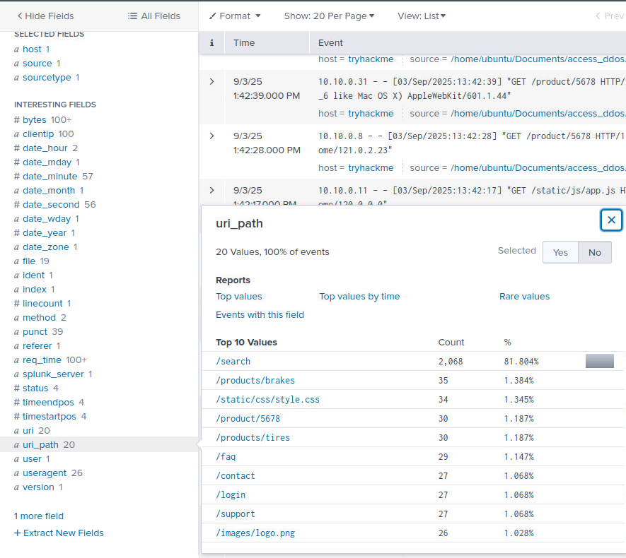

Once filtered to those `2,068` events, Splunk zoomed the timeline bar to the exact `9.1-second` window of the attack, running from `13:12:22` to `13:12:31 UTC` on `03/Sep/2025`. Hovering over the tallest green column at `13:12:27` gave the peak rate immediately:

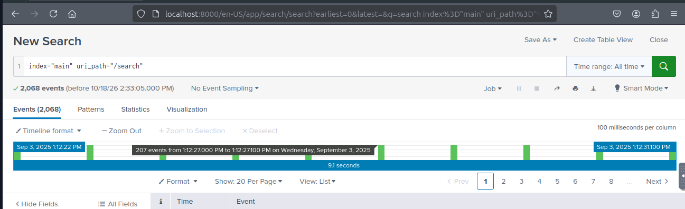

The peak is `207` requests per second at `13:12:27 UTC` (averaging `206.8` requests per second across all 10 seconds of the burst).

> Because standard Apache `access_combined` timestamps only have 1-second precision (`[03/Sep/2025:13:12:27]`), Splunk assigns every event in that second to `.000`. Even when the zoomed timeline displays `100 milliseconds per column`, each `1:12:XX.000` bar holds the full 1-second count, matching `timechart span=1s count`.
{: .prompt-tip }

### Finding the First Impacted Legitimate User

The flood ended at `13:12:31 UTC`, but the backend stayed degraded afterward. To find which real user hit the first `503` response post-attack without sorting through botnet `503`s, I filtered for `status=503`, excluded the `203.0.113.0/24` subnet, and sorted ascending by `_time`:

```spl
index="main" status=503 NOT clientip="203.0.113*"
| sort _time
```

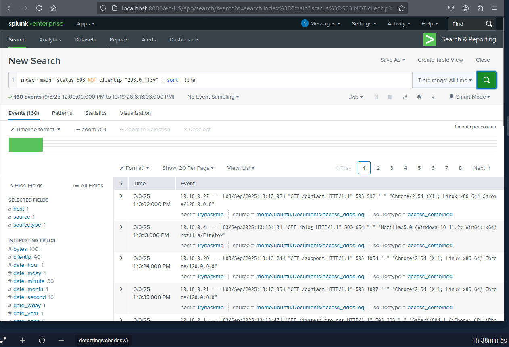

The query returned `160` failed requests spread across all `40` internal `10.10.0.x` clients. The earliest post-attack `503` hit `10.10.0.27` at `13:13:02 UTC` (`31` seconds after the last botnet packet) when that host requested `GET /contact HTTP/1.1` from Linux Chrome (`Chrome/120.0.0.0`). Seconds later, `10.10.0.4` (`GET /blog` at `13:13:13`), `10.10.0.20` (`GET /support` at `13:13:24`), and `10.10.0.21` (`GET /contact` at `13:13:35`) hit the same outage.

## Practical Mitigation

Comparing the two logs highlights why mitigation has to work in layers rather than relying on static blocklists:

1. In the first incident, dropping `203.12.23[.]195` at the perimeter firewall or setting a basic per-IP rate limit on `/login` stops the outage right away because one host generated all 90+ requests per second.
2. Against the `60`-bot `/search` flood, each IP sent only ~4 to 5 requests per second for 10 seconds while cycling through more than a dozen User-Agent strings. Loose per-IP limits can miss individual bots, and blocking `Java/1.8.0_181` or `curl` one by one leaves over 90% of the traffic untouched.
3. Endpoint-aware rate limiting and resource isolation on heavy routes like `/search` and `/login` keep uncached database queries from starving unrelated pages such as `/contact` and `/blog`.
4. Putting a WAF or bot-management policy on high-cost endpoints to challenge suspicious bursts or non-browser TLS/HTTP fingerprints with a JavaScript check or `CAPTCHA` stops headless clients (`Java`, `python-requests`, `Go-http-client`, `curl`, `wget`, `ApacheBench`) that cannot solve interactive challenges.
5. Placing a reverse proxy or CDN ahead of the web tier absorbs request spikes at the edge, serves static assets from cache, and uses `Load-balancing` across multiple backend servers so a burst against one worker pool does not take down the entire origin with `503` errors.

*The lab and the analysis are mine. I used Gemini to help structure my notes and edit the post.*
