Room: [Windows Threat Detection 3](https://tryhackme.com/room/windowsthreatdetection3)

This room wraps up the Windows Threat Detection series in TryHackMe's SOC Level 1 path. While earlier rooms focused on initial breach vectors and host discovery, part 3 shifts to what happens after an attacker lands on a Windows endpoint (`THM-DFIR-VM-3`): establishing a Command and Control (`TA0011`) channel, planting Persistence (`TA0003`) to survive reboots or credential resets, and understanding how early detection prevents downstream Impact (`TA0040`).

## Detection Reference: C2 and Persistence Telemetry

Across the exercises, every post-exploitation technique leaves correlation points across either `Microsoft-Windows-Sysmon/Operational` or the Windows `Security` log. Rather than memorizing isolated event numbers, I find it easier to group them by what the attacker is modifying on the host and what parent process launches the payload later.

| Technique | MITRE ID | Primary Event IDs | Key Log Fields and Runtime Clues |
| --- | --- | --- | --- |
| Staged C2 Dropper and DNS Beaconing | `T1105`, `T1071.001` | Sysmon `11`, `22`, `3` | `TargetFilename` in `Downloads` or `AppData`, followed by `QueryName` in DNS logs from an unusual binary path |
| Backdoor Local User and Group Escalation | `T1136.001`, `T1098` | Security `4625`, `4720`, `4732`, `4724` | `SAM Account Name` on creation (`4720`) and subsequent addition to `Administrators` or `Remote Desktop Users` (`4732`) under the same `Logon ID` |
| Windows Service Persistence | `T1543.003` | Security `4697`, System `7045`, Sysmon `1` | `sc.exe create` command line, `Service File Name` outside standard system folders, and runtime child processes spawned by `services.exe` |
| Scheduled Task Persistence | `T1053.005` | Security `4698`, Sysmon `1` | `schtasks.exe /create` execution, `<Command>` inside the `4698` XML body, and child processes with parent `svchost.exe -k netsvcs -p -s Schedule` |
| Startup Folder Persistence | `T1547.001` | Sysmon `11`, `1` | File creation under `...\Start Menu\Programs\Startup\` and user-logon execution with `C:\Windows\explorer.exe` as parent |
| Registry Run Key Persistence | `T1547.001` | Sysmon `13`, `1` | `SetValue` (`RuleName: T1060,RunKey`) on `...\CurrentVersion\Run\<ValueName>` pointing `Details` to a payload path |

## Task 2: Command and Control (C2)

Interactive RDP intrusions let an operator type commands directly, but that access disappears as soon as the session closes or the password changes. Most phishing and loader chains instead drop a standalone C2 implant in a writable user folder so the beacon keeps running even if the user deletes the original download.

For Task 2, I opened `C:\Users\Administrator\Desktop\Practice\Task 2\Sysmon.evtx` (23 events total) in Event Viewer to trace the full infection and C2 staging sequence.

### Downloaded Archive (Sysmon Event ID 11)

Filtering the Sysmon log for Event ID `11` (`FileCreate`) narrows the capture down to 7 events. At `2025-07-02 20:13:50 UTC` (with the Mark-of-the-Web stream written at `20:13:55.860 UTC`), Google Chrome (`chrome.exe`, PID `5708`) saved a ZIP archive into the `Administrator` user's `Downloads` folder:

- Event ID: `11` (`RuleName: Downloads`)
- Image: `C:\Program Files (x86)\Google\Chrome\Application\chrome.exe`
- TargetFilename: `C:\Users\Administrator\Downloads\URGENT!.zip:Zone.Identifier`
- User: `THM-DFIR-VM-3\Administrator`

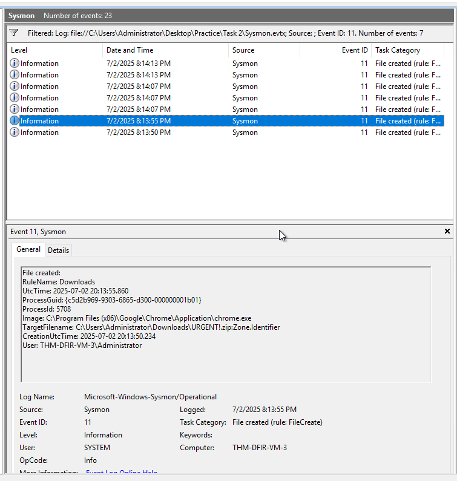

The suspicious archive downloaded by the user is `URGENT!.zip`.

> In Event Viewer's bottom summary pane, Sysmon events always display `User: SYSTEM` because the Sysmon service itself writes the record under the local system account. Always check the `User:` field inside the event's General text block (here `THM-DFIR-VM-3\Administrator`) to see which account actually triggered the activity.
{: .prompt-tip }

### Hidden C2 Binary Path (Sysmon Event ID 11)

Staying on the Event ID `11` filter and stepping forward 18 seconds to `20:14:13.444 UTC` shows `powershell.exe` (PID `3140`) dropping a second-stage executable (`RuleName: EXE`) inside `AppData\Roaming`:

- ProcessGuid: `{c5d2b969-9314-6865-d500-000000001b01}`
- Image: `C:\Windows\System32\WindowsPowerShell\v1.0\powershell.exe`
- TargetFilename: `C:\Users\Administrator\AppData\Roaming\update.exe`

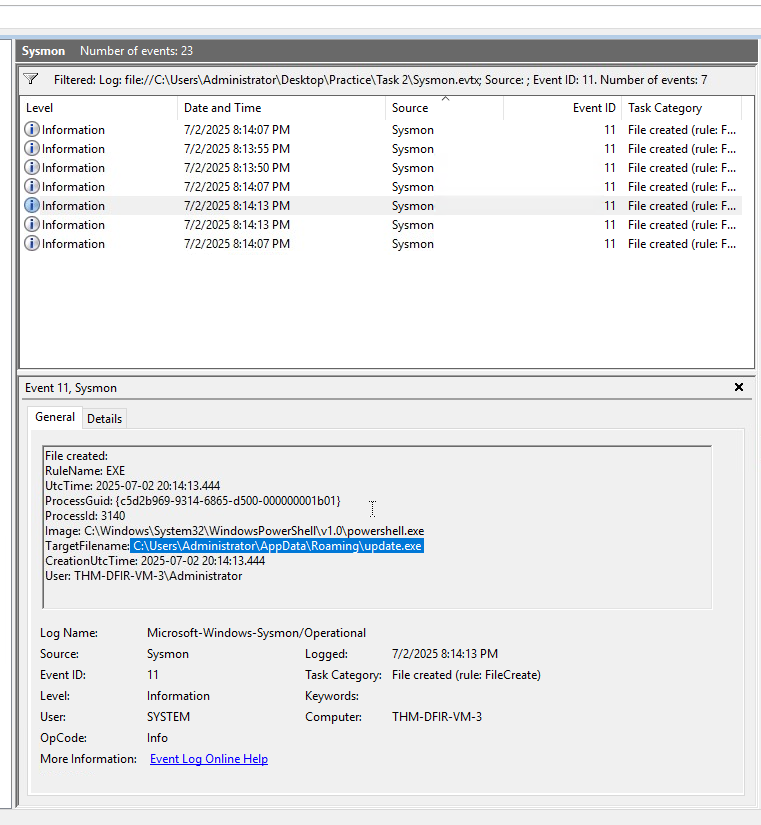

The attackers hid the C2 malware file at `C:\Users\Administrator\AppData\Roaming\update.exe`.

### C2 Server Domain (Sysmon Event ID 22)

Once the dropped binary path is known, the fastest way to spot its callback destination in Sysmon is Event ID `22` (`DnsQuery`). Filtering `Sysmon.evtx` for Event ID `22` returns a single lookup at `20:14:28.636 UTC`, 15 seconds after `update.exe` hit disk:

- Image: `C:\Users\Administrator\AppData\Roaming\update.exe` (PID `4340`)
- QueryName: `route.m365officesync.workers[.]dev`
- QueryStatus: `9003` (`DNS_ERROR_RCODE_NAME_ERROR` in the isolated lab environment)

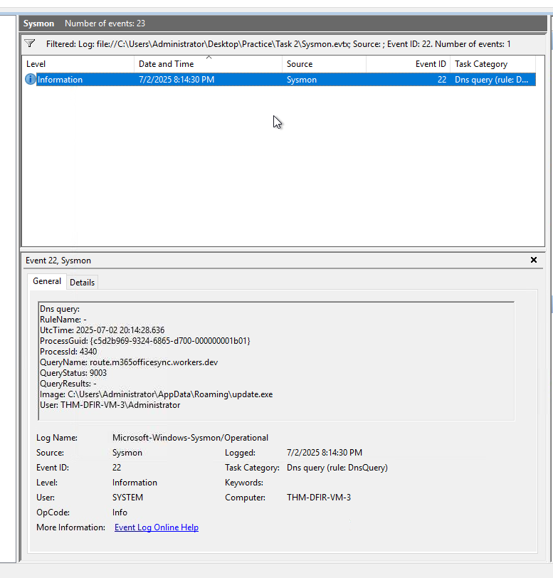

The implant beacons to `route.m365officesync.workers[.]dev` (entered un-defanged in TryHackMe), abusing a Cloudflare Workers (`workers[.]dev`) subdomain named to mimic legitimate Microsoft 365 synchronization traffic.

## Task 3: Persistence via Backdoored User Account

When initial access comes through an exposed remote login service like RDP, attackers frequently create a spare local administrator account (`T1136.001` / `T1098`) so they can still sign back in after the victim rotates the breached account's password.

For Task 3, I loaded `C:\Users\Administrator\Desktop\Practice\Task 3\Security.evtx` (31 events).

### Failed Administrator Logons (Security Event ID 4625)

Filtering `Security.evtx` for Event ID `4625` isolates failed logon attempts. Six events appear on `7/2/2025`: five rapid failures between `8:58:05 PM` and `8:58:22 PM` spaced 4 to 5 seconds apart, followed by one final failed attempt at `9:00:20 PM` before the attacker authenticated as `Administrator`.

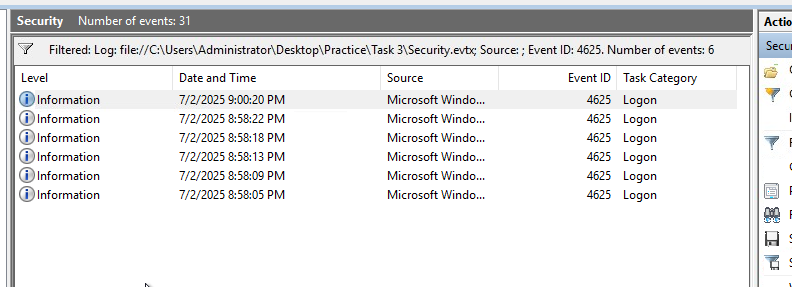

The threat actor failed to log in to `Administrator` `6` times.

### Backdoor Account Creation and Group Membership (Security Event IDs 4720 and 4732)

Filtering the same Security log for Event ID `4720` (`A user account was created`) turns up one event at `7/2/2025 9:01:38 PM`, roughly a minute after the brute-force sequence ended:

- Subject Account Name: `Administrator` (`THM-DFIR-VM-3`, `Logon ID: 0x1CBC41`)
- New Account Name: `support` (`THM-DFIR-VM-3\support`)

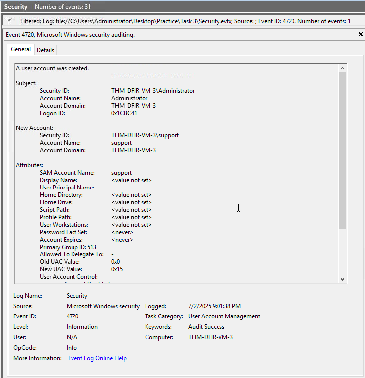

Naming the account `support` is a classic blending trick meant to look like an internal IT or vendor account during casual review. Because a newly created standard user cannot connect via RDP or run administrative tools by default, checking Security Event ID `4732` (`A member was added to a security-enabled local group`) under the same `0x1CBC41` logon session confirms that `support` was immediately added to the local `Administrators` group.

## Task 4: Persistence via Services and Scheduled Tasks

Backdoor accounts only help if a remote login surface stays reachable from the outside. When an endpoint sits behind NAT and was compromised via phishing, malware needs local boot persistence so its C2 implant restarts automatically every time Windows reboots. Task 4 examines `C:\Users\Administrator\Desktop\Practice\Task 4\Security (All Time).evtx` (20 events) alongside the live Sysmon log on `THM-DFIR-VM-3`.

### Nessie Malware Service (Security Event ID 4697)

Windows service installations are recorded as Security Event ID `4697` (and System Event ID `7045`). Filtering `Security (All Time).evtx` for `4697` highlights a service registered on `7/2/2025 7:09:16 PM` by `THM-DFIR-VM-3\Administrator` (`Logon ID: 0x3D349`):

- Service Name: `Data Protection Service`
- Service File Name: `C:\Windows\Help\nessie.exe`
- Service Type: `0x10` (Win32 own process)
- Service Start Type: `2` (`AUTO_START`, runs on system boot)
- Service Account: `LocalSystem`

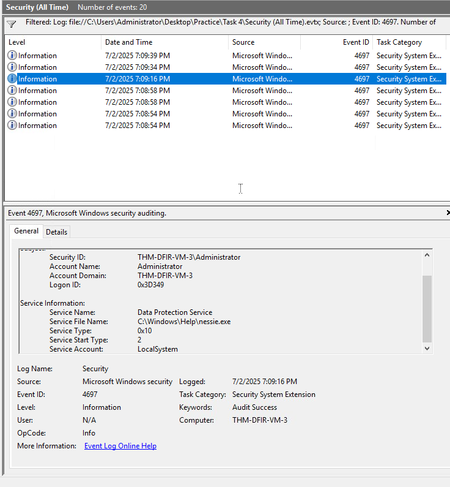

Stashing `nessie.exe` inside `C:\Windows\Help\` and naming the service `Data Protection Service` gives the implant `SYSTEM` privileges on every boot while blending into `services.msc`.

### Troy Malware Scheduled Task (Security Event ID 4698 and Sysmon Event ID 1)

Next, I filtered `Security (All Time).evtx` for Event ID `4698` (`A scheduled task was created`). Under the exact same `Logon ID: 0x3D349` at `7/2/2025 7:10:09 PM` (53 seconds after installing the Nessie service), the attacker registered a scheduled task named `\AmazonSync`:

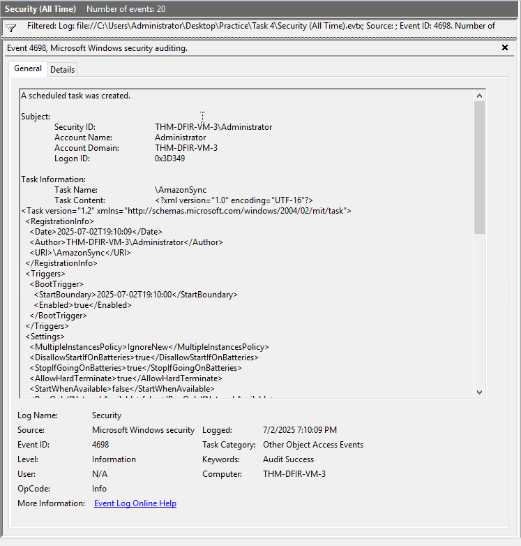

Scrolling down through the embedded `Task Content` XML reveals both the payload path and the privilege level:

- Trigger: `<BootTrigger>` enabled from `2025-07-02T19:10:00`
- Command: `"C:\Program Files\Common Files\troy.exe"`
- Principal UserId: `S-1-5-18` (`NT AUTHORITY\SYSTEM`)

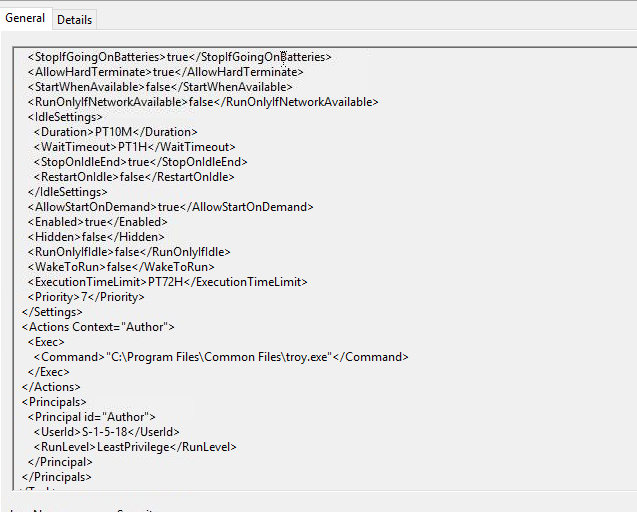

The scheduled task name is `AmazonSync`. To get the flag from `C:\Program Files\Common Files\troy.exe`, running the binary prompts for the parent command line that launched it when the scheduled task fired. I switched to the live `Microsoft-Windows-Sysmon/Operational` log, filtered for Event ID `1` (`Process Create`), and located the execution record for `"C:\Program Files\Common Files\troy.exe" -d`:

- User and Integrity: `NT AUTHORITY\SYSTEM` (`System`, `LogonId: 0x3E7`)
- SHA256: `B311083FDF799F3E298A5357FAB9C975E9EDFB3E7A64678523155A2053C9A9F6`
- ParentProcessId: `1424`
- ParentImage: `C:\Windows\System32\svchost.exe`
- ParentCommandLine: `C:\Windows\system32\svchost.exe -k netsvcs -p -s Schedule`

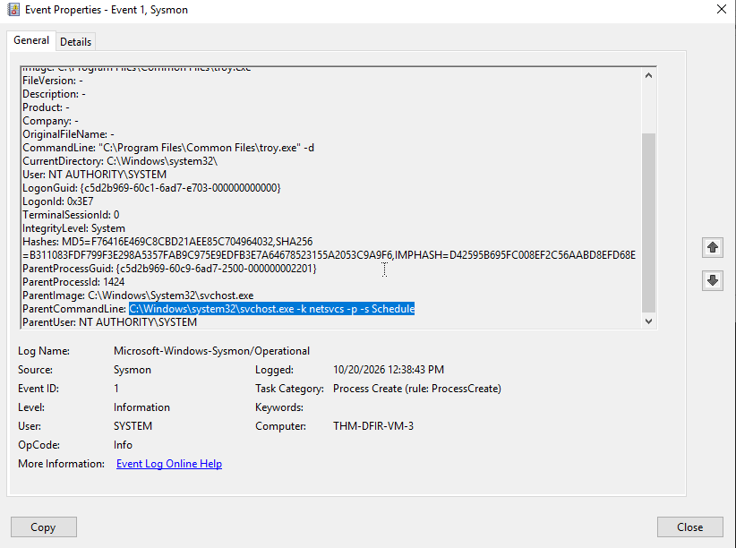

Supplying `C:\Windows\system32\svchost.exe -k netsvcs -p -s Schedule` to `troy.exe` returns the flag `THM{c2_is_on_schedule!}`.

## Task 5: Per-User Persistence via Startup Folder and Registry Run Keys

Services and boot-triggered scheduled tasks require local administrator rights. When malware runs under an unprivileged user token, two reliable per-user logon persistence locations (`T1547.001`) are the Windows `Startup` folder and `CurrentVersion\Run` registry keys. Task 5 combines live host inspection with saved logs in `C:\Users\Administrator\Desktop\Practice\Task 5\`.

### Odin Malware in the Startup Folder (Sysmon Event ID 1)

Searching the live `Microsoft-Windows-Sysmon/Operational` log for `odin` surfaces a Sysmon Event ID `1` record (`2026-10-20 12:39:31.756 UTC`) showing `powershell.exe` (PID `5888`) spawned by a batch script inside the `Administrator` Startup folder:

- ParentImage: `C:\Windows\System32\cmd.exe` (PID `5836`)
- ParentCommandLine: `C:\Windows\system32\cmd.exe /c ""C:\Users\Administrator\AppData\Roaming\Microsoft\Windows\Start Menu\Programs\Startup\odin.cmd" "`
- Image: `C:\Windows\System32\WindowsPowerShell\v1.0\powershell.exe`
- CommandLine: `powershell -Command "Write-Output 'Doing bad stuff...'; for ($i = 0; $i -lt 10; $i++) {   $line = -join (1..10 | ForEach-Object { Get-Random -Minimum 0 -Maximum 2 });   Start-Sleep -Milliseconds 150;   Write-Output $line }; Write-Output 'Done doing bad stuff!'; Start-Sleep -Milliseconds 150"`

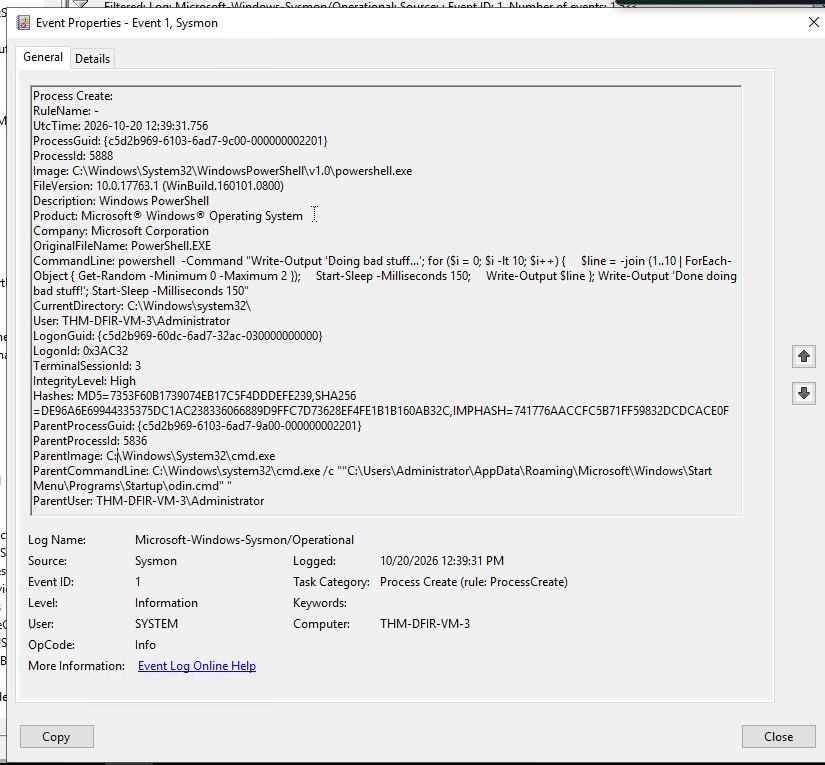

Two questions map directly to this process chain:

1. Because Windows launches every item inside `...\Start Menu\Programs\Startup\` through the user shell at logon, the parent process image of `odin.cmd` (PID `5836`) is `C:\Windows\explorer.exe`.
2. Reading the inline PowerShell script from `CommandLine` shows it prints `Doing bad stuff...`, loops 10 times outputting random 10-character binary strings, and ends with `Write-Output 'Done doing bad stuff!'`. The last line Odin outputs is `Done doing bad stuff!`.

### Kitten Malware in Registry Run Keys (Sysmon Event ID 13)

For the second backdoor, I opened the saved `Sysmon (Before Reboot)` log (`16` events) in `Practice\Task 5\` and searched for `kitten`. That matched a Sysmon Event ID `13` (`Registry value set`, `RuleName: T1060,RunKey`) record logged at `2025-07-04 22:09:47.409 UTC`:

- Image: `C:\Windows\system32\reg.exe` (PID `5200`)
- TargetObject: `HKU\S-1-5-21-1966530601-3185510712-10604624-500\Software\Microsoft\Windows\CurrentVersion\Run\Basket`
- Details: `C:\Users\Public\kitten.exe`
- User: `THM-DFIR-VM-3\Administrator`

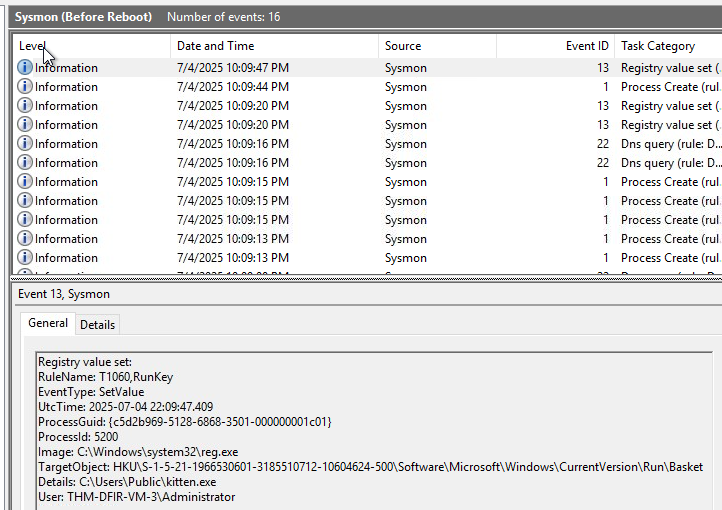

> In Sysmon Event ID `13`, writes to `HKEY_CURRENT_USER` (`HKCU`) resolve to the underlying hive path under `HKEY_USERS\<SID>` (`HKU`). The relative identifier `-500` at the end of `S-1-5-21-1966530601-3185510712-10604624-500` always belongs to the built-in local `Administrator` account.
{: .prompt-info }

Browsing to `C:\Users\Public` in File Explorer confirms `kitten.exe` (`8,192 KB`) is still sitting on disk:

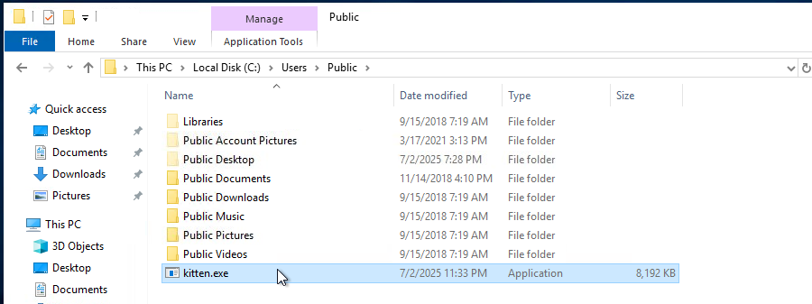

Launching `C:\Users\Public\kitten.exe` brings up a console prompt asking how its Run key is named:

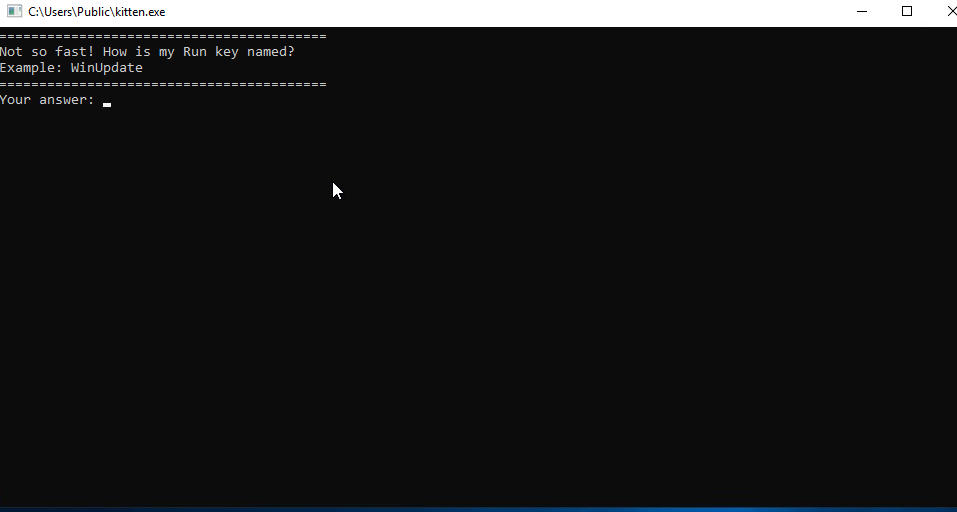

Entering `Basket` (the value name at the end of `...\CurrentVersion\Run\Basket`) unlocks the flag `THM{persisting_in_basket!}`.

## Task 6: Impact and Detection Takeaways

Threat actors rarely deploy persistence for its own sake. Maintaining quiet footholds lets operators enroll hosts into botnets, conduct long-term espionage, or spend days enumerating Active Directory and moving laterally before staging a domain-wide attack. Across corporate Windows networks, `Ransomware` remains the primary high-impact threat (`TA0040`), combining data theft with mass encryption across servers and workstations.

Stopping an intrusion during `Initial Access`, right when the suspicious archive lands in `Downloads` or spawns its first child script, keeps containment limited to a single host before backdoor accounts, SYSTEM services, scheduled tasks, and Run keys multiply the cleanup scope.

## Artifacts and IOC Summary

| Task | Artifact Type | Value | Detection Source |
| --- | --- | --- | --- |
| Task 2 | Phishing Archive | `C:\Users\Administrator\Downloads\URGENT!.zip` | Sysmon Event ID `11` |
| Task 2 | Staged C2 Implant | `C:\Users\Administrator\AppData\Roaming\update.exe` | Sysmon Event ID `11` |
| Task 2 | C2 Domain | `route.m365officesync.workers[.]dev` | Sysmon Event ID `22` |
| Task 3 | Backdoor Admin User | `THM-DFIR-VM-3\support` (added to `Administrators`) | Security Event IDs `4625`, `4720`, `4732` |
| Task 4 | Malicious Service | `Data Protection Service` -> `C:\Windows\Help\nessie.exe` | Security Event ID `4697` |
| Task 4 | Malicious Scheduled Task | `\AmazonSync` -> `C:\Program Files\Common Files\troy.exe` | Security Event ID `4698`, Sysmon Event ID `1` |
| Task 5 | Startup Script | `...\Start Menu\Programs\Startup\odin.cmd` | Sysmon Event ID `1` (`explorer.exe` parent) |
| Task 5 | Registry Run Key | `HKU\...\CurrentVersion\Run\Basket` -> `C:\Users\Public\kitten.exe` | Sysmon Event ID `13` |

*The lab and the analysis are mine. I used Gemini to help structure my notes and edit the post.*
